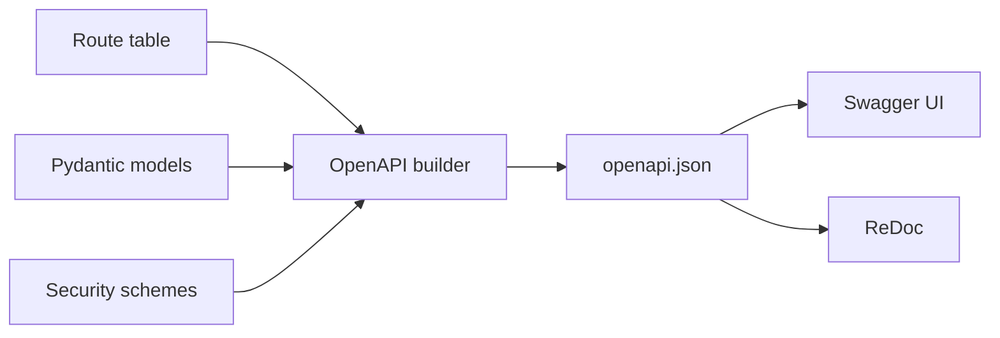

# Swagger UI, ReDoc, and OpenAPI Generation

## 1. Metadata and prerequisites

- Topic IDs: D12-T11, D12-T12, D12-T13
- Domain: 12, FastAPI Fundamentals
- Difficulty: Beginner
- Prerequisites: D11-T01, D12-T05
- Learning objectives:
  - Locate interactive docs and the raw OpenAPI JSON.
  - Explain how types and models become schema components.
  - Decide when to expose docs in production.
- Related topic IDs: D20-T18, D25-T07
- Estimated complexity: low
- Completion status: DRAFT
- Verification: Default doc URLs may change; confirm in FastAPI docs 2026-10-13. **UNVERIFIED** snippets.

## 2. Introduction and fundamentals

### D12-T11 Swagger UI at `/docs`

**Definition.** Swagger UI is an interactive browser UI that renders the OpenAPI schema and lets developers try endpoints.

**Mechanism.** FastAPI mounts a route (commonly `/docs`) that serves Swagger UI configured to fetch the OpenAPI schema URL. Your route decorators, `response_model`, and security schemes feed that schema.

**Misconception.** Swagger UI authenticates users to your real IdP automatically. It only sends what you configure (e.g., bearer token pasted into the UI).

**Production rule.** Disable or protect `/docs` on public internet deployments; treat it like an admin surface.

### D12-T12 ReDoc at `/redoc`

**Definition.** ReDoc is an alternative documentation UI optimized for reading nested schemas.

**Mechanism.** FastAPI serves ReDoc at `/redoc` by default, using the same OpenAPI document as Swagger UI.

**Misconception.** You must pick Swagger or ReDoc. Both can coexist; they are views over one schema.

**Production rule.** Apply the same access controls to `/redoc` as `/docs`.

### D12-T13 OpenAPI schema generation

**Definition.** OpenAPI generation is FastAPI’s automatic construction of an OpenAPI 3.x document describing paths, parameters, request bodies, responses, and security requirements.

**Mechanism.** At startup (or first access), FastAPI inspects routes, Pydantic models, dependencies that declare security, and status codes to build `openapi.json` (default path commonly `/openapi.json`—verify in your version).

**Misconception.** The schema is guaranteed complete for all runtime behavior. Dynamic routes, custom middleware, and side-channel auth may not appear unless declared.

**Production rule.** Treat generated OpenAPI as the contract baseline; validate it in CI against consumer tests (Domain 11). Regenerate client SDKs when models change.

## 3. Internal workings

1. Route registration records endpoint metadata (`tags`, `summary`, `responses`).
2. Pydantic models become `$ref` components with field types, constraints, and examples.
3. `OAuth2PasswordBearer` and similar classes add `securitySchemes` entries—they declare how clients send tokens, not a full authorization server (Domain 20).
4. Clients download `/openapi.json` or load it via the UI.

## 4. Architecture diagrams



## 5. Code and implementation

Customize metadata (**UNVERIFIED**):

```python
from fastapi import FastAPI

app = FastAPI(
    title="Orders API",
    version="1.0.0",
    description="Internal handbook example",
    docs_url="/docs",
    redoc_url="/redoc",
    openapi_url="/openapi.json",
)


@app.get("/health", tags=["ops"])
async def health() -> dict[str, str]:
    return {"status": "ok"}
```

Disable public docs (**UNVERIFIED**):

```python
app = FastAPI(docs_url=None, redoc_url=None, openapi_url=None)
```

## 6. API contracts

| Resource | Method | Purpose |
| --- | --- | --- |
| `/openapi.json` | GET | Machine-readable contract |
| `/docs` | GET | Swagger UI HTML shell |
| `/redoc` | GET | ReDoc HTML shell |

Illustrative curl (**UNVERIFIED**):

```bash
curl -sS "http://127.0.0.1:8000/openapi.json" | head
```

## 7. Production considerations

Mandatory:

- Turn off or VPN-gate docs in production unless the API is truly public developer-facing.
- Ensure `response_model` excludes secrets so OpenAPI does not document internal fields you never intend to ship.

Optional:

- Custom OpenAPI hooks for multi-tenant servers (Domain 25).

## 8. Comparison and tradeoffs

| UI | Strength | Weakness |
| --- | --- | --- |
| Swagger UI | Try-it-out flows | Busy for large APIs |
| ReDoc | Readable schemas | Less interactive testing |

## 9. Debugging and troubleshooting

**Symptom:** model field missing in docs.  
**Cause:** Field excluded via `response_model` or not part of the declared model.  
**Fix:** Align public DTOs with documentation models.

**Symptom:** security scheme shows but requests fail with 401.  
**Cause:** Token not sent or wrong header; scheme only documents extraction.  
**Fix:** Wire real auth dependency (Domain 20).

## 10. Interview preparation

**Beginner.** Where does FastAPI’s OpenAPI come from?  
**Model answer.** Generated from route signatures, Pydantic models, dependencies, and declared responses—not hand-written YAML.  
**Incorrect answer.** “You must write Swagger first.”

**Intermediate.** Should `/docs` be public in production?  
**Model answer.** Usually no for internal APIs; it reveals surface area. Public product APIs may expose docs with rate limits and without privileged operations.

## 11. Exercises and mastery assessment

1. **Conceptual.** List three elements that appear in `openapi.json` for a POST with a body model.
2. **Coding.** Add `tags` and a `summary` to two routes; inspect the JSON diff mentally.
3. **Security.** Why must OpenAPI match `response_model` filtering?

**Solutions.** (3) Clients and security reviewers trust the schema; leaking fields in docs encourages integration mistakes even if runtime filtering works.

**Mastery checklist.**

- [ ] Know `/docs`, `/redoc`, `/openapi.json` defaults (verify version).
- [ ] OpenAPI reflects Pydantic models and security declarations.
- [ ] Docs exposure is a production decision.

**Revision summary.** FastAPI publishes OpenAPI and two UIs by default. The schema is a living contract derived from types—guard it like any public interface.
