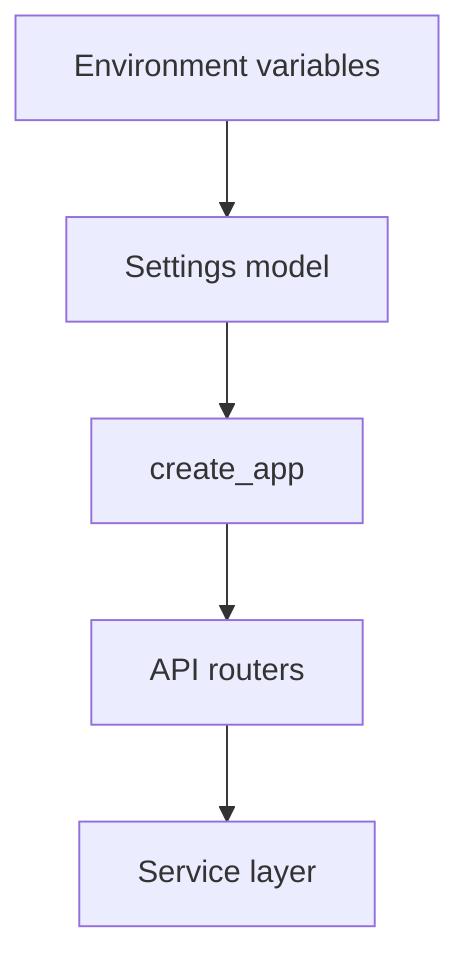

# Project Structure and Configuration

## 1. Metadata and prerequisites

- Topic IDs: D12-T14, D12-T15, D12-T16
- Domain: 12, FastAPI Fundamentals
- Difficulty: Intermediate
- Prerequisites: D12-T05, D12-T06
- Learning objectives:
  - Lay out routers, services, and settings for medium-sized APIs.
  - Load configuration from environment variables safely.
  - Avoid secrets in source control.
- Related topic IDs: D14-T25, D15-T06, D29-T03
- Estimated complexity: medium
- Completion status: DRAFT
- Verification: Pydantic Settings v2 patterns as of 2026-10-13. **UNVERIFIED** snippets.

## 2. Introduction and fundamentals

### D12-T14 Project structure

**Definition.** Project structure is how you partition packages for the ASGI entry point, routers, domain services, infrastructure adapters, and tests.

**Mechanism.** A common layout: `app/main.py` exposes `app`; `app/api/routers/` holds `APIRouter` modules; `app/services/` business logic; `app/core/config.py` settings; `tests/` mirrors `app`. Imports flow inward: routers depend on services, not vice versa.

**Misconception.** One giant `main.py` is acceptable for production. It becomes untestable and encourages circular imports.

**Production rule.** Split by domain router (orders, users) and keep side-effect-free factories for tests (Domain 15).

### D12-T15 Configuration management

**Definition.** Configuration management is how runtime behavior (database URLs, feature flags, log levels) is supplied without code changes.

**Mechanism.** Twelve-factor style: config in the environment. Pydantic `BaseSettings` reads env vars with validation and typed defaults. Layered settings: defaults → `.env` (dev only) → deployment env.

**Misconception.** Checking config only at first request is enough. Fail fast at import or lifespan startup when required secrets are missing.

**Production rule.** Validate settings once per worker at boot; crash loudly if `DATABASE_URL` or signing keys are absent.

### D12-T16 Environment variables

**Definition.** Environment variables are key-value pairs injected by the shell, container orchestrator, or secret manager into the process.

**Mechanism.** Pydantic Settings maps env names to fields (`model_config = SettingsConfigDict(env_prefix="APP_")`). Case sensitivity and nesting follow Settings docs—confirm for your pin.

**Misconception.** `.env` files belong in production images. They encourage secret baking into layers; prefer orchestrator secrets.

**Production rule.** Never commit `.env` with real credentials. Use placeholders like `change-me` in examples only.

## 3. Internal workings

Boot path:

1. Process starts; OS injects env vars.
2. `Settings()` class validates and coerces types (`model_validate` for complex nested config if using custom sources).
3. `create_app(settings: Settings)` builds FastAPI with dependencies closed over settings.
4. Routers import services that receive settings via DI, not global reads.

## 4. Architecture diagrams



## 5. Code and implementation

Settings (**UNVERIFIED**):

```python
from pydantic import Field
from pydantic_settings import BaseSettings, SettingsConfigDict


class Settings(BaseSettings):
    model_config = SettingsConfigDict(env_prefix="APP_", env_file=".env", extra="ignore")

    app_name: str = "Handbook API"
    database_url: str = Field(..., description="PostgreSQL URL")
    debug: bool = False


def get_settings() -> Settings:
    return Settings()
```

Wire settings with DI (**UNVERIFIED**):

```python
from functools import lru_cache
from fastapi import Depends, FastAPI

from app.core.config import Settings, get_settings


@lru_cache
def cached_settings() -> Settings:
    return get_settings()


def create_app() -> FastAPI:
    app = FastAPI(title=cached_settings().app_name)

    @app.get("/info")
    async def info(settings: Settings = Depends(cached_settings)) -> dict[str, str]:
        return {"app": settings.app_name}

    return app
```

Suggested tree (documentation only):

```text
app/
  main.py
  core/config.py
  api/routers/
  services/
tests/
```

## 6. API contracts

Configuration is not HTTP, but `/info` or `/health` may expose non-secret metadata. Never return `database_url` or keys.

## 7. Production considerations

Mandatory:

- Separate settings classes per environment only when validation rules differ; avoid copy-paste drift.
- Secret rotation without redeploying code—only env values.
- `debug=False` in production; unhandled exceptions must not return stack traces (Domain 19).

Optional:

- Feature flags as settings with safe defaults.

## 8. Comparison and tradeoffs

| Approach | Benefit | Risk |
| --- | --- | --- |
| Env-only | Cloud-native | Typo-prone without validation |
| Pydantic Settings | Typed fail-fast | Must pin `pydantic-settings` |
| Config files in repo | Easy local dev | Secrets leakage if misused |

## 9. Debugging and troubleshooting

**Symptom:** `ValidationError` on boot in staging only.  
**Cause:** Missing env var or wrong prefix.  
**Fix:** Log allowed field names, not values; compare orchestrator secret mapping.

## 10. Interview preparation

**Intermediate.** How should database URLs be provided?  
**Model answer.** Via environment variables validated at startup, injected by the platform secret store, never committed.  
**Incorrect answer.** “Hard-code in `main.py` for simplicity.”

## 11. Exercises and mastery assessment

1. **Design.** Sketch packages for `billing` and `users` routers sharing one `Settings`.
2. **Coding.** Add `APP_LOG_LEVEL` with default `INFO` using Settings.
3. **Security.** List three values that must never appear in OpenAPI or git.

**Solutions.** (3) Database passwords, JWT signing keys, internal admin tokens.

**Mastery checklist.**

- [ ] Factory + routers + services layout.
- [ ] Settings validated at startup.
- [ ] Env vars for secrets, placeholders in docs.

**Revision summary.** Structure code for testable routers and services; load typed configuration from the environment; treat settings as part of the security boundary.
