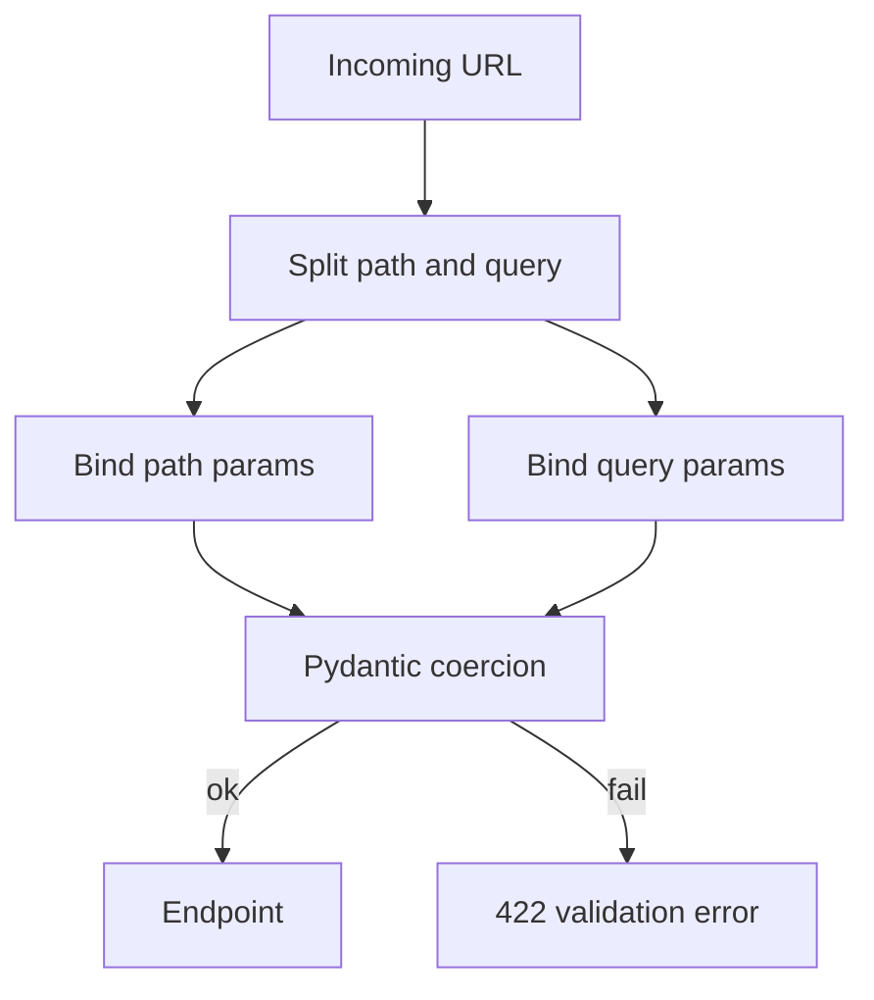

# Path and Query Parameters

## 1. Metadata and prerequisites

- Topic IDs: D13-T01 through D13-T11
- Domain: 13, Path, Query, and Request Parameters
- Difficulty: Beginner
- Prerequisites: D12-T05, D05-T03
- Learning objectives: Declare path and query parameters with types, defaults, constraints, and collections.
- Related topic IDs: D14-T01, D19-T02
- Estimated complexity: medium
- Completion status: DRAFT
- Verification: FastAPI parameter binding as of 2026-10-13. **UNVERIFIED** code.

## 2. Introduction and fundamentals

### D13-T01 Path parameters

**Definition.** Path parameters are variable segments in the URL path, bound to function parameters declared without a default after the path template.

**Mechanism.** FastAPI matches `{name}` in the route to annotated parameters, coercing types before the handler runs.

**Misconception.** Path parameters are always strings. Annotations drive coercion (`item_id: int`).

**Production rule.** Use path params for resource identity; keep cardinality low—do not encode filters in ten path segments.

### D13-T02 Query parameters

**Definition.** Query parameters are key-value pairs after `?` in the URL, bound to function parameters not in the path.

**Mechanism.** FastAPI treats simple scalar parameters as query params unless marked `Path`, `Body`, etc.

**Misconception.** Optional query params require `Optional` only. You also need a default value (`limit: int = 10`).

**Production rule.** Validate query params with constraints or Pydantic models for complex filters (D13-T16).

### D13-T03 Required and optional parameters

**Definition.** Required parameters have no default; optional ones have defaults or use `Optional` with `None` default.

**Mechanism.** Missing required query/path params yield `422` via `RequestValidationError` before your handler.

**Misconception.** `Optional[str]` without default is still required. Use `str | None = None`.

**Production rule.** Document required params in OpenAPI; align with client SDK generation.

### D13-T04 Default values

**Definition.** Defaults apply when the client omits the parameter.

**Mechanism.** Python default values become OpenAPI `default` fields.

**Misconception.** Mutable defaults (`= []`) are safe. Use `Field(default_factory=list)` in models; for simple query lists prefer explicit typing patterns in docs.

**Production rule.** Choose defaults that are safe under abuse (`limit` capped).

### D13-T05 Parameter types

**Definition.** Annotations (`int`, `float`, `UUID`, custom types) tell FastAPI how to parse strings from the wire.

**Mechanism.** Pydantic powers coercion and validation for parameters.

**Misconception.** `bool` query params are portable as `true`/`false` strings—verify client conventions; document accepted literals.

**Production rule.** Prefer explicit enums for categorical query params (D13-T09).

### D13-T06 Type conversion

**Definition.** Type conversion transforms incoming string components into Python values.

**Mechanism.** Invalid conversion raises validation errors aggregated into `422`.

**Misconception.** Silent truncation happens. Validation fails instead for out-of-range ints.

**Production rule.** Use constrained types rather than manual `int()` in handlers.

### D13-T07 Numeric constraints

**Definition.** Constraints such as `ge`, `le`, `gt`, `lt` bound numeric parameters.

**Mechanism.** `Query(ge=1, le=100)` or `Annotated[int, Field(ge=1)]` depending on style—confirm FastAPI `Annotated` patterns in current docs.

**Misconception.** Constraints are documentation only. They enforce at runtime.

**Production rule.** Cap `limit` and offset to protect the database (Domain 6).

### D13-T08 String constraints

**Definition.** `min_length`, `max_length`, and patterns restrict strings.

**Mechanism.** Applied during parameter validation.

**Misconception.** Regex in the API replaces authorization. It does not.

**Production rule.** Reject overlong strings at the edge before ORM allocation.

### D13-T09 Enum parameters

**Definition.** `enum.Enum` or `Literal` restricts values to a closed set.

**Mechanism.** Invalid enum values produce `422` with explicit loc paths.

**Misconception.** Enums serialize as names automatically in all clients—document whether you use names or values.

**Production rule.** Keep enum sets backward compatible when adding values.

### D13-T10 Lists and repeated query parameters

**Definition.** List-typed query parameters accept repeated keys (`tag=a&tag=b`) or CSV conventions per framework rules.

**Mechanism.** `tags: list[str] = Query()` collects values—verify parsing style in FastAPI docs for your version.

**Misconception.** Infinite list length is fine. Cap list size.

**Production rule.** Limit repeated parameters to prevent query-string bombs.

### D13-T11 Boolean query parameters

**Definition.** Booleans accept constrained truthy/falsy representations after coercion.

**Mechanism.** FastAPI/Pydantic parse common bool strings; invalid values fail validation.

**Misconception.** `?active` without value is reliably true across frameworks. Prefer explicit `true`/`false`.

**Production rule.** Document bool query semantics in the API guide.

## 3. Internal workings

Routing extracts path template variables, merges query keys, coerces each parameter through Pydantic, then calls the endpoint. Failure short-circuits to exception handlers (Domain 19) with `422` by default for `RequestValidationError`.

## 4. Architecture diagrams



## 5. Code and implementation

**UNVERIFIED:**

```python
from enum import Enum
from typing import Annotated

from fastapi import FastAPI, Path, Query

app = FastAPI()


class SortOrder(str, Enum):
    asc = "asc"
    desc = "desc"


@app.get("/items/{item_id}")
async def read_item(
    item_id: Annotated[int, Path(ge=1)],
    q: Annotated[str | None, Query(max_length=50)] = None,
    limit: Annotated[int, Query(ge=1, le=100)] = 20,
    sort: SortOrder = SortOrder.asc,
    tags: Annotated[list[str], Query(max_length=5)] = [],
) -> dict[str, object]:
    return {"item_id": item_id, "q": q, "limit": limit, "sort": sort, "tags": tags}
```

## 6. API contracts

| Method | Path | Query | Status |
| --- | --- | --- | --- |
| GET | `/items/{item_id}` | `q`, `limit`, `sort`, `tags` | `200` or `422` |

```bash
curl -sS "http://127.0.0.1:8000/items/7?limit=5&sort=desc&tags=a&tags=b"
```

## 7. Production considerations

Mandatory: max `limit`, validate sort fields against allow-lists (Domain 6). Optional: dedicated filter models.

## 8. Comparison and tradeoffs

Path for identity; query for filters. POST bodies for large search payloads.

## 9. Debugging and troubleshooting

**Symptom:** `422` on valid-looking UUID. **Fix:** send canonical string; check hyphen casing.

## 10. Interview preparation

**Beginner.** Path versus query? **Model:** path identifies resource; query modifies representation or filters. **Wrong:** "POST uses query only."

**Intermediate.** Why cap `limit`? **Model:** protects DB and memory from unbounded scans.

## 11. Exercises and mastery assessment

1. Add `cursor` optional query for pagination preview. 2. Return `422` for `item_id=0` via `Path(ge=1)`. 3. Design allow-list for `sort` field names.

**Solutions.** (1) `cursor: str | None = None`. (3) enum or regex plus server-side column map.

**Mastery checklist:** path vs query; defaults; constraints; enums; list caps.

**Revision summary.** FastAPI binds path and query parameters through Pydantic with defaults and constraints—fail fast with `422` before business logic.
