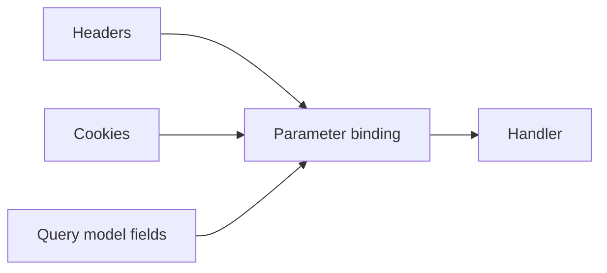

# Aliases, Headers, Cookies, and Parameter Models

## 1. Metadata and prerequisites

- Topic IDs: D13-T12, D13-T13, D13-T14, D13-T15, D13-T16, D13-T17
- Domain: 13
- Difficulty: Intermediate
- Prerequisites: D13-T01, D14-T01
- Learning objectives: Use aliases, header/cookie params, and Pydantic models for grouped query validation.
- Related topic IDs: D18-T11, D20-T03
- Estimated complexity: medium
- Completion status: DRAFT
- Verification: 2026-10-13. **UNVERIFIED** snippets.

## 2. Introduction and fundamentals

### D13-T12 Aliases

**Definition.** An alias is an external name (query key, header name) that differs from the Python parameter name.

**Mechanism.** `Query(alias="filter-q")` or Pydantic `Field(alias=...)` map wire names to fields.

**Misconception.** Aliases change only OpenAPI, not runtime. They affect parsing.

**Production rule.** Use aliases for backward-compatible renames; keep old alias during deprecation windows.

### D13-T13 Parameter metadata

**Definition.** Metadata (`title`, `description`, `examples`, `deprecated`) enriches OpenAPI and tooling.

**Mechanism.** Passed via `Query(description="...")` or `Field`.

**Misconception.** Description text enforces behavior. It documents only.

**Production rule.** Document security-sensitive parameters without embedding secrets in examples.

### D13-T14 Header parameters

**Definition.** Header parameters bind HTTP request headers to function arguments via `Header()`.

**Mechanism.** FastAPI reads headers case-insensitively per HTTP rules; underscores in names may map to hyphens—confirm in docs.

**Misconception.** Any header is authentication. Prefer security dependencies (Domain 20).

**Production rule.** Do not trust client-supplied identity headers (`X-User-Id`) without cryptographic verification at the edge.

### D13-T15 Cookie parameters

**Definition.** Cookie parameters read named cookies from the `Cookie` header.

**Mechanism.** `session_id: str = Cookie()` extracts value; missing cookie fails validation if required.

**Misconception.** Cookies are automatically secure. You must set `HttpOnly`, `Secure`, `SameSite` on responses (Domain 18).

**Production rule.** Treat cookie-based sessions as CSRF-sensitive; pair with anti-CSRF tokens for browser flows (Domain 7).

### D13-T16 Query parameter models

**Definition.** A Pydantic model declared as a dependency or with `Query()` model pattern groups many query fields with one validation pass.

**Mechanism.** FastAPI expands model fields into query parameters in OpenAPI; validation uses `model_validate` on constructed dicts.

**Misconception.** Models in query replace pagination standards. You still need stable ordering (Domain 6).

**Production rule.** Use query models for admin filters; cap field count and depth.

### D13-T17 Path parameter validation

**Definition.** Path validation applies constraints to path segments (`Path(ge=1)`, UUID types, custom validators).

**Mechanism.** Runs before handler; failures are `422`.

**Misconception.** Regex in path template replaces types. Prefer typed validation for clearer errors.

**Production rule.** Reject ambiguous slugs early to avoid DB lookups for garbage IDs.

## 3. Internal workings

Header and cookie parameters participate in the same dependency resolution order as query params. Query models flatten to key-value sets, validate, then inject a single object.

## 4. Architecture diagrams



## 5. Code and implementation

**UNVERIFIED:**

```python
from typing import Annotated

from fastapi import Cookie, FastAPI, Header, Query
from pydantic import BaseModel, ConfigDict, Field

app = FastAPI()


class ItemFilter(BaseModel):
    model_config = ConfigDict(extra="forbid")
    min_price: float | None = Field(default=None, ge=0)
    max_price: float | None = None


@app.get("/items")
async def list_items(
    filters: Annotated[ItemFilter, Query()],
    x_request_id: Annotated[str | None, Header(alias="X-Request-ID")] = None,
    session_id: Annotated[str | None, Cookie()] = None,
) -> dict[str, object]:
    return {
        "filters": filters.model_dump(),
        "x_request_id": x_request_id,
        "session_id": session_id,
    }
```

## 6. API contracts

Document `X-Request-ID` as optional correlation header (Domain 17). Cookies only when using cookie auth.

## 7. Production considerations

Mandatory: forbid extra fields on filter models (`extra="forbid"`). Optional: require `X-Request-ID` from gateway.

## 8. Comparison and tradeoffs

Flat query params for simple APIs; models for many optional filters.

## 9. Debugging and troubleshooting

**Symptom:** header not bound. **Cause:** wrong alias or missing `Header()`. **Fix:** log incoming header keys at middleware, redacting secrets.

## 10. Interview preparation

**Intermediate.** When use query model vs individual params? **Model:** many related optional filters with shared validation. **Wrong:** always use models for two params.

## 11. Exercises and mastery assessment

1. Rename query `q` to `search` via alias while keeping Python name `q`. 2. Add `ItemFilter` with `extra=forbid`. 3. Explain why `X-User-Id` header is unsafe alone.

**Mastery checklist:** aliases; Header/Cookie; query models; Path constraints.

## 7. Production considerations (extended)

Treat `Cookie()` parameters as sensitive: log only whether a cookie was present, not its value. For `Header(alias="X-Request-ID")`, reject oversized values (max length) to avoid log injection. Query models with ten or more fields should still expose a coherent OpenAPI page—group fields in descriptions and cap list lengths on array-typed filters.

## 10. Interview preparation (extended)

**Intermediate.** Why forbid extra fields on a query model? **Model answer:** prevents mass-assignment style surprises where clients send `is_admin=true` as a query flag you did not implement but might have been forwarded to SQL builders. **Incorrect answer:** “Query strings cannot carry extra keys.”

## 11. Exercises and mastery assessment (extended)

4. **Security.** Document why `session_id` from `Cookie()` must be validated server-side against a session store.  
5. **Coding.** Add `X-Tenant-ID` header validated as UUID.

**Revision summary.** Aliases and metadata shape the wire contract; headers and cookies carry cross-cutting context; query models batch validation with `extra="forbid"` on untrusted filters.
