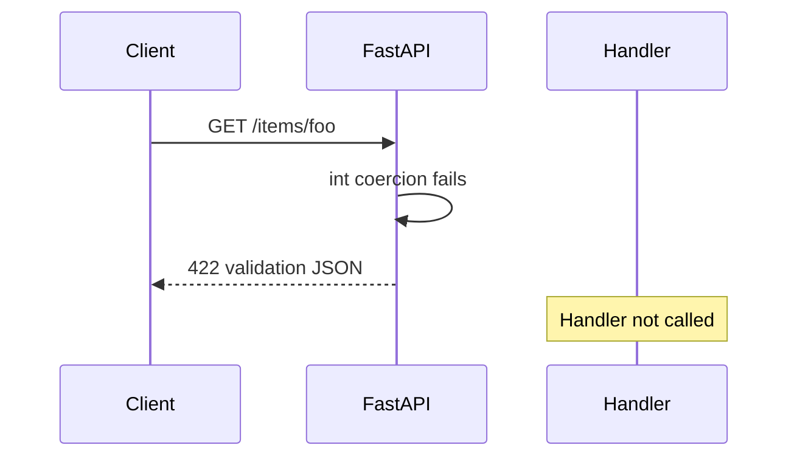

# Parameter Validation Errors

## 1. Metadata and prerequisites

- Topic IDs: D13-T18
- Domain: 13
- Difficulty: Intermediate
- Prerequisites: D13-T03, D19-T05
- Learning objectives: Predict default `422` bodies for parameter failures and customize handlers safely.
- Related topic IDs: D19-T01, D05-T18
- Estimated complexity: low
- Completion status: DRAFT
- Verification: RFC 9110 `422`; FastAPI default handler 2026-10-13. **UNVERIFIED**.

## 2. Introduction and fundamentals

### D13-T18 Validation error responses

**Definition.** A validation error response is the HTTP reply when FastAPI/Pydantic reject parameters or bodies before the route handler executes.

**Mechanism.** FastAPI raises `RequestValidationError` (a wrapper around Pydantic validation errors). The default exception handler serializes a JSON array of `{loc, msg, type}` entries and returns status `422 Unprocessable Content` (semantic successor to older `422 Unprocessable Entity` naming in RFC 9110).

**Misconception.** `400 Bad Request` is the default for schema mistakes in FastAPI. The framework default is `422` for request validation.

**Production rule.** Keep `422` for client shape errors; map domain rule violations in handlers to `400` or `409` with stable problem details (RFC 9457, Domain 19). Never include stack traces in validation responses.

## 3. Internal workings

1. Router matches; parameter extraction builds inputs.
2. Pydantic validation fails on type, constraint, or missing required field.
3. FastAPI short-circuits; your handler does not run.
4. Exception handler formats JSON; middleware may add request ID header.

Authentication failures are separate: missing bearer token is typically `401`, not `422` (Domain 20).

## 4. Architecture diagrams



## 5. Code and implementation

Default shape illustration (**UNVERIFIED** response body):

```json
{
  "detail": [
    {
      "type": "int_parsing",
      "loc": ["path", "item_id"],
      "msg": "Input should be a valid integer, unable to parse string as an integer",
      "input": "foo"
    }
  ]
}
```

Custom handler sketch (**UNVERIFIED**):

```python
from fastapi import FastAPI, Request
from fastapi.exceptions import RequestValidationError
from fastapi.responses import JSONResponse

app = FastAPI()


@app.exception_handler(RequestValidationError)
async def validation_handler(
    request: Request, exc: RequestValidationError
) -> JSONResponse:
    return JSONResponse(
        status_code=422,
        content={
            "title": "Validation failed",
            "status": 422,
            "errors": exc.errors(),
            "instance": str(request.url.path),
        },
    )
```

## 6. API contracts

| Condition | Status | Body |
| --- | --- | --- |
| Invalid path type | `422` | `detail` list with `loc` containing `path` |
| Missing required query | `422` | `loc` contains `query` |

```bash
curl -sS -D - "http://127.0.0.1:8000/items/not-an-int" -o /dev/null
```

## 7. Production considerations

Mandatory: stable error schema for clients; log validation failures at info/debug without storing PII from `input` fields. Optional: translate `msg` for end users while keeping machine `type`.

## 8. Comparison and tradeoffs

| Status | Use |
| --- | --- |
| `422` | Syntax/shape/constraint violations at the edge |
| `400` | Semantically invalid but well-formed business commands |
| `401`/`403` | Authn/authz failures |

## 9. Debugging and troubleshooting

**Symptom:** clients see `422` after deploy. **Cause:** stricter constraints or renamed fields. **Fix:** contract tests on query models.

## 10. Interview preparation

**Beginner.** Default status for FastAPI request validation? **Model:** `422`. **Wrong:** `400` for everything.

**Intermediate.** Should validation responses include stack traces? **Model:** never in production responses; log server-side with trace ID.

## 11. Exercises and mastery assessment

1. Trigger `422` with invalid enum sort. 2. Customize handler to RFC 9457 `type` URI field. 3. Differentiate `401` vs `422` for missing token vs bad JSON types.

**Solutions.** (3) Missing `Authorization` is security (`401`); malformed JSON field types are validation (`422`).

**Mastery checklist:** `RequestValidationError`; default `422`; safe custom handlers.

### Additional interview preparation

**Advanced.** A client sends `Authorization: Bearer` but malformed JSON in the body. Which status codes appear for each failure mode if auth runs in a dependency before body parsing? **Model answer:** Trace the dependency graph: if the bearer dependency runs and fails first, expect `401`; if the body is parsed before auth in your stack, invalid JSON may surface as `422` or a parse error depending on version—confirm ordering in FastAPI docs rather than assuming. **Incorrect answer:** “Always 400 for bad JSON.”

**Beginner.** Should you return database connection errors as `422`? **Model answer:** No—`422` is for request validation; infrastructure faults are `503` or `500` with safe bodies (Domain 19).

### Additional exercises

4. **Design.** Specify a problem-details `type` URI namespace for your organization and map `int_parsing` to a stable code `invalid_path_id`.  
5. **Debugging.** Clients report `422` only in production. List four differences between prod and dev that change validation (stricter settings, extra middleware, API gateway body limits, different Pydantic version).

**Additional solutions.** (4) Use HTTPS URLs under your domain, e.g. `https://api.example.com/problems/invalid-path-id`. (5) Compare dependency pins, `strict` settings, gateway max body, and whether prod strips unknown query params.

**Mastery checklist (extended).**

- [ ] Can explain `loc` paths for nested query models.
- [ ] Can justify why stack traces never belong in `422` bodies.

**Revision summary.** Parameter validation fails before handlers, returning structured `422` responses without leaking implementation details; authentication and infrastructure errors use different status classes.
