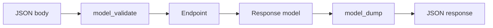

# Models, Nesting, and Field Presence

## 1. Metadata and prerequisites

- Topic IDs: D14-T01 through D14-T08
- Domain: 14, Request Bodies and Pydantic
- Difficulty: Intermediate
- Prerequisites: D05-T01, D12-T04
- Learning objectives: Model requests and responses with Pydantic v2; distinguish optional, nullable, and required fields.
- Related topic IDs: D18-T02, D19-T02
- Estimated complexity: medium
- Completion status: DRAFT
- Verification: Pydantic v2 only (`model_validate`, `model_dump`, `ConfigDict`). 2026-10-13. **UNVERIFIED**.

## 2. Introduction and fundamentals

### D14-T01 Pydantic BaseModel

**Definition.** `BaseModel` is Pydantic’s declarative data class with validation and serialization.

**Mechanism.** Subclass `BaseModel`, annotate fields; construction runs validation; `model_validate` parses dict/JSON; `model_dump` emits dict/JSON-compatible data.

**Misconception.** Models must be used only for requests. They are equally important for response DTOs and settings.

**Production rule.** Separate create/update/read models to prevent mass assignment and secret leakage.

### D14-T02 Request body validation

**Definition.** Request body validation is automatic parsing of HTTP bodies into a Pydantic model on endpoints that declare a body parameter.

**Mechanism.** FastAPI reads body bytes, passes data to `model_validate`, injects the model into your handler on success.

**Misconception.** Validation replaces authentication. It does not.

**Production rule.** Combine body validation with authn/authz dependencies before mutating state.

### D14-T03 Response models

**Definition.** `response_model` on a route tells FastAPI to serialize and filter the return value through a Pydantic model.

**Mechanism.** After the handler returns, FastAPI validates/filters fields, dropping undeclared attributes—critical when returning ORM instances.

**Misconception.** Returning a dict bypasses filtering unless `response_model` still applies to compatible shapes—prefer explicit DTOs.

**Production rule.** Always set `response_model` on public endpoints that touch ORM rows; never leak password hashes or internal flags.

### D14-T04 Nested models

**Definition.** Fields typed as other `BaseModel` subclasses compose nested objects in JSON.

**Mechanism.** Validation recurses; errors include `loc` paths into children.

**Misconception.** Deep nesting is free. It increases payload size and validation cost—cap depth in public APIs.

**Production rule.** Flatten admin-only structures; nest only where the domain is naturally hierarchical.

### D14-T05 Lists and dictionaries

**Definition.** `list[Item]` and `dict[str, Item]` fields validate collections with per-element rules.

**Mechanism.** Pydantic v2 validates each element; use `Field(max_length=...)` on lists.

**Misconception.** JSON objects with dynamic keys are always `dict[str, Any]`. Prefer typed values or constrained key sets.

**Production rule.** Limit list lengths on write endpoints to prevent abuse.

### D14-T06 Optional fields

**Definition.** Optional fields may be omitted on input when given a default (often `None`).

**Mechanism.** `field: str | None = None` means omit → `None`; distinguish from required fields.

**Misconception.** `Optional[str]` without default is optional on the wire. It is still required unless a default exists.

**Production rule.** Document which omissions mean “unchanged” in PATCH versus “clear value”.

### D14-T07 Nullable fields

**Definition.** Nullable fields explicitly allow JSON `null` as a value.

**Mechanism.** `str | None` accepts `null` when present; combine with `Field` defaults for create versus update semantics.

**Misconception.** Nullable and optional are identical. Optional concerns presence; nullable concerns `null` value.

**Production rule.** For PATCH, define whether `null` clears a column or is rejected.

### D14-T08 Required fields versus default values

**Definition.** Required fields lack defaults; defaulted fields are optional on input.

**Mechanism.** Pydantic marks fields required in schema when no default factory/default is set.

**Misconception.** `Field(...)` ellipsis is required; `Field(default=0)` is not.

**Production rule.** Use separate `Create` and `Update` models instead of one model with ambiguous defaults.

## 3. Internal workings

FastAPI selects body model from parameter annotation, validates once, passes model instance. On output, `response_model` runs `model_validate` on the return value (from attributes or dict) then `model_dump` for JSON encoding.

## 4. Architecture diagrams



## 5. Code and implementation

**UNVERIFIED:**

```python
from pydantic import BaseModel, ConfigDict, Field


class Address(BaseModel):
    model_config = ConfigDict(str_strip_whitespace=True)
    city: str
    country: str = "US"


class CustomerCreate(BaseModel):
    name: str = Field(min_length=1, max_length=120)
    email: str
    tags: list[str] = Field(default_factory=list, max_length=10)
    address: Address | None = None


class CustomerRead(BaseModel):
    id: int
    name: str
    email: str
    address: Address | None
```

## 6. API contracts

POST `/customers` accepts `CustomerCreate`; returns `CustomerRead` without internal fields.

## 7. Production considerations

Mandatory: `response_model` filtering; forbid unknown fields on input via `model_config = ConfigDict(extra="forbid")` where appropriate.

## 8. Comparison and tradeoffs

One mega-model vs split create/read/update models—split wins for security and clarity.

## 9. Debugging and troubleshooting

**Symptom:** field missing in response. **Cause:** not on `response_model`. **Fix:** add to DTO intentionally.

## 10. Interview preparation

**Intermediate.** How prevent ORM secret leakage? **Model:** `response_model` DTO excludes hash fields. **Wrong:** “SQLAlchemy hides columns.”

## 11. Exercises and mastery assessment

1. Create `CustomerUpdate` with optional `name`. 2. Nest `Address` and reject extra JSON keys. 3. Explain optional vs nullable for `phone`.

**Mastery checklist:** BaseModel; body vs response models; nesting; optional/nullable/required.

**Revision summary.** Pydantic v2 models gate input with `model_validate` and gate output with `response_model` + `model_dump`.
