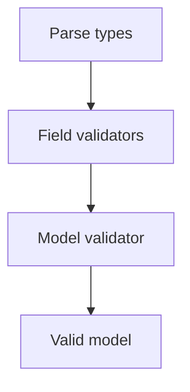

# Validators, Constraints, Enums, and Reuse

## 1. Metadata and prerequisites

- Topic IDs: D14-T09 through D14-T16
- Domain: 14
- Difficulty: Intermediate
- Prerequisites: D14-T01
- Learning objectives: Apply field/model validators, constraints, enums, inheritance, and generics in Pydantic v2.
- Related topic IDs: D14-T27, D15-T08
- Estimated complexity: medium
- Completion status: DRAFT
- Verification: 2026-10-13. **UNVERIFIED**.

## 2. Introduction and fundamentals

### D14-T09 Field validators

**Definition.** `field_validator` decorates methods that validate or transform single fields after parsing.

**Mechanism.** Use `@field_validator("email", mode="after")` on a `@classmethod`; raise `ValueError` for failures.

**Misconception.** Validators run only once at import. They run per validation.

**Production rule.** Keep validators pure and fast; heavy checks belong in services.

### D14-T10 Model validators

**Definition.** `model_validator` validates the whole model, often for cross-field rules.

**Mechanism.** `@model_validator(mode="after")` receives `self` (model instance) in v2 style—confirm signature in Pydantic v2 docs.

**Misconception.** Model validators replace database constraints. Use both.

**Production rule.** Encode invariant rules in validators; encode uniqueness in the database.

### D14-T11 Custom validation

**Definition.** Custom validation is any rule beyond built-in types—regex, business calendars, checksums.

**Mechanism.** Validators, constrained types, or `Annotated` wrappers.

**Misconception.** `try/except` in the route is cleaner. Centralize in models for consistent `422` errors.

**Production rule.** Return user-safe messages; log detailed causes server-side.

### D14-T12 Field constraints

**Definition.** `Field(ge=..., max_length=...)` attaches constraints declaratively.

**Mechanism.** Pydantic enforces during validation; appears in JSON Schema for OpenAPI.

**Misconception.** Constraints are hints. They enforce.

**Production rule.** Mirror API constraints with DB checks where durability matters.

### D14-T13 Enums and literals

**Definition.** `enum.Enum` and `typing.Literal` restrict discrete values.

**Mechanism.** Invalid values fail validation with typed errors.

**Misconception.** Adding enum members is always safe for clients. Old clients may break if they validate strictly.

**Production rule.** Version enums or accept unknown values only when explicitly forward-compatible.

### D14-T14 Reusable schemas

**Definition.** Shared partial models (`Money`, `AuditFields`) reduce duplication.

**Mechanism.** Composition via nested models or mixins.

**Misconception.** One global `User` model for input and output. Split read/write.

**Production rule.** Publish reusable components in an internal package with semver.

### D14-T15 Model inheritance

**Definition.** Subclassing `BaseModel` shares fields across create/update variants.

**Mechanism.** Child models add or override fields; mind `model_config` inheritance.

**Misconception.** Inheritance always beats composition. Favor small composed chunks.

**Production rule.** Document which subclass is accepted per endpoint.

### D14-T16 Generic models

**Definition.** `BaseModel` generic over a type parameter for paginated wrappers (`Page[T]`).

**Mechanism.** `class Page(BaseModel, Generic[T]): items: list[T]`—OpenAPI generics vary by tooling.

**Misconception.** Generics are invisible in OpenAPI. Verify schema output for clients.

**Production rule.** Provide concrete examples in docs when generics flatten poorly.

## 3. Internal workings

Validation pipeline: parse → field validators → model validator → model instance. FastAPI surfaces errors as `422`.

## 4. Architecture diagrams



## 5. Code and implementation

**UNVERIFIED:**

```python
from enum import Enum
from typing import Generic, TypeVar

from pydantic import BaseModel, Field, field_validator, model_validator

T = TypeVar("T")


class Role(str, Enum):
    member = "member"
    admin = "admin"


class UserCreate(BaseModel):
    email: str
    role: Role = Role.member

    @field_validator("email")
    @classmethod
    def normalize_email(cls, v: str) -> str:
        return v.strip().lower()

    @model_validator(mode="after")
    def check_email_present(self) -> "UserCreate":
        if "@" not in self.email:
            raise ValueError("email must contain @")
        return self


class Page(BaseModel, Generic[T]):
    items: list[T]
    total: int = Field(ge=0)
```

## 6. API contracts

Document allowed enum values and max lengths in OpenAPI via `Field` metadata.

## 7. Production considerations

Keep validators deterministic; no I/O inside validators unless explicitly justified (prefer service layer).

## 8. Comparison and tradeoffs

| Tool | When |
| --- | --- |
| `Field` constraints | simple bounds |
| `field_validator` | normalization |
| `model_validator` | cross-field rules |

## 9. Debugging and troubleshooting

Validator not running: wrong field name in decorator or `mode` mismatch.

## 10. Interview preparation

**Intermediate.** Field vs model validator? **Model:** single field vs cross-field invariants.

## 11. Exercises and mastery assessment

1. Normalize phone digits in `field_validator`. 2. Build `Page[ItemRead]`. 3. Reject `end_date` before `start_date` in model validator.

**Mastery checklist:** v2 validators; enums; reuse; generics awareness.

## 9. Debugging and troubleshooting (extended)

**Symptom:** validator never runs. **Cause:** field name typo in `@field_validator` or validating before type coercion failed earlier. **Fix:** inspect `exc.errors()` loc paths in tests.

## 10. Interview preparation (extended)

**Advanced.** Should validators call external HTTP services? **Model answer:** generally no—keeps validation fast and deterministic; call services in the application layer after validation passes. **Incorrect answer:** “Validators are the service layer.”

## 11. Exercises and mastery assessment (extended)

4. **Design.** Split `UserCreate` and `UserAdminCreate` instead of one model with optional `role`.  
5. **Testing.** Unit-test `model_validate` without FastAPI for a cross-field validator.

**Revision summary.** Pydantic v2 validators and `Field` constraints express API rules once, feeding OpenAPI and consistent `422` errors without embedding I/O.
