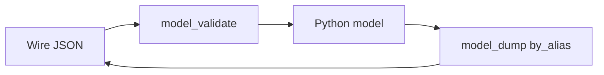

# Serialization, Aliases, and Pydantic v2

## 1. Metadata and prerequisites

- Topic IDs: D14-T17 through D14-T24
- Domain: 14
- Difficulty: Advanced
- Prerequisites: D14-T01, D14-T09
- Learning objectives: Master `model_validate`/`model_dump`, aliases, computed fields, extras, and custom types in v2.
- Related topic IDs: D18-T01, D12-T13
- Estimated complexity: high
- Completion status: DRAFT
- Verification: Pydantic v2 serialization flags—confirm in docs 2026-10-13. **UNVERIFIED**.

## 2. Introduction and fundamentals

### D14-T17 Serialization and deserialization

**Definition.** Deserialization maps wire data to Python models; serialization maps models back to wire-safe dicts/JSON.

**Mechanism.** `model_validate` / `model_validate_json` in; `model_dump` / `model_dump_json` out.

**Misconception.** `dict(model)` is supported equivalently. Use `model_dump` in v2.

**Production rule.** Choose `mode="json"` when you need JSON-native types (e.g., `datetime` as ISO strings).

### D14-T18 JSON serialization

**Definition.** JSON serialization produces UTF-8 JSON-compatible structures.

**Mechanism.** `model_dump_json()` uses Pydantic’s encoder; FastAPI uses similar paths for responses.

**Misconception.** All numeric types become JSON numbers without loss. `Decimal` needs policy—often string in finance APIs.

**Production rule.** Document money and decimal encoding explicitly (Domain 5).

### D14-T19 model_dump() and model_validate()

**Definition.** Core v2 APIs replacing `.dict()` and `.parse_obj()`.

**Mechanism.** `model_validate` accepts dicts; `model_dump(exclude_none=True, by_alias=True)` controls output.

**Misconception.** They are symmetric by default. Aliases and serializers change round-trip behavior.

**Production rule.** Pin Pydantic major version in services; test round-trips in CI.

### D14-T20 Pydantic v2 validation concepts

**Definition.** v2 uses a core validation engine with stricter performance and schema generation.

**Mechanism.** `ConfigDict`, `field_validator`, typed dictionaries integration—no v1 `class Config`.

**Misconception.** v1 patterns still work. Migrate `validator` → `field_validator`, `Config` → `ConfigDict`.

**Production rule.** Ban v1 imports in new code; codify in lint rules.

### D14-T21 Extra-field handling

**Definition.** `model_config` `extra` controls unknown keys (`ignore`, `forbid`, `allow`).

**Mechanism.** `forbid` raises on unexpected JSON fields—best for public write APIs.

**Misconception.** `ignore` is safest. It silently drops attacker-supplied fields that might matter for mass assignment reviews.

**Production rule.** Use `extra="forbid"` on create/update models unless merging documents intentionally.

### D14-T22 Aliases and serialization aliases

**Definition.** `Field(alias="external_name")` and `serialization_alias` separate input vs output names.

**Mechanism.** `model_validate` uses aliases per `populate_by_name` settings in `ConfigDict`.

**Misconception.** Aliases apply only to JSON. They affect OpenAPI parameter names too when wired through FastAPI.

**Production rule.** Keep Pythonic attribute names internally; aliases for legacy clients.

### D14-T23 Computed fields

**Definition.** `@computed_field` exposes derived values in serialization.

**Mechanism.** Included in `model_dump` unless excluded; not accepted on input.

**Misconception.** Computed fields are free to compute heavy joins. Keep them cheap or move to read models filled in services.

**Production rule.** Do not put secrets into computed fields.

### D14-T24 Custom types

**Definition.** `Annotated` types with `BeforeValidator` / custom `PlainSerializer` encode domain primitives.

**Mechanism.** Register types reusable across models.

**Misconception.** Custom types skip OpenAPI. They appear if schema generation supports them—verify.

**Production rule.** Test OpenAPI for custom types used in public APIs.

## 3. Internal workings

Inbound JSON → `model_validate` → handler → outbound `response_model` validation → `model_dump` → Starlette JSON encoder.

## 4. Architecture diagrams



## 5. Code and implementation

**UNVERIFIED:**

```python
from pydantic import BaseModel, ConfigDict, Field, computed_field, field_validator


class PublicUser(BaseModel):
    model_config = ConfigDict(populate_by_name=True, extra="forbid")

    user_name: str = Field(alias="userName", serialization_alias="userName")
    first: str
    last: str

    @computed_field  # type: ignore[prop-decorator]
    @property
    def display_name(self) -> str:
        return f"{self.first} {self.last}"


class Payload(BaseModel):
    model_config = ConfigDict(extra="forbid")
    value: int

    @classmethod
    def from_json(cls, raw: bytes) -> "Payload":
        return cls.model_validate_json(raw)
```

## 6. API contracts

Document alias names in OpenAPI; clients must send `userName` if alias-only validation is configured.

## 7. Production considerations

Use `exclude_unset` on PATCH serializers; combine with dedicated update models.

## 8. Comparison and tradeoffs

`by_alias=True` for external clients; `by_alias=False` for internal logs.

## 9. Debugging and troubleshooting

Round-trip failures: mismatched `populate_by_name` and aliases.

## 10. Interview preparation

**Advanced.** v2 replacement for `.dict()`? **Model:** `model_dump`. **Wrong:** `.dict()` in new code.

## 11. Exercises and mastery assessment

1. `forbid` extra keys demo. 2. Serialize with `exclude_none`. 3. Add computed `full_name`.

**Mastery checklist:** validate/dump; extras; aliases; computed fields.

## 7. Production considerations (extended)

When serializing for audit logs, use `model_dump(exclude={...})` or dedicated log DTOs—never log full models that still contain tokens. For PATCH, combine `model_dump(exclude_unset=True)` with update models so clients cannot accidentally null fields by omitting keys unless that is your contract.

## 10. Interview preparation (extended)

**Intermediate.** Difference between `validation_alias` and `serialization_alias`? **Model answer:** control input wire names versus output wire names for legacy clients; confirm exact Field arguments in Pydantic v2 docs. **Incorrect answer:** “Aliases are cosmetic only.”

## 11. Exercises and mastery assessment (extended)

4. Round-trip JSON with `populate_by_name=True` using both alias and field name.  
5. Explain why `extra="allow"` is risky on write models.

**Revision summary.** Pydantic v2 centers on `model_validate` and `model_dump` with `ConfigDict` controlling extras, aliases, and safe logging boundaries.
