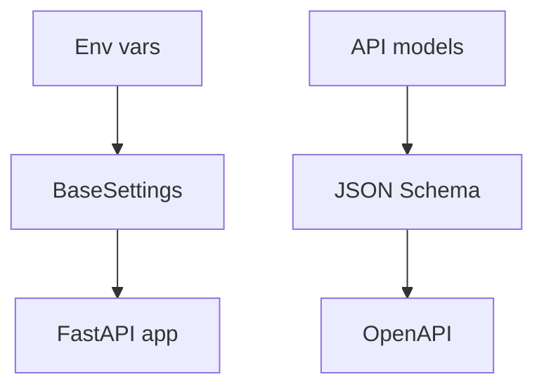

# Settings, Schemas, Strict Mode, and Error Customization

## 1. Metadata and prerequisites

- Topic IDs: D14-T25, D14-T26, D14-T27, D14-T28
- Domain: 14
- Difficulty: Advanced
- Prerequisites: D12-T16, D14-T17
- Learning objectives: Configure Settings, JSON Schema export, strict validation, and tailored validation errors.
- Related topic IDs: D29-T01, D19-T05
- Estimated complexity: medium
- Completion status: DRAFT
- Verification: 2026-10-13. **UNVERIFIED**.

## 2. Introduction and fundamentals

### D14-T25 Pydantic Settings

**Definition.** `pydantic-settings` provides `BaseSettings` for environment-driven configuration with validation.

**Mechanism.** Fields map to env vars; `SettingsConfigDict` sets prefix, env file, secrets dir—confirm options in pinned version.

**Misconception.** Settings models belong in request handlers. Load once per process.

**Production rule.** Fail fast on boot if secrets missing; never log secret field values.

### D14-T26 Schema generation

**Definition.** Pydantic generates JSON Schema for models used by FastAPI OpenAPI.

**Mechanism.** `Model.model_json_schema()` exposes components; FastAPI merges into `openapi.json`.

**Misconception.** Schema equals runtime guarantees for custom middleware paths.

**Production rule.** Diff OpenAPI in CI on model changes.

### D14-T27 Strict validation

**Definition.** Strict mode rejects lax coercion (e.g., `"1"` → `1` when disabled).

**Mechanism.** `ConfigDict(strict=True)` or field-level strict types.

**Misconception.** Strict is always better. It breaks lenient clients; adopt at API boundaries intentionally.

**Production rule.** Use strict on internal service boundaries; document lenient public APIs explicitly.

### D14-T28 Validation error customization

**Definition.** Customize error messages and types via `ValidationError`, `field_validator` messages, and FastAPI exception handlers.

**Mechanism.** Raise `ValueError` with text in validators; wrap `RequestValidationError` handler for RFC 9457 bodies.

**Misconception.** Custom errors should include SQL details. Never expose internals.

**Production rule.** Stable machine-readable `type` codes; human text optional; default `422` for request validation.

## 3. Internal workings

Settings instantiate at import/lifespan; routes use DI to read settings. Strict validation runs in core validator before field validators.

## 4. Architecture diagrams



## 5. Code and implementation

**UNVERIFIED:**

```python
from pydantic import BaseModel, ConfigDict, ValidationError
from pydantic_settings import BaseSettings, SettingsConfigDict


class AppSettings(BaseSettings):
    model_config = SettingsConfigDict(env_prefix="APP_", extra="ignore")
    jwt_issuer: str
    jwt_audience: str


class StrictId(BaseModel):
    model_config = ConfigDict(strict=True)
    id: int


def parse_strict_id(data: dict[str, object]) -> StrictId:
    try:
        return StrictId.model_validate(data)
    except ValidationError as exc:
        raise ValueError("invalid id payload") from exc
```

## 6. API contracts

Settings are not exposed via HTTP. Schema changes are contract changes—version APIs (Domain 15).

## 7. Production considerations

Separate secrets using `SecretStr` for redaction in logs where supported.

## 8. Comparison and tradeoffs

Strict vs lax at public edge—choose per endpoint sensitivity.

## 9. Debugging and troubleshooting

Settings not loading `.env` in Docker: file not copied; use orchestrator env instead.

## 10. Interview preparation

**Intermediate.** Where validate env vars? **Model:** `BaseSettings` at startup, not per request.

## 11. Exercises and mastery assessment

1. Add `SecretStr` API key field. 2. Export JSON schema for a model. 3. Map validation errors to RFC 9457 `detail`.

**Mastery checklist:** Settings; schema gen; strict mode tradeoffs; safe error customization.

## 8. Comparison and tradeoffs (extended)

| Approach | Benefit | Cost |
| --- | --- | --- |
| `BaseSettings` at import | Fail-fast deploys | Harder to test without env isolation |
| Strict models at edge | Prevents silent coercion | Breaks legacy clients sending `"1"` for integers |
| Custom 422 handler | Brand-consistent errors | Must stay compatible with client parsers |

## 9. Debugging and troubleshooting (extended)

**Symptom:** OpenAPI component missing a field you added to a model. **Cause:** Route still uses an older response model or a duplicate model class with the same name in another module. **Fix:** grep for class name; ensure the route annotation references the updated model; restart workers so schema regenerates.

**Symptom:** Strict validation passes in unit tests but fails in integration tests. **Cause:** TestClient sends JSON with string numbers while direct `model_validate` used ints. **Fix:** align fixtures with wire-format JSON.

## 10. Interview preparation (extended)

**Advanced.** How do settings differ from request models? **Model answer:** Settings load from environment once per process with secrets and deployment config; request models validate per HTTP message and must never embed production secrets from env into responses. **Incorrect answer:** “They are the same BaseModel.”

**Intermediate.** When export JSON Schema in CI? **Model answer:** On every PR that touches models, diff `openapi.json` or `model_json_schema()` output to catch accidental breaking changes.

## 11. Exercises and mastery assessment (extended)

4. **Coding.** Add `model_config = ConfigDict(strict=True)` to a query filter model and document one client migration step.  
5. **Operations.** Describe how four Uvicorn workers load settings—does each validate env independently?

**Solutions.** (5) Yes—each worker process imports settings; missing env vars crash that worker at boot; orchestrator restarts loop.

**Mastery checklist (extended).**

- [ ] Can use `SecretStr` without logging values.
- [ ] Can articulate strict vs lax boundary policy.

**Revision summary.** Settings, schema export, strict validation, and tailored `422` responses complete the Pydantic v2 story for FastAPI services—validated at boot for config and at the edge for HTTP payloads.
