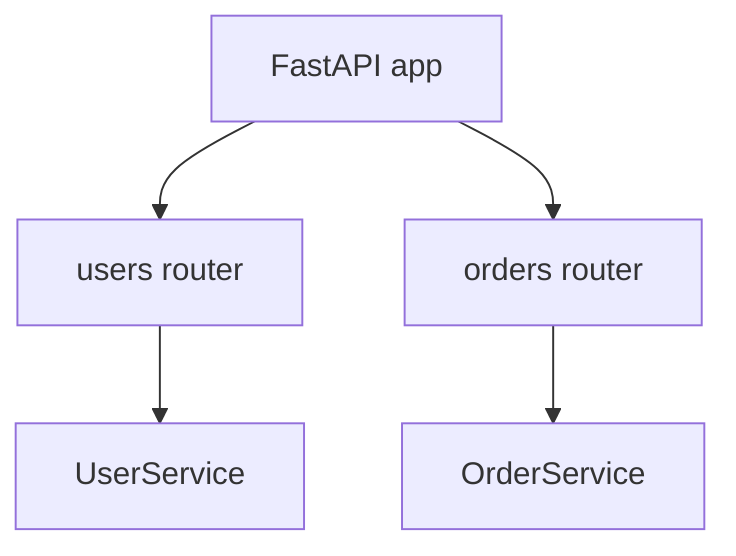

# Routers, Prefixes, Tags, and Modular Design

## 1. Metadata and prerequisites

- Topic IDs: D15-T01 through D15-T07
- Domain: 15, Routing and Application Structure
- Difficulty: Intermediate
- Prerequisites: D12-T05, D13-T01
- Learning objectives: Structure APIs with `APIRouter`, prefixes, tags, and shared router dependencies.
- Related topic IDs: D16-T14, D04-T21
- Estimated complexity: medium
- Completion status: DRAFT
- Verification: 2026-10-13. **UNVERIFIED**.

## 2. Introduction and fundamentals

### D15-T01 APIRouter

**Definition.** `APIRouter` groups related routes for inclusion in a `FastAPI` app.

**Mechanism.** `router = APIRouter()`; decorate functions; `app.include_router(router)`.

**Misconception.** Routers are separate apps. They share the same middleware and exception handlers unless mounted separately.

**Production rule.** One router per bounded context (billing, users).

### D15-T02 Route registration

**Definition.** Registration attaches HTTP methods and paths to callables.

**Mechanism.** Decorators record routes on the router; inclusion merges into app route table.

**Misconception.** Order never matters. Static paths should be registered before parameterized paths to avoid shadowing (D15-T15).

**Production rule.** Integration-test route tables after refactors.

### D15-T03 Router prefixes

**Definition.** `APIRouter(prefix="/v1/items")` prepends to all routes in the router.

**Mechanism.** Applied at `include_router` time; combines with route path.

**Misconception.** Prefix replaces OpenAPI tags. Tags are separate metadata.

**Production rule.** Version prefixes (`/v1`) align with deprecation policy (Domain 4).

### D15-T04 Tags and endpoint metadata

**Definition.** `tags=["items"]` group endpoints in OpenAPI UIs.

**Mechanism.** Metadata flows to `openapi.json` for Swagger/ReDoc.

**Misconception.** Tags enforce auth. They are documentary unless paired with dependencies.

**Production rule.** Tag internal admin routes clearly; hide or protect them in prod docs.

### D15-T05 Router dependencies

**Definition.** Dependencies declared on `APIRouter(dependencies=[Depends(...)])` run for every route in the router.

**Mechanism.** Composes with per-route dependencies; same caching rules per request (Domain 16).

**Misconception.** Router deps run once per app lifetime. They run per request.

**Production rule.** Use router-level auth for entire admin sections.

### D15-T06 Modular application design

**Definition.** Modules separate transport (routers), application services, and infrastructure.

**Mechanism.** Import direction: routers → services → repositories; avoid circular imports via interfaces.

**Misconception.** Fat controllers are fine in FastAPI. They become untestable.

**Production rule.** Keep endpoints thin—validate, authorize, delegate, map response.

### D15-T07 Splitting routers by domain

**Definition.** Domain routers mirror business capabilities, not database tables only.

**Mechanism.** `app.include_router(users_router)` etc.

**Misconception.** One router per file is mandatory. Group by cohesion.

**Production rule.** Co-locate router and schemas for that domain package.

## 3. Internal workings

`include_router` copies routes into app, merging dependencies and prefixes. OpenAPI rebuild reflects new paths.

## 4. Architecture diagrams



## 5. Code and implementation

**UNVERIFIED:**

```python
from fastapi import APIRouter, Depends, FastAPI

app = FastAPI()
items = APIRouter(prefix="/items", tags=["items"])


def require_api_version() -> None:
    return None


items_with_dep = APIRouter(
    prefix="/items",
    tags=["items"],
    dependencies=[Depends(require_api_version)],
)


@items.get("/{item_id}")
async def get_item(item_id: int) -> dict[str, int]:
    return {"item_id": item_id}


app.include_router(items)
```

## 6. API contracts

Routers inherit global exception handlers and default `422` behavior.

## 7. Production considerations

Avoid importing heavy modules at router import time; lazy-load costly clients in lifespan.

## 8. Comparison and tradeoffs

Monolith app vs modular routers—routers scale with team size.

## 9. Debugging and troubleshooting

404 after moving routes: wrong prefix or router not included.

## 10. Interview preparation

**Intermediate.** Why `APIRouter`? **Model:** modularity and shared router dependencies.

## 11. Exercises and mastery assessment

1. Split public `/v1` and internal `/internal` routers. 2. Add router-level auth dependency stub. 3. Document tags in OpenAPI.

**Mastery checklist:** router; prefix; tags; modular splits.

## 7. Production considerations (extended)

Avoid circular imports by having routers depend on service interfaces defined in a neutral `services` package, not on other routers. When multiple teams contribute routers, standardize tag names (`billing`, not `Billing`) so OpenAPI UIs remain readable. Router-level dependencies that perform I/O should be async if they await network calls; blocking auth lookups in async routers harm latency.

## 9. Debugging and troubleshooting (extended)

**Symptom:** OpenAPI missing routes from a router. **Cause:** router not `include_router` on the app instance under test or wrong `prefix` doubling paths. **Fix:** print `app.routes` in a diagnostic test.

## 10. Interview preparation (extended)

**Intermediate.** Difference between `app.include_router(router, prefix="/api")` and router’s own `prefix`? **Model answer:** prefixes compose—document the final paths to avoid double `/api/api` mistakes.

## 11. Exercises and mastery assessment (extended)

4. Mount two routers with different tags under `/v1`.  
5. Add router dependency that rejects requests without `X-API-Version: 1`.

**Revision summary.** `APIRouter` modularizes FastAPI apps with prefixes, metadata, and shared dependencies while keeping import graphs acyclic.
