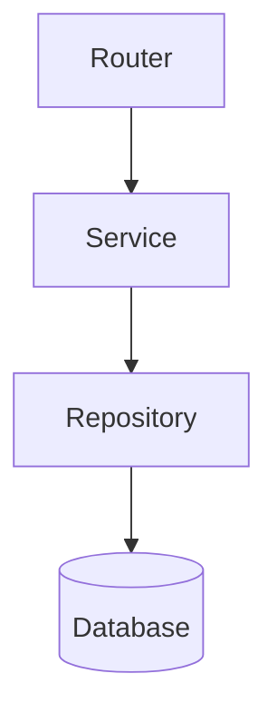

# Service, Repository, and Application Factories

## 1. Metadata and prerequisites

- Topic IDs: D15-T08 through D15-T13
- Domain: 15
- Difficulty: Advanced
- Prerequisites: D15-T06, D16-T01
- Learning objectives: Separate business logic, persistence, and app construction with DI-friendly factories.
- Related topic IDs: D22-T18, D12-T14
- Estimated complexity: high
- Completion status: DRAFT
- Verification: 2026-10-13. **UNVERIFIED**.

## 2. Introduction and fundamentals

### D15-T08 Service layer

**Definition.** Services implement use cases (place order, transfer funds) independent of HTTP.

**Mechanism.** Routers call service methods with primitives/DTOs; services orchestrate repositories and policies.

**Misconception.** Services must be classes. Functions modules work if consistent.

**Production rule.** No FastAPI imports inside services—keeps unit tests fast.

### D15-T09 Repository layer

**Definition.** Repositories encapsulate persistence queries and commands.

**Mechanism.** `UserRepository.get_by_id` hides SQL/ORM; returns domain objects or ORM entities per team choice.

**Misconception.** Repository replaces ORM. It wraps ORM.

**Production rule.** Transactions boundary at service or UoW, not scattered in routers.

### D15-T10 Business logic separation

**Definition.** Rules live outside endpoints and Pydantic models (except simple normalization).

**Mechanism.** Services enforce invariants; raise domain exceptions mapped to HTTP (Domain 19).

**Misconception.** Pydantic validators should call the database. Avoid I/O in validators.

**Production rule.** Object-level authorization in services after authentication (Domain 20).

### D15-T11 Dependency inversion

**Definition.** High-level modules depend on abstractions (`Protocol`), not concrete DB drivers.

**Mechanism.** FastAPI `Depends` provides concrete implementations per environment.

**Misconception.** DI frameworks are mandatory. FastAPI `Depends` suffices.

**Production rule.** Swap fakes in tests via `dependency_overrides`.

### D15-T12 Application factories

**Definition.** `create_app(settings) -> FastAPI` builds configured apps for prod and tests.

**Mechanism.** Register routers, middleware, handlers inside factory.

**Misconception.** Global `app` is required. Factory improves test isolation.

**Production rule.** Single factory used by Uvicorn import and pytest fixtures.

### D15-T13 Shared application state

**Definition.** `app.state` holds per-process objects (clients, config flags).

**Mechanism.** Set in lifespan; access via `Request.app.state` or dependencies.

**Misconception.** `app.state` is shared across workers. It is per worker only.

**Production rule.** Use external stores for cross-worker coordination.

## 3. Internal workings

Request → router → service → repository → DB; exceptions bubble to handlers; `response_model` shapes output.

## 4. Architecture diagrams



## 5. Code and implementation

**UNVERIFIED:**

```python
from typing import Protocol

from fastapi import Depends, FastAPI


class UserRepo(Protocol):
    def get(self, user_id: int) -> dict[str, object] | None: ...


class UserService:
    def __init__(self, repo: UserRepo) -> None:
        self._repo = repo

    def profile(self, user_id: int) -> dict[str, object]:
        row = self._repo.get(user_id)
        if row is None:
            raise KeyError("missing")
        return row


def create_app() -> FastAPI:
    app = FastAPI()
    return app
```

## 6. API contracts

Services return DTOs; routers map `KeyError` to `404` via handlers.

## 7. Production considerations

Enforce ownership checks in services, not roles alone (Domain 20).

## 8. Comparison and tradeoffs

Anemic services vs rich domain models—pick one style per codebase.

## 9. Debugging and troubleshooting

Circular imports: move protocols to `interfaces.py`.

## 10. Interview preparation

**Advanced.** Where put object ownership check? **Model:** service layer after resolving current user.

## 11. Exercises and mastery assessment

1. Sketch `OrderService` with repo protocol. 2. Factory registers two routers. 3. Explain `app.state` per worker.

**Mastery checklist:** layers; factory; inversion; state scope.

## 7. Production considerations (extended)

Object ownership checks belong in the service layer after loading the entity: compare `owner_id` to `current_user.id`, not merely check roles. Factories should accept `Settings` so tests can inject fakes without mutating environment variables globally. Repository methods should always apply tenant filters when `tenant_id` is part of your model—router prefixes alone do not enforce isolation.

## 10. Interview preparation (extended)

**Advanced.** Why no FastAPI imports in services? **Model answer:** keeps domain logic testable without HTTP stack and prevents accidental `Request` coupling. **Incorrect answer:** “It is just style.”

## 11. Exercises and mastery assessment (extended)

4. Write a service method that raises a domain exception when a user edits another user’s order.  
5. Map that exception to `403` in an exception handler (Domain 19).

## 8. Comparison and tradeoffs (extended)

Fat repositories versus active record: repositories keep SQL out of services; active record couples models to HTTP. For FastAPI, keep ORM models in infrastructure packages and map to Pydantic DTOs at boundaries. Application factories enable multiple apps (`create_app(testing=True)`) without forking code paths in `main.py`.

## 9. Debugging and troubleshooting (extended)

**Symptom:** tests hit real database. **Cause:** factory registers real dependencies. **Fix:** override repository in `dependency_overrides` for integration versus unit tests.

**Revision summary.** Factories wire routers to services and repositories with clear boundaries, testable dependencies, and object-level authorization in services—not in routers alone.
