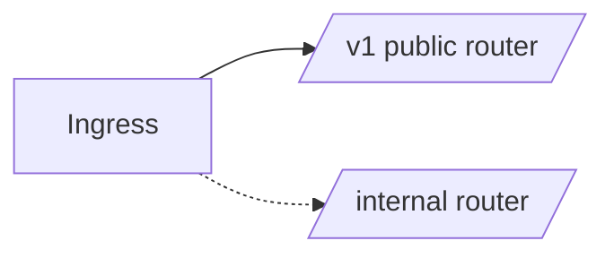

# Route Names, Conflicts, Versioning, and Exposure

## 1. Metadata and prerequisites

- Topic IDs: D15-T14, D15-T15, D15-T16, D15-T17
- Domain: 15
- Difficulty: Advanced
- Prerequisites: D15-T01, D04-T21
- Learning objectives: Name routes, avoid path conflicts, version APIs, and separate internal endpoints.
- Related topic IDs: D12-T11, D25-T09
- Estimated complexity: medium
- Completion status: DRAFT
- Verification: 2026-10-13. **UNVERIFIED**.

## 2. Introduction and fundamentals

### D15-T14 Route naming

**Definition.** `name` on routes supports `url_path_for` and OpenAPI operationId generation.

**Mechanism.** `router.get("/items", name="list_items")`.

**Misconception.** Names are URLs. They are internal keys.

**Production rule.** Stable names for emails/links generated server-side.

### D15-T15 Route ordering and path conflicts

**Definition.** More specific routes must win over parametric catch-alls.

**Mechanism.** First registered match may apply—confirm matching algorithm in Starlette/FastAPI docs for your version.

**Misconception.** `/items/{id}` and `/items/special` always disambiguate automatically. Register `/items/special` first.

**Production rule.** Add tests for ambiguous paths.

### D15-T16 API versioning

**Definition.** Versioning exposes `/v1` vs `/v2` or header versioning.

**Mechanism.** Router prefixes or separate routers included conditionally.

**Misconception.** Version in query string is enough for caching. Prefer path or header with clear docs.

**Production rule.** Sunset old versions with metrics on traffic.

### D15-T17 Internal versus public endpoints

**Definition.** Internal routes (metrics, debug) differ from public contract routes.

**Mechanism.** Separate routers, network policies, or auth dependencies.

**Misconception.** Hiding paths equals security. Always authenticate internal APIs.

**Production rule.** Do not expose internal routes on public ingress; use mTLS or private networks.

## 3. Internal workings

Starlette routing trie matches path; conflicts surface as wrong handler or 404.

## 4. Architecture diagrams



## 5. Code and implementation

**UNVERIFIED:**

```python
from fastapi import APIRouter, FastAPI

app = FastAPI()
v1 = APIRouter(prefix="/v1")
internal = APIRouter(prefix="/internal", include_in_schema=False)


@v1.get("/items/special", name="special_item")
async def special() -> dict[str, str]:
    return {"kind": "special"}


@v1.get("/items/{item_id}")
async def by_id(item_id: int) -> dict[str, int]:
    return {"item_id": item_id}


@internal.get("/metrics")
async def metrics() -> dict[str, int]:
    return {"uptime_seconds": 1}


app.include_router(v1)
app.include_router(internal)
```

## 6. API contracts

Public OpenAPI excludes `include_in_schema=False` routes.

## 7. Production considerations

Align versioning with backward compatibility tests (Domain 11).

## 8. Comparison and tradeoffs

Path versioning vs header versioning—path is easier for caches and curl.

## 9. Debugging and troubleshooting

Wrong handler: reorder routes or narrow param types.

## 10. Interview preparation

**Intermediate.** How hide admin routes from Swagger? **Model:** `include_in_schema=False` plus network controls.

## 11. Exercises and mastery assessment

1. Register static before dynamic path. 2. Add `/v2` router stub. 3. List three controls for internal APIs.

**Mastery checklist:** naming; ordering; versioning; exposure.

## 7. Production considerations (extended)

Run contract tests that call both `/v1/items/special` and `/v1/items/{id}` with representative IDs to ensure the special path is not captured as an integer route. For internal routers, enforce network policy (private subnets, security groups) even when `include_in_schema=False`, because obscurity is not authentication. When deprecating `/v1`, keep the router mounted until metrics show near-zero traffic, then return `410 Gone` or redirect per your API policy (Domain 4).

## 8. Comparison and tradeoffs (extended)

Header versioning (`Accept-Version`) avoids URL churn but complicates caching and curl examples. Path versioning is verbose yet obvious in logs. Feature flags inside one version are for gradual rollout, not a substitute for breaking schema changes—ship `/v2` when types change incompatibly.

## 9. Debugging and troubleshooting (extended)

**Symptom:** `url_path_for("list_items")` breaks after refactor. **Cause:** renamed route `name` or router not included on the app used in tests. **Fix:** grep `name=` decorators; snapshot test URL generation for emailed links.

## 10. Interview preparation (extended)

**Scenario.** Two teams add `GET /users/me` in different routers. **Model answer:** Last registered route wins or first match wins depending on Starlette order—resolve by merging routers, using distinct prefixes, or integration tests that fail on duplicate method+path templates. **Incorrect answer:** “FastAPI merges them automatically.”

## 11. Exercises and mastery assessment (extended)

4. **Design.** Plan `/v1` → `/v2` migration for a renamed field using parallel routers for six months.  
5. **Security.** List two controls besides `include_in_schema=False` for `/internal/metrics`.

**Solutions.** (5) mTLS or private network, admin bearer role, IP allow-list at proxy.

**Mastery checklist (extended).**

- [ ] Can explain route `name` vs OpenAPI `operationId`.
- [ ] Can register static paths before dynamic ones.

**Revision summary.** Explicit route names, ordering discipline, versioning routers, and internal exposure controls keep large FastAPI codebases maintainable and safe at the edge.
