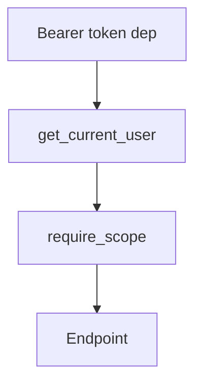

# Depends, Nesting, and Request-Scoped Resources

## 1. Metadata and prerequisites

- Topic IDs: D16-T01 through D16-T09
- Domain: 16, Dependency Injection
- Difficulty: Intermediate
- Prerequisites: D12-T05, D15-T06
- Learning objectives: Use `Depends()` for functions, classes, nesting, DB sessions, and auth stubs.
- Related topic IDs: D22-T09, D20-T10
- Estimated complexity: medium
- Completion status: DRAFT
- Verification: Depends caching per request—confirm FastAPI docs 2026-10-13. **UNVERIFIED**.

## 2. Introduction and fundamentals

### D16-T01 Depends()

**Definition.** `Depends(callable)` declares a dependency FastAPI resolves before the endpoint runs.

**Mechanism.** Parameters default to `Depends(fn)`; FastAPI builds a DAG and executes it.

**Misconception.** Depends is only for databases. Use for settings, users, permissions, clients.

**Production rule.** Keep dependency callables small; compose them.

### D16-T02 Dependency functions

**Definition.** Plain functions (sync or async) produce dependency values.

**Mechanism.** Return value injects into parameters; exceptions propagate unless handled.

**Misconception.** Dependencies cannot take parameters. They can depend on other dependencies.

**Production rule.** Type-annotate returns for clarity and OpenAPI where applicable.

### D16-T03 Dependency classes

**Definition.** Classes with `__call__` or methods used as dependencies via `Depends(Class)`.

**Mechanism.** Instantiation rules depend on signature—verify class dependency pattern in docs.

**Misconception.** Classes are singletons automatically. Scope is per request unless you manage caching.

**Production rule.** Prefer functions unless you need structured grouping.

### D16-T04 Nested dependencies

**Definition.** Dependencies that themselves declare `Depends` form chains.

**Mechanism.** FastAPI resolves from inner requirements outward.

**Misconception.** Nesting depth is unlimited without cost. Deep graphs harm readability—flatten when needed.

**Production rule.** Document auth dependency chains for security review.

### D16-T05 Shared dependencies

**Definition.** Reusable dependencies imported across routers (`get_current_user`).

**Mechanism.** Same callable referenced in multiple routes shares per-request cache (D16-T10).

**Misconception.** Importing the function creates new cache keys. Identity of callable matters.

**Production rule.** Define shared deps in one module to avoid duplicate callables.

### D16-T06 Request-scoped resources

**Definition.** Objects living for one request (DB session, unit of work).

**Mechanism.** Created in dependency, closed after response—often `yield` pattern (D16-T11).

**Misconception.** Request scope equals asyncio task scope in background tasks. Background work may outlive request—do not use request session there.

**Production rule.** Never share mutable request state across tasks without context vars.

### D16-T07 Database session dependencies

**Definition.** A dependency yields an ORM session per request.

**Mechanism.** `yield session` in dependency; commit/rollback in `try/finally` after yield.

**Misconception.** One global session per worker. Use per-request sessions.

**Production rule.** Pair with connection pool sized for workers (Domain 22).

### D16-T08 Authentication dependencies

**Definition.** Dependencies extract and validate credentials, returning a principal.

**Mechanism.** Use security schemes (`HTTPBearer`, `OAuth2PasswordBearer`) plus verification logic.

**Misconception.** Authentication dependency implies authorization. Split checks (Domain 20).

**Production rule.** Return `401` when credentials missing/invalid; `403` when authenticated but not allowed.

### D16-T09 Authorization dependencies

**Definition.** Dependencies enforce permissions after authentication.

**Mechanism.** `require_admin(user: User = Depends(get_current_user))` raises `HTTPException(403)`.

**Misconception.** Role checks alone secure resources. Add object ownership checks in services.

**Production rule.** Roles gate features; ownership gates rows.

## 3. Internal workings

For each request, FastAPI computes a cache keyed by dependency callable. First invocation runs the callable; subsequent parameters reuse the result for that request.

## 4. Architecture diagrams



## 5. Code and implementation

**UNVERIFIED:**

```python
from collections.abc import Generator

from fastapi import Depends, FastAPI, HTTPException, status

app = FastAPI()


def get_db() -> Generator[dict[str, str], None, None]:
    db = {"conn": "active"}
    try:
        yield db
    finally:
        db.clear()


def get_current_user_id(token: str | None = None) -> int:
    if token is None:
        raise HTTPException(status_code=status.HTTP_401_UNAUTHORIZED, detail="Not authenticated")
    return 42


@app.get("/me")
async def me(
    user_id: int = Depends(get_current_user_id),
    db: dict[str, str] = Depends(get_db),
) -> dict[str, object]:
    return {"user_id": user_id, "db": db}
```

## 6. API contracts

Auth failures: `401` without valid credentials; `403` when dependency denies action.

## 7. Production considerations

Do not perform blocking I/O in async dependencies without offload (Domain 21).

## 8. Comparison and tradeoffs

DI vs manual singletons—DI improves test overrides.

## 9. Debugging and troubleshooting

Dependency called twice: two different callables (lambdas) break cache—use named functions.

## 10. Interview preparation

**Intermediate.** Is `Depends` cached per request? **Model:** yes, per same callable per request. **Wrong:** cached forever globally.

## 11. Exercises and mastery assessment

1. Chain `get_db` → repository → service. 2. Split authn and authz dependencies. 3. Explain 401 vs 403.

**Mastery checklist:** Depends; nesting; request scope; auth split.

**Revision summary.** `Depends()` composes request-scoped graphs with per-request caching for shared callables.
