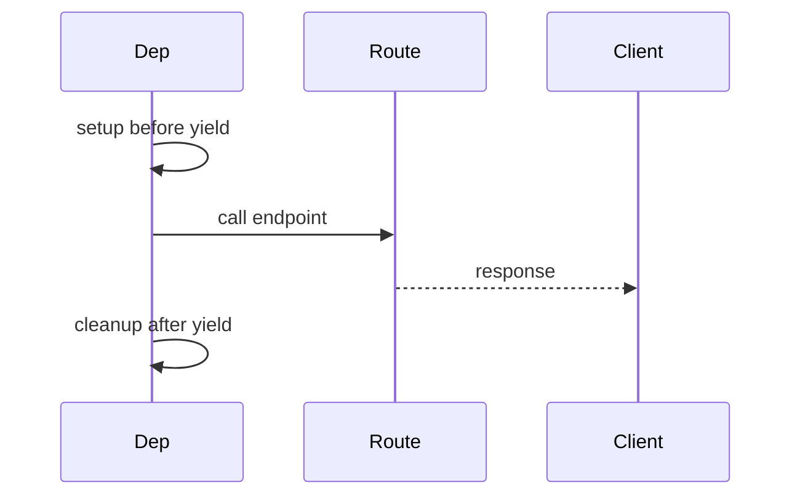

# Yield, Overrides, Levels, and Execution Order

## 1. Metadata and prerequisites

- Topic IDs: D16-T10 through D16-T16
- Domain: 16
- Difficulty: Advanced
- Prerequisites: D16-T01, D26-T06
- Learning objectives: Use yield dependencies, overrides in tests, app/router deps, and reason about order.
- Related topic IDs: D19-T14, D17-T13
- Estimated complexity: high
- Completion status: DRAFT
- Verification: yield cleanup on errors—confirm FastAPI docs 2026-10-13. **UNVERIFIED**.

## 2. Introduction and fundamentals

### D16-T10 Dependency caching within a request

**Definition.** Identical dependency callables execute once per request; results are reused.

**Mechanism.** Cache keyed by callable identity and scope.

**Misconception.** Different lambdas wrapping same logic share cache. They do not—use one function.

**Production rule.** Extract shared deps to module-level functions.

### D16-T11 Dependencies with yield

**Definition.** Generator dependencies `yield` a resource, then run cleanup after the response.

**Mechanism.** FastAPI treats `yield` like `try/finally` around the endpoint; cleanup runs even if the endpoint raises.

**Misconception.** Cleanup waits until background tasks finish. Confirm behavior for background tasks in your FastAPI version.

**Production rule.** Use `yield` for sessions, transactions, and locks; keep cleanup idempotent.

### D16-T12 Resource cleanup

**Definition.** Releasing connections, flushing metrics, closing files after the request.

**Mechanism.** Code after `yield` in the dependency generator.

**Misconception.** Raising in the endpoint skips cleanup. Yield dependencies still finalize in normal FastAPI flow—verify for cancelled requests.

**Production rule.** Log cleanup failures; do not swallow exceptions that hide leaks.

### D16-T13 Dependency overrides in tests

**Definition.** `app.dependency_overrides[callable] = fake` replaces dependencies in tests.

**Mechanism.** TestClient requests use overrides; reset after tests.

**Misconception.** Overrides affect production. Only test apps should set them.

**Production rule.** Centralize override fixtures in pytest; never ship overrides in factory used by prod entry point.

### D16-T14 Application-wide dependencies

**Definition.** `FastAPI(dependencies=[...])` applies to all routes.

**Mechanism.** Runs before route-specific deps.

**Misconception.** Global deps replace middleware. Cross-cutting HTTP concerns may still belong in middleware (Domain 17).

**Production rule.** Use sparingly for universal auth or timing.

### D16-T15 Router-level dependencies

**Definition.** Dependencies on `APIRouter` affect only that router’s routes.

**Mechanism.** Composes with app-level deps.

**Misconception.** Router deps run after endpoint. They run before endpoint like others.

**Production rule.** Admin router gets stricter deps than public router.

### D16-T16 Dependency execution order

**Definition.** Order follows dependency graph topological sort, not parameter order in endpoint signature.

**Mechanism.** Sub-dependencies run before dependents.

**Misconception.** You control order by reordering endpoint parameters. Graph dictates order.

**Production rule.** Avoid side-effect dependencies that rely on implicit ordering—make dependencies explicit.

## 3. Internal workings

Yield deps: enter → yield value → endpoint → response → exit generator cleanup. Overrides substitute callables before graph build in tests.

## 4. Architecture diagrams



## 5. Code and implementation

**UNVERIFIED:**

```python
from collections.abc import AsyncGenerator

from fastapi import Depends, FastAPI
from fastapi.testclient import TestClient

app = FastAPI()


async def get_counter() -> AsyncGenerator[list[int], None]:
    state = [0]
    state[0] += 1
    try:
        yield state
    finally:
        state.clear()


@app.get("/")
async def root(counter: list[int] = Depends(get_counter)) -> dict[str, int]:
    return {"value": counter[0]}


def fake_counter() -> list[int]:
    return [99]


def test_override() -> None:
    app.dependency_overrides[get_counter] = fake_counter
    client = TestClient(app)
    _ = client.get("/")
    app.dependency_overrides.clear()
```

## 6. API contracts

Tests should assert behavior with overrides without hitting real DB.

## 7. Production considerations

Yield deps must not block event loop on cleanup—use async drivers where needed.

## 8. Comparison and tradeoffs

Middleware vs yield dep: middleware sees all ASGI events; yield dep integrates with DI graph.

## 9. Debugging and troubleshooting

Connection leak: cleanup after yield not running—check unhandled generator exit paths.

## 10. Interview preparation

**Advanced.** How test DB without Postgres? **Model:** `dependency_overrides` for fake repo/session.

**Follow-up.** Does yield cleanup run on 500? **Model:** yes in normal completion paths; confirm cancelled disconnect behavior in docs.

## 11. Exercises and mastery assessment

1. Write yield session that rolls back on exception. 2. Override `get_current_user` in test. 3. Diagram dep graph for A→B, C→B.

**Mastery checklist:** cache; yield cleanup; overrides; ordering.

## 7. Production considerations (extended)

After `yield`, cleanup should close DB sessions even when `HTTPException` is raised in the endpoint—verify behavior for your FastAPI version in docs rather than assuming. `dependency_overrides` must be cleared in test teardown to prevent bleed across cases. Application-wide dependencies run for OpenAPI and health routes unless excluded—consider whether health checks should skip expensive deps.

## 8. Comparison and tradeoffs (extended)

Yield dependencies versus middleware for DB sessions: yield participates in OpenAPI dependency graph and test overrides; middleware cannot inject session into endpoint parameters without context hacks.

**Revision summary.** Yield dependencies manage lifecycle; overrides enable tests; execution order follows the dependency graph, not parameter order.
