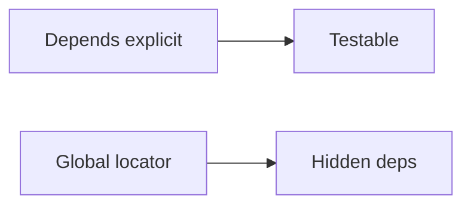

# Async Dependencies versus Service Locators

## 1. Metadata and prerequisites

- Topic IDs: D16-T17, D16-T18
- Domain: 16
- Difficulty: Advanced
- Prerequisites: D16-T01, D21-T01
- Learning objectives: Write async dependencies safely and avoid service-locator antipatterns.
- Related topic IDs: D21-T06, D17-T13
- Estimated complexity: medium
- Completion status: DRAFT
- Verification: 2026-10-13. **UNVERIFIED**.

## 2. Introduction and fundamentals

### D16-T17 Async dependencies

**Definition.** `async def` dependencies can `await` non-blocking I/O before endpoints run.

**Mechanism.** FastAPI awaits async deps when the endpoint is async; sync deps may run in threadpool—confirm mixed patterns in docs.

**Misconception.** Async deps automatically parallelize. They run sequentially along the graph unless you spawn tasks yourself.

**Production rule.** Never call blocking libraries inside `async def` dependencies without `run_in_threadpool` or equivalent.

### D16-T18 Dependency injection versus service locators

**Definition.** DI injects explicit dependencies via parameters; service locators hide lookups (`get_service()` globals).

**Mechanism.** FastAPI encourages DI via `Depends`; locators use registries or `app.state` magic.

**Misconception.** `app.state` is a service locator anti-pattern always. It is acceptable for true process singletons (config), not per-request DB.

**Production rule.** Inject per-request resources; reserve `app.state` for lifespan-managed clients.

## 3. Internal workings

Async dependency awaited → result cached → endpoint awaited. Blocking in async dep stalls the event loop for that worker.

## 4. Architecture diagrams



## 5. Code and implementation

**UNVERIFIED:**

```python
import asyncio

from fastapi import Depends, FastAPI

app = FastAPI()


async def fetch_feature_flag(name: str) -> bool:
    await asyncio.sleep(0)  # stand-in for async I/O
    return name == "beta"


@app.get("/flags/{name}")
async def read_flag(enabled: bool = Depends(fetch_feature_flag)) -> dict[str, bool]:
    return {"enabled": enabled}
```

## 6. API contracts

N/A beyond endpoint behavior.

## 7. Production considerations

Use httpx AsyncClient in async deps, created in lifespan, not per request if expensive—balance pooling.

## 8. Comparison and tradeoffs

| Pattern | Testability | Risk |
| --- | --- | --- |
| `Depends` | high | verbose signatures |
| Locator | low | hidden coupling |

## 9. Debugging and troubleshooting

Event loop blocked: profile async deps for sync DB calls.

## 10. Interview preparation

**Intermediate.** Blocking in `async def` endpoint? **Model:** blocks loop; use `def` endpoint or offload. **Wrong:** "async makes it non-blocking."

## 11. Exercises and mastery assessment

1. Convert sync HTTP call in async dep to async client. 2. Refactor global `get_db()` to `Depends`. 3. When is `app.state` appropriate?

**Solutions.** (3) Lifespan-managed shared clients, not per-user sessions.

**Mastery checklist:** async deps; no blocking; avoid locators.

## 7. Production considerations (extended)

Size HTTP client pools in lifespan based on expected concurrent requests per worker, not global traffic—each worker is independent. When a sync ORM call must run inside an async stack, use Starlette `run_in_threadpool` or switch the endpoint to `def` so FastAPI schedules it in a thread pool (confirm current behavior in FastAPI docs). Never mix locator globals that hold per-request sessions; that pattern causes data leaks across concurrent requests on the same worker.

## 8. Comparison and tradeoffs (extended)

| Pattern | When it wins |
| --- | --- |
| `async def` dependency + async driver | High concurrency I/O |
| `def` endpoint + sync ORM | Small services with sync SQLAlchemy |
| `Depends` injection | Tests with overrides |
| Service locator | Legacy code only—migrate away |

## 9. Debugging and troubleshooting (extended)

**Symptom:** p99 latency spikes under load with low CPU. **Cause:** blocking call inside `async def` dependency (DNS, sync DB, heavy JSON). **Fix:** profile with asyncio debug mode or middleware timing; offload blocking work.

## 10. Interview preparation (extended)

**Scenario.** Teammate stores `current_user` on a module global set in a dependency. **Model answer:** unsafe—concurrent requests overwrite each other; use `Depends` parameters or `ContextVar`. **Incorrect answer:** “Globals are fine in async.”

## 11. Exercises and mastery assessment (extended)

4. **Refactor.** Replace `get_service()` locator with `Depends(get_service)` factory returning a protocol.  
5. **Conceptual.** Why is `app.state.db` acceptable for a connection pool but not for a request session?

**Solutions.** (5) Pool is process-scoped and thread-safe when used correctly; session carries transaction state tied to one request.

**Mastery checklist (extended).**

- [ ] Can name two symptoms of event-loop blocking.
- [ ] Can explain per-worker memory for caches.

**Revision summary.** Async dependencies must await real async I/O; prefer explicit DI over hidden service locators; process-scoped resources belong in lifespan, request-scoped resources in `Depends` or yield dependencies.
