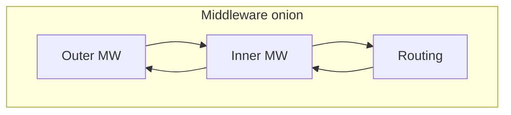
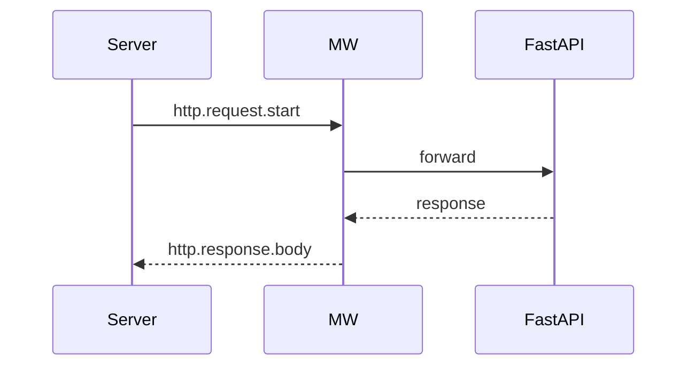

# ASGI Lifecycle and Middleware Order

## 1. Metadata and prerequisites

- Topic IDs: D17-T01 through D17-T05
- Domain: 17, Request Lifecycle and Middleware
- Difficulty: Advanced
- Prerequisites: D12-T03, D16-T01
- Learning objectives: Trace ASGI lifecycle, routing, middleware onion, and custom middleware basics.
- Related topic IDs: D21-T02, D25-T01
- Estimated complexity: high
- Completion status: DRAFT
- Verification: Middleware order—confirm Starlette docs 2026-10-13. **UNVERIFIED**.

## 2. Introduction and fundamentals

### D17-T01 ASGI request lifecycle

**Definition.** ASGI lifecycle is the sequence `scope` → receive events → application processing → send response events, optionally spanning WebSockets and lifespan.

**Mechanism.** Uvicorn calls the app; Starlette/FastAPI route or middleware handles HTTP `type` in scope.

**Misconception.** One thread per request always. Async workers multiplex many requests on one loop.

**Production rule.** Align proxy timeouts with app processing time.

### D17-T02 Routing and endpoint execution

**Definition.** After middleware, the router matches path/method and runs the endpoint stack including dependencies.

**Mechanism.** Unmatched routes return `404` before dependencies.

**Misconception.** Middleware runs after routing always. Outer middleware wraps routing—order matters (D17-T03).

**Production rule.** Keep routing table tests for critical paths.

### D17-T03 Middleware execution order

**Definition.** Middleware forms an onion: last added runs first on the way in, last on the way out.

**Mechanism.** `app.add_middleware(M)` wraps existing app; confirm exact order in Starlette documentation.

**Misconception.** CORS middleware can be innermost. It often must be outer to handle preflight early—verify your stack.

**Production rule.** Document middleware order in README for operators.

### D17-T04 Custom middleware

**Definition.** Custom middleware intercepts all requests/responses for cross-cutting concerns.

**Mechanism.** Subclass `BaseHTTPMiddleware` or pure ASGI middleware—prefer pure ASGI for performance (D17-T14).

**Misconception.** Middleware can replace dependencies entirely. Auth often still belongs in dependencies for OpenAPI security.

**Production rule.** Keep middleware thin; avoid heavy logic and blocking calls in `async` middleware.

### D17-T05 Request and response middleware

**Definition.** Middleware can inspect or mutate request headers before routing and response headers after endpoint.

**Mechanism.** `call_next(request)` continues chain; wrap response object.

**Misconception.** Middleware can read request body freely without consuming it. Body reads are tricky—use dependencies or receive wrapper carefully.

**Production rule.** Do not log full bodies by default.

## 3. Internal workings

Request enters outer middleware → … → routing → dependencies → endpoint → response travels outward through middleware.

## 4. Architecture diagrams



Request lifecycle:



## 5. Code and implementation

**UNVERIFIED:**

```python
from starlette.middleware.base import BaseHTTPMiddleware
from starlette.requests import Request
from starlette.responses import Response

from fastapi import FastAPI

app = FastAPI()


class AddHeaderMiddleware(BaseHTTPMiddleware):
    async def dispatch(self, request: Request, call_next) -> Response:
        response = await call_next(request)
        response.headers["X-Handbook"] = "1"
        return response


app.add_middleware(AddHeaderMiddleware)
```

## 6. API contracts

Middleware may add correlation headers documented for clients.

## 7. Production considerations

Measure middleware overhead (D17-T17); avoid duplicate JSON parsing.

## 8. Comparison and tradeoffs

Middleware for universal HTTP concerns; dependencies for endpoint-specific needs (D17-T13 preview).

## 9. Debugging and troubleshooting

CORS fails: middleware order or missing OPTIONS handling.

## 10. Interview preparation

**Intermediate.** Draw middleware onion. **Model:** outer runs first inbound, last outbound.

## 11. Exercises and mastery assessment

1. Add middleware setting `X-Request-ID`. 2. Explain when middleware runs vs `Depends`. 3. Sketch ASGI events vs HTTP.

**Mastery checklist:** ASGI lifecycle; order; custom MW basics.

## 7. Production considerations (extended)

Align Uvicorn, reverse proxy, and application timeouts: a middleware timing log showing 29s processing with a 30s proxy timeout means clients see `504` while your app still runs—dangerous for duplicate POST retries. Document middleware order in infrastructure runbooks because on-call engineers will add “just one more” layer. For FastAPI specifically, remember the stack is Starlette under the hood—middleware behavior should be verified against Starlette release notes when upgrading.

## 10. Interview preparation (extended)

**Advanced.** Where does routing happen relative to middleware? **Model answer:** middleware wraps the entire app including the router; inbound passes outer→inner until the route endpoint runs. **Incorrect answer:** “Middleware runs after the endpoint.”

## 11. Exercises and mastery assessment (extended)

4. List inbound/outbound order for three middleware classes A, B, C added in order A, B, C.  
5. Sketch ASGI `scope["type"]` values for HTTP versus lifespan.

**Solutions.** (4) Inbound A→B→C, outbound C→B→A. (5) `http` for requests, `lifespan` for startup/shutdown events.

**Revision summary.** ASGI drives the request; middleware wraps routing in an order-sensitive onion—document order and timeouts in production.
