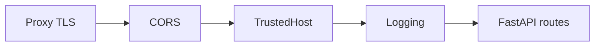

# Identity, Timing, Logging, CORS, Hosts, and Exceptions

## 1. Metadata and prerequisites

- Topic IDs: D17-T06 through D17-T12
- Domain: 17
- Difficulty: Advanced
- Prerequisites: D17-T01, D07-T20
- Learning objectives: Operate standard Starlette/FastAPI middleware for IDs, CORS, hosts, HTTPS, and exceptions.
- Related topic IDs: D27-T03, D19-T04
- Estimated complexity: medium
- Completion status: DRAFT
- Verification: 2026-10-13. **UNVERIFIED**.

## 2. Introduction and fundamentals

### D17-T06 Request IDs and correlation IDs

**Definition.** Request IDs uniquely identify one HTTP exchange; correlation IDs tie multiple services to one user action.

**Mechanism.** Middleware reads `X-Request-ID` or generates UUID, stores in context, echoes on response.

**Misconception.** Clients may forge IDs without validation. Accept but sanitize length; prefer edge-generated IDs.

**Production rule.** Propagate correlation ID to outbound calls and logs.

### D17-T07 Timing middleware

**Definition.** Measures wall time from request start to response complete.

**Mechanism.** Record monotonic clock before `call_next`, log duration after.

**Misconception.** Duration header replaces APM. Use both.

**Production rule.** Exclude health checks from SLO dashboards or tag separately.

### D17-T08 Logging middleware

**Definition.** Structured logs per request with method, path template, status, duration.

**Mechanism.** Access log at middleware or Uvicorn logging config.

**Misconception.** Logging middleware should log bodies. Avoid PII/secrets.

**Production rule.** Log path templates not raw URLs with sensitive query params.

### D17-T09 CORS middleware

**Definition.** `CORSMiddleware` adds ACAO headers and handles preflight OPTIONS.

**Mechanism.** Configures allowed origins, methods, headers.

**Misconception.** CORS replaces authentication. It only relaxes browser same-origin policy.

**Production rule.** Never use `allow_origins=["*"]` with credentials.

### D17-T10 Trusted host middleware

**Definition.** `TrustedHostMiddleware` rejects Host headers not in an allow-list.

**Mechanism.** Returns `400` for unknown hosts—mitigates host header attacks.

**Misconception.** TLS alone validates Host. Apps behind proxies must trust forwarded headers carefully.

**Production rule.** Set allowed hosts per environment.

### D17-T11 HTTPS redirects

**Definition.** Middleware redirects HTTP to HTTPS in environments terminating TLS at app (uncommon) or enforcing scheme.

**Mechanism.** `HTTPSRedirectMiddleware` issues 307/308 to https URL.

**Misconception.** Redirect middleware replaces reverse proxy TLS. Terminate TLS at proxy in most deployments.

**Production rule.** Prefer proxy TLS; use redirect middleware only when architecturally required.

### D17-T12 Exception middleware

**Definition.** Middleware catching unhandled exceptions to return generic responses.

**Mechanism.** Often paired with FastAPI exception handlers; avoid duplicating logic.

**Misconception.** Middleware sees `HTTPException` same as generic `Exception`. Handlers usually map `HTTPException` separately.

**Production rule.** Unhandled exceptions return `500` without stack traces (Domain 19).

## 3. Internal workings

Operational middleware runs on every request before business logic, enabling consistent observability and edge policy.

## 4. Architecture diagrams



## 5. Code and implementation

**UNVERIFIED:**

```python
import uuid

from fastapi import FastAPI
from starlette.middleware.cors import CORSMiddleware
from starlette.middleware.trustedhost import TrustedHostMiddleware

app = FastAPI()
app.add_middleware(
    CORSMiddleware,
    allow_origins=["https://app.example.com"],
    allow_credentials=True,
    allow_methods=["GET", "POST"],
    allow_headers=["Authorization", "X-Request-ID"],
)
app.add_middleware(TrustedHostMiddleware, allowed_hosts=["api.example.com"])


@app.middleware("http")
async def request_id_middleware(request, call_next):
    request_id = request.headers.get("X-Request-ID", str(uuid.uuid4()))
    response = await call_next(request)
    response.headers["X-Request-ID"] = request_id
    return response
```

## 6. API contracts

Document `X-Request-ID` optional inbound, returned on responses.

## 7. Production considerations

Configure CORS narrowly; align with CSRF strategy for cookie auth.

## 8. Comparison and tradeoffs

Proxy access logs vs app middleware logs—correlate with shared request ID.

## 9. Debugging and troubleshooting

CORS preflight 400: missing allowed headers list.

## 10. Interview preparation

**Intermediate.** Does CORS protect the API from curl? **Model:** no; browsers only.

## 11. Exercises and mastery assessment

1. Tighten CORS origins. 2. Add timing log field. 3. Why trusted hosts behind nginx?

**Mastery checklist:** IDs; CORS; hosts; safe exception surfacing.

## 8. Comparison and tradeoffs (extended)

Centralized logging at the proxy versus application middleware: proxies see TLS metadata and true client IPs when configured; apps see routed paths and user principals after auth dependencies. Use both with a shared `X-Request-ID`. CORS is never a substitute for authentication—curl and server-side attackers ignore CORS entirely.

## 10. Interview preparation (extended)

**Scenario.** Browser preflight fails with 400. **Model answer:** check `CORSMiddleware` allowed origins/headers/methods; ensure OPTIONS route exists for the path; verify middleware order so CORS runs early. **Incorrect answer:** “Add `*` origin with credentials.”

## 11. Exercises and mastery assessment (extended)

4. Configure CORS for `https://app.example.com` with credentials.  
5. Explain why `TrustedHostMiddleware` matters behind nginx.

**Revision summary.** Operational middleware standardizes IDs, logging, CORS, host policy, and safe error envelopes at the edge without leaking bodies or secrets.
