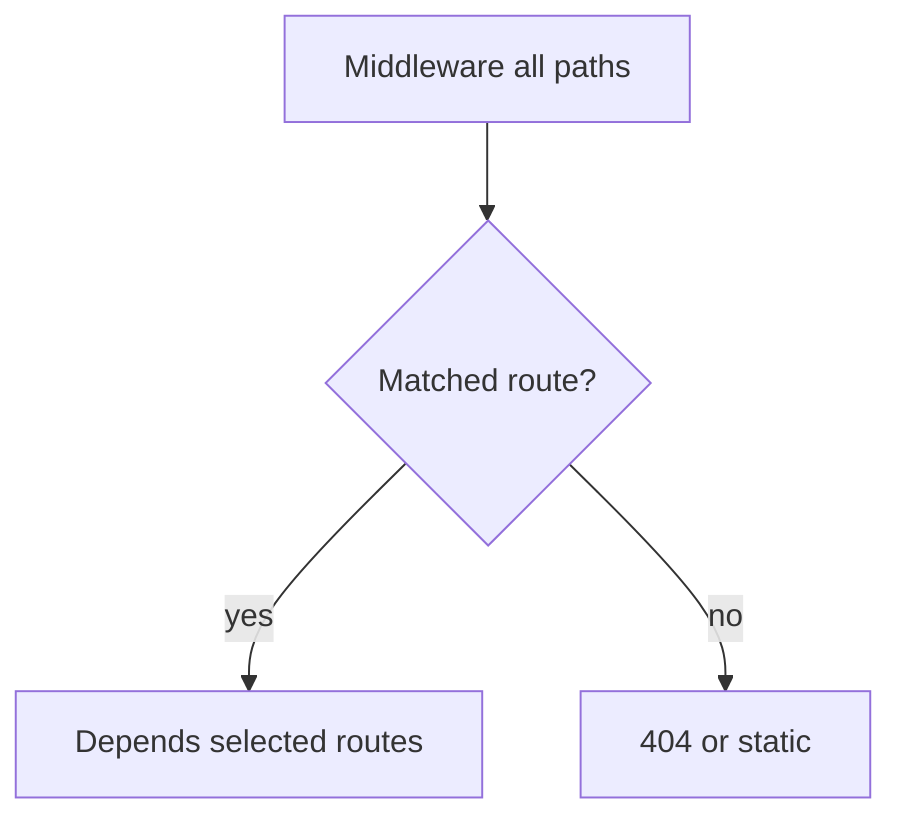

# Middleware versus Dependencies, Context, and Cost

## 1. Metadata and prerequisites

- Topic IDs: D17-T13 through D17-T17
- Domain: 17
- Difficulty: Advanced
- Prerequisites: D17-T04, D16-T18
- Learning objectives: Choose middleware vs DI, propagate context, and manage performance.
- Related topic IDs: D29-T05, D21-T20
- Estimated complexity: medium
- Completion status: DRAFT
- Verification: 2026-10-13. **UNVERIFIED**.

## 2. Introduction and fundamentals

### D17-T13 Middleware versus dependencies

**Definition.** Middleware wraps ASGI HTTP; dependencies inject values per endpoint.

**Mechanism.** Middleware sees all routes including `/docs`; dependencies run only when declared.

**Misconception.** Duplicate auth in both layers is harmless. It adds latency and drift risk.

**Production rule.** Pick one primary auth enforcement layer; use the other only for cross-cutting concerns (e.g., JWT parsing in dependency, request ID in middleware).

### D17-T14 Pure ASGI middleware versus decorator-style

**Definition.** Pure ASGI implements `async def __call__(scope, receive, send)`; `BaseHTTPMiddleware` offers simpler `dispatch`.

**Mechanism.** Pure ASGI avoids extra task overhead noted in Starlette docs for some workloads—confirm benchmarks yourself.

**Misconception.** `BaseHTTPMiddleware` is always fine at scale. Profile hot paths.

**Production rule.** Use pure ASGI for high-QPS simple transforms.

### D17-T15 Context propagation

**Definition.** Passing request-scoped values (user, trace ID) through call stacks without global state.

**Mechanism.** `contextvars.ContextVar` set in middleware or dependencies, read in services.

**Misconception.** Thread-local works in async. Prefer contextvars.

**Production rule.** Reset contextvars carefully across `asyncio` tasks.

### D17-T16 Request-scoped context

**Definition.** Context bound to the current request task chain.

**Mechanism.** Set in middleware early; dependencies and services read the same var within the request.

**Misconception.** Context propagates automatically to `BackgroundTasks`. It may not—pass explicit IDs.

**Production rule.** Pass IDs explicitly to background jobs.

### D17-T17 Middleware performance overhead

**Definition.** Extra latency and allocations per middleware layer.

**Mechanism.** Each `call_next` hop adds async continuation cost.

**Misconception.** More middleware is free observability. Cap layers; merge simple concerns.

**Production rule.** Budget middleware count; sample traces in staging.

## 3. Internal workings

Middleware chain executes before FastAPI routing; dependencies run only for matched routes with declared deps.

## 4. Architecture diagrams



## 5. Code and implementation

**UNVERIFIED:**

```python
from contextvars import ContextVar

from fastapi import FastAPI

request_id_ctx: ContextVar[str] = ContextVar("request_id", default="")
app = FastAPI()
```

## 6. API contracts

Context is internal; external contract remains HTTP headers.

## 7. Production considerations

Blocking inside middleware blocks the loop—same rule as endpoints.

## 8. Comparison and tradeoffs

| Concern | Middleware | Depends |
| --- | --- | --- |
| Request ID | yes | possible |
| Current user for OpenAPI | rare | yes |
| `/docs` coverage | yes | only if routed |

## 9. Debugging and troubleshooting

Missing context in service: set too late or different task.

## 10. Interview preparation

**Advanced.** Auth in middleware or Depends? **Model:** Depends for per-route OpenAPI security and testing overrides; middleware for universal IDs/CORS.

## 11. Exercises and mastery assessment

1. List three concerns for middleware only. 2. Implement ContextVar set in HTTP middleware. 3. Estimate cost of five middleware layers qualitatively.

**Mastery checklist:** MW vs DI; contextvars; performance awareness.

## 7. Production considerations (extended)

Limit middleware to concerns that truly apply to every path—or accept that `/docs` and health checks pay the same tax. For authentication, dependencies integrate with OpenAPI `security` and `dependency_overrides` in tests; middleware cannot be overridden per test as cleanly. Context variables must be set before any `await` that yields control if downstream code reads them in the same request.

## 10. Interview preparation (extended)

**Advanced.** When propagate trace IDs via middleware vs dependency? **Model answer:** middleware if every path including static and docs must have IDs; dependency if only business routes need enriched spans. **Incorrect answer:** “Always middleware for everything.”

## 11. Exercises and mastery assessment (extended)

4. Count async hops for `BaseHTTPMiddleware` with three layers—qualitative latency impact.  
5. Design: auth token parsing in middleware, user load in `Depends`—justify split.

## 8. Comparison and tradeoffs (extended)

| Layer | Sees WebSocket upgrade | Appears in OpenAPI security |
| --- | --- | --- |
| Middleware | yes | no |
| Depends | route-level | yes |

Pure ASGI middleware can short-circuit before routing (early 404/health) with minimal overhead; `BaseHTTPMiddleware` trades ergonomics for an extra task hop—profile if p99 matters.

**Revision summary.** Middleware is global and order-sensitive; dependencies are selective and testable—use each deliberately and avoid blocking the event loop in either layer.
