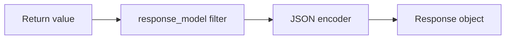

# Serialization and Response Classes

## 1. Metadata and prerequisites

- Topic IDs: D18-T01 through D18-T10
- Domain: 18, Response Handling
- Difficulty: Intermediate
- Prerequisites: D14-T03, D12-T04
- Learning objectives: Use `response_model`, status codes, and Starlette response classes.
- Related topic IDs: D19-T01, D23-T14
- Estimated complexity: medium
- Completion status: DRAFT
- Verification: 2026-10-13. **UNVERIFIED**.

## 2. Introduction and fundamentals

### D18-T01 Automatic response serialization

**Definition.** FastAPI converts return values to JSON responses when endpoints return models, dicts, or scalars.

**Mechanism.** Uses `jsonable_encoder` and optional `response_model` filtering.

**Misconception.** Any Python object serializes. Exotic types need custom encoders or explicit `Response`.

**Production rule.** Return explicit DTOs for public APIs.

### D18-T02 response_model

**Definition.** Declares the response schema and filters output fields.

**Mechanism.** Validates/constructs response model from return value; drops undeclared ORM attributes.

**Misconception.** `response_model` hides fields only in OpenAPI. It also filters runtime JSON.

**Production rule.** Mandatory on endpoints returning ORM entities; never leak password hashes.

### D18-T03 status_code

**Definition.** Route decorator `status_code=201` sets default success status.

**Mechanism.** Applied unless overridden by `Response` or `JSONResponse` with explicit status.

**Misconception.** Returning a dict changes status automatically. It does not without `status_code` or `Response`.

**Production rule.** Use `201` for creates, `204` for deletes without body—match Domain 3 semantics.

### D18-T04 JSONResponse

**Definition.** Starlette `JSONResponse` with explicit content and status.

**Mechanism.** Bypasses some automatic serialization paths when you need full control.

**Misconception.** Always prefer `JSONResponse`. Use plain returns when `response_model` suffices.

**Production rule.** Use for non-standard envelopes while keeping schema documented.

### D18-T05 Response

**Definition.** Base `Response` for raw bytes/headers.

**Mechanism.** Set `content`, `media_type`, `status_code`.

**Misconception.** `Response` runs `response_model`. Returning `Response` skips automatic model filtering—dangerous with secrets.

**Production rule.** Do not return raw ORM JSON via `Response` without manual filtering.

### D18-T06 RedirectResponse

**Definition.** HTTP redirect with `Location` header.

**Mechanism.** Status `307`/`308` for method-preserving redirects per policy.

**Misconception.** Redirects carry JSON bodies reliably. Avoid bodies on redirects.

**Production rule.** Use for canonical URL moves, not business errors.

### D18-T07 HTMLResponse

**Definition.** Serves HTML content type.

**Mechanism.** For tiny admin pages or OAuth callbacks—not typical JSON APIs.

**Misconception.** FastAPI is HTML-first. It is API-first; HTML is supported via Starlette.

**Production rule.** Separate HTML routes from JSON API routers.

### D18-T08 PlainTextResponse

**Definition.** `text/plain` responses.

**Mechanism.** Health simple text or webhook acknowledgments.

**Misconception.** Plain text skips charset. Set charset when non-ASCII.

**Production rule.** Prefer JSON for structured health details.

### D18-T09 StreamingResponse

**Definition.** Streams iterable/async iterable bodies.

**Mechanism.** Used for large downloads or generated content (D18-T19).

**Misconception.** Streaming bypasses `response_model`. True—document contract separately.

**Production rule.** Set cache and content headers appropriately.

### D18-T10 FileResponse

**Definition.** Efficient file serving with range support (Starlette).

**Mechanism.** Path or file-like with headers.

**Misconception.** FileResponse validates auth automatically. Protect route with dependencies.

**Production rule.** Validate paths to prevent traversal (Domain 10).

## 3. Internal workings

Handler return → optional response_model validation → encoder → Starlette response → middleware.

## 4. Architecture diagrams



## 5. Code and implementation

**UNVERIFIED:**

```python
from fastapi import FastAPI, status
from fastapi.responses import JSONResponse, PlainTextResponse, RedirectResponse
from pydantic import BaseModel

app = FastAPI()


class Item(BaseModel):
    id: int
    name: str


@app.post("/items", response_model=Item, status_code=status.HTTP_201_CREATED)
async def create_item() -> Item:
    return Item(id=1, name="a")


@app.get("/healthz")
async def healthz() -> PlainTextResponse:
    return PlainTextResponse("ok")


@app.get("/old")
async def old() -> RedirectResponse:
    return RedirectResponse(url="/new", status_code=status.HTTP_307_TEMPORARY_REDIRECT)
```

## 6. API contracts

Document response models in OpenAPI; streaming endpoints need prose docs.

## 7. Production considerations

`response_model` is a security control, not cosmetic.

## 8. Comparison and tradeoffs

Return model vs `JSONResponse`—model for standard CRUD.

## 9. Debugging and troubleshooting

Field still leaking: returning `Response` directly or `response_model=None`.

## 10. Interview preparation

**Intermediate.** How prevent ORM secret in JSON? **Model:** `response_model` DTO.

## 11. Exercises and mastery assessment

1. Add `201` create with `response_model`. 2. When use `StreamingResponse`? 3. Risk of skipping `response_model`.

**Mastery checklist:** response_model; status; response classes.

## 7. Production considerations (extended)

Default JSON encoding may be slower on huge payloads than specialized response classes—measure before adopting alternatives. When returning ORM objects, `response_model` is your last line of defense against leaking `password_hash` columns; never disable it for convenience. Status codes should follow RFC 9110 semantics: `204` responses must not include bodies clients rely on.

## 10. Interview preparation (extended)

**Scenario.** Handler returns `dict` with extra keys from SQL join. **Model answer:** without `response_model`, extra keys may be serialized—add a DTO. **Incorrect answer:** “FastAPI always strips unknown keys.”

## 11. Exercises and mastery assessment (extended)

4. Return `204` on delete with empty body.  
5. Compare `JSONResponse` versus `response_model=Item` for OpenAPI accuracy.

**Revision summary.** FastAPI serializes returns through `response_model` and Starlette response types—choose explicitly to avoid data leaks and document non-JSON responses separately.
