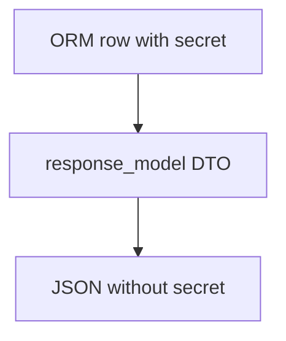

# Headers, Cookies, Status, and Field Filtering

## 1. Metadata and prerequisites

- Topic IDs: D18-T11 through D18-T16
- Domain: 18
- Difficulty: Intermediate
- Prerequisites: D18-T02, D07-T19
- Learning objectives: Set response headers/cookies securely; exclude fields from output.
- Related topic IDs: D20-T15, D27-T06
- Estimated complexity: medium
- Completion status: DRAFT
- Verification: 2026-10-13. **UNVERIFIED**.

## 2. Introduction and fundamentals

### D18-T11 Response headers

**Definition.** Headers communicate metadata (`Cache-Control`, `ETag`, `X-Request-ID`).

**Mechanism.** `Response(headers={...})` or `response.headers["key"] = value` on returned response objects.

**Misconception.** FastAPI adds security headers automatically. Add explicitly or at proxy.

**Production rule.** Set `Cache-Control` intentionally for API JSON.

### D18-T12 Cookies and cookie security

**Definition.** `set_cookie` on responses for session tokens.

**Mechanism.** Parameters `httponly`, `secure`, `samesite`—confirm Starlette API.

**Misconception.** HttpOnly prevents all XSS impact. It protects cookie theft; still validate CSRF.

**Production rule.** `Secure` in production; `SameSite=Lax` or `Strict` per flow.

### D18-T13 Response status codes

**Definition.** Explicit statuses via decorator, `JSONResponse(status_code=...)`, or `HTTPException`.

**Mechanism.** FastAPI maps exceptions to responses (Domain 19).

**Misconception.** `200` for failed business rules. Use `409`/`422`/`400` appropriately.

**Production rule.** `401` unauthenticated; `403` authenticated but forbidden—do not swap.

### D18-T14 Response model filtering

**Definition.** Subset of fields emitted compared to internal objects.

**Mechanism.** `response_model=PublicUser` with fewer fields than ORM row.

**Misconception.** Filtering happens only in Python memory but still sends extra fields. Filtering affects serialized output.

**Production rule.** Separate read models per audience (admin vs public).

### D18-T15 Excluding fields from output

**Definition.** `response_model_exclude`, `model_dump(exclude=...)`, or dedicated DTOs.

**Mechanism.** Prefer explicit DTOs over exclude lists that drift.

**Misconception.** `exclude_unset` removes secrets. It only omits unset fields, not sensitive set fields.

**Production rule.** Never rely on exclude alone for secrets—omit fields from schema.

### D18-T16 Custom response classes

**Definition.** Subclass `Response` for specialized content types.

**Mechanism.** Register media type and render method.

**Misconception.** Custom classes integrate with `response_model` automatically. Often manual.

**Production rule.** Use only when JSON defaults are insufficient.

## 3. Internal workings

Endpoint may return a `Response` subclass with headers/cookies already attached; otherwise FastAPI builds JSONResponse and applies `response_model`.

## 4. Architecture diagrams



## 5. Code and implementation

**UNVERIFIED:**

```python
from fastapi import FastAPI, Response
from pydantic import BaseModel

app = FastAPI()


class UserORM(BaseModel):
    id: int
    email: str
    password_hash: str


class UserPublic(BaseModel):
    id: int
    email: str


@app.get("/users/{user_id}", response_model=UserPublic)
async def get_user(user_id: int) -> UserORM:
    return UserORM(id=user_id, email="a@example.com", password_hash="hidden")


@app.post("/login")
async def login() -> Response:
    response = Response(content='{"ok":true}', media_type="application/json")
    response.set_cookie("session", "opaque-token", httponly=True, secure=True, samesite="lax")
    return response
```

## 6. API contracts

Document which cookies are set and their security attributes.

## 7. Production considerations

Align cookie auth with CSRF tokens for browser clients.

## 8. Comparison and tradeoffs

Header-based auth vs cookies—SPA patterns differ.

## 9. Debugging and troubleshooting

Cookie not set: `Secure` on http localhost—adjust for dev only.

## 10. Interview preparation

**Intermediate.** 401 vs 403? **Model:** missing/invalid auth vs valid auth denied.

## 11. Exercises and mastery assessment

1. Public DTO without hash field. 2. Set `Cache-Control: no-store` on `/me`. 3. Secure cookie flags list.

**Mastery checklist:** headers; secure cookies; filtering; status semantics.

## 8. Comparison and tradeoffs (extended)

Returning `404` versus `403` for unauthorized access to another user’s resource is a product decision: `404` obscures existence; `403` confirms the resource is there but forbidden. Document the policy consistently. `response_model_exclude` lists drift from models—prefer separate read DTOs for admin and public APIs.

## 10. Interview preparation (extended)

**Beginner.** Does `response_model` filter ORM attributes at runtime? **Model answer:** yes, undeclared fields are not serialized in the normal return path. **Incorrect answer:** “Only OpenAPI documentation.”

## 11. Exercises and mastery assessment (extended)

4. Set `Set-Cookie` with `Secure` and `HttpOnly` on login response.  
5. Add `Cache-Control: private, no-store` on authenticated reads.

## 7. Production considerations (extended)

Security headers (`X-Content-Type-Options`, `X-Frame-Options`) may be set at proxy or middleware—avoid duplicating conflicting values. When setting cookies for auth, pair with HTTPS termination and rotation policy. For APIs returning sensitive JSON, prefer `Cache-Control: no-store` on authenticated routes to prevent intermediary caching mistakes.

## 9. Debugging and troubleshooting (extended)

**Symptom:** `response_model` still exposes a field. **Cause:** returning `JSONResponse` manually with unfiltered dict. **Fix:** let FastAPI serialize from DTO or filter dict before `JSONResponse`.

**Revision summary.** Control headers, cookies, statuses, and `response_model` filtering to ship safe, intentional HTTP responses with correct 401/403 semantics.
