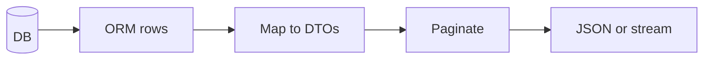

# Serialization Cost, ORM Safety, and Large Streams

## 1. Metadata and prerequisites

- Topic IDs: D18-T17, D18-T18, D18-T19
- Domain: 18
- Difficulty: Advanced
- Prerequisites: D18-T02, D22-T01
- Learning objectives: Optimize serialization, return ORM objects safely, stream large payloads.
- Related topic IDs: D09-T15, D28-T09
- Estimated complexity: high
- Completion status: DRAFT
- Verification: 2026-10-13. **UNVERIFIED**.

## 2. Introduction and fundamentals

### D18-T17 Response serialization performance

**Definition.** Cost to validate and encode responses, especially large lists.

**Mechanism.** `response_model` adds validation pass; `model_dump` per item in lists.

**Misconception.** FastAPI JSON is free. Large collections dominate CPU.

**Production rule.** Paginate collections; consider `ORJSONResponse` where appropriate—confirm compatibility in docs.

### D18-T18 Returning ORM objects safely

**Definition.** Map ORM instances to Pydantic read models before responding.

**Mechanism.** `UserRead.model_validate(orm_obj, from_attributes=True)` in service or `response_model` with `from_attributes` config on model.

**Misconception.** `from_attributes` means all columns are safe. Still filter via response DTO.

**Production rule.** Never return lazy-loaded relations unintentionally—watch N+1 (Domain 9).

### D18-T19 Streaming large responses

**Definition.** Send bodies incrementally with `StreamingResponse` or async generators.

**Mechanism.** Starlette iterates chunks; client downloads progressively.

**Misconception.** Streaming skips timeouts. Proxies still timeout slow streams.

**Production rule.** Set reasonable proxy read timeouts; monitor backpressure (Domain 21).

## 3. Internal workings

ORM → service maps to DTO list → optional pagination → `response_model` validation → JSON encoder or stream iterator.

## 4. Architecture diagrams



## 5. Code and implementation

**UNVERIFIED:**

```python
from collections.abc import AsyncIterator

from fastapi import FastAPI
from fastapi.responses import StreamingResponse
from pydantic import BaseModel, ConfigDict

app = FastAPI()


class Row(BaseModel):
    model_config = ConfigDict(from_attributes=True)
    id: int
    value: str


async def big_csv() -> AsyncIterator[bytes]:
    yield b"id,value\n"
    for i in range(3):
        yield f"{i},x\n".encode()


@app.get("/export.csv")
async def export_csv() -> StreamingResponse:
    return StreamingResponse(big_csv(), media_type="text/csv")
```

## 6. API contracts

Streaming endpoints should document content type and chunk format.

## 7. Production considerations

Measure p95 serialization time on representative list endpoints.

## 8. Comparison and tradeoffs

Buffered JSON vs streaming—streaming for exports, JSON for typical APIs.

## 9. Debugging and troubleshooting

Huge responses: missing pagination or accidental eager load of relations.

## 10. Interview preparation

**Advanced.** Safe ORM return pattern? **Model:** `response_model` read DTO with `from_attributes`, exclude secrets.

## 11. Exercises and mastery assessment

1. Paginate list endpoint. 2. Stream CSV generator. 3. Explain double validation cost of `response_model` on large lists.

**Mastery checklist:** perf awareness; ORM DTO mapping; streaming.

## 7. Production considerations (extended)

`response_model` validation on lists of thousands of rows can dominate request time—paginate before validation or validate a page DTO only. Streaming exports should run with auth dependencies and rate limits; otherwise they become a cheap DoS vector. When using `from_attributes=True`, eager-load only what the DTO needs to avoid N+1 queries during serialization.

## 9. Debugging and troubleshooting (extended)

**Symptom:** memory grows during large GET. **Cause:** loading entire table into ORM objects before pagination. **Fix:** limit/query at database; stream if appropriate.

## 10. Interview preparation (extended)

**Advanced.** When is streaming inappropriate? **Model answer:** when clients need atomic JSON documents, small payloads, or when intermediaries buffer entire responses—confirm proxy behavior.

## 11. Exercises and mastery assessment (extended)

4. Add pagination query params to a list endpoint.  
5. Map ORM row to `ItemRead` with `model_validate(..., from_attributes=True)` in service layer.

## 8. Comparison and tradeoffs (extended)

| Strategy | Memory | Client complexity |
| --- | --- | --- |
| Paginated JSON | low | must follow pages |
| Full JSON list | high | simple |
| Streaming CSV | medium | must handle chunks |

ORM lazy loads during `model_validate` can trigger N+1—eager load in repository when building DTOs.

## 6. API contracts (extended)

Document maximum page size and streaming rate limits in human-readable API guides, not only code.

## 10. Interview preparation (extended)

**Intermediate.** Why paginate before `response_model` validation? **Model answer:** reduces CPU spent validating rows clients will never see and caps memory for ORM instances. **Incorrect answer:** “Pagination is only for UI.”

**Revision summary.** Paginate and DTO-map ORM data; stream when responses exceed memory or time budgets; measure serialization cost on hot list endpoints and guard streams with auth and limits.
