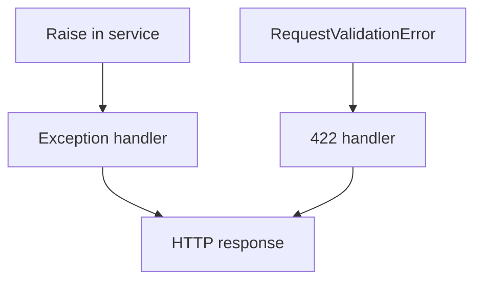

# HTTPException, Validation Errors, and Handlers

## 1. Metadata and prerequisites

- Topic IDs: D19-T01 through D19-T07
- Domain: 19, Error Handling and Validation
- Difficulty: Intermediate
- Prerequisites: D13-T18, D03-T15
- Learning objectives: Raise `HTTPException`, handle `RequestValidationError`, map domain and DB errors.
- Related topic IDs: D05-T18, D22-T21
- Estimated complexity: medium
- Completion status: DRAFT
- Verification: RFC 9457 optional; default 422 for validation 2026-10-13. **UNVERIFIED**.

## 2. Introduction and fundamentals

### D19-T01 HTTPException

**Definition.** FastAPI/Starlette exception carrying `status_code`, `detail`, and optional headers.

**Mechanism.** Raised in endpoints/dependencies; default handler converts to JSON `{"detail": ...}`.

**Misconception.** `HTTPException` is for business logic everywhere. Prefer domain exceptions mapped centrally for consistency.

**Production rule.** Use stable `detail` shapes; avoid leaking internals in `detail`.

### D19-T02 Request validation errors

**Definition.** Client payload or parameter fails Pydantic validation before handler runs.

**Mechanism.** Becomes `RequestValidationError`; default status `422`.

**Misconception.** Change validation failures to `400` without client coordination. Many clients expect `422` in FastAPI ecosystems.

**Production rule.** Keep `422` for shape errors unless your org standardizes otherwise document-wide.

### D19-T03 Custom exception classes

**Definition.** Application-specific exceptions (`OrderNotFound`, `InsufficientFunds`).

**Mechanism.** Raised in services; registered handlers map to HTTP status and problem JSON.

**Misconception.** Custom exceptions should inherit `HTTPException` only. Separate domain from transport.

**Production rule.** One handler per exception family with logging context.

### D19-T04 Global exception handlers

**Definition.** `@app.exception_handler(ExceptionType)` centralizes responses.

**Mechanism.** Overrides defaults for listed types; order matters for subclasses.

**Misconception.** Handlers run in arbitrary order. Register specific types before generic `Exception`.

**Production rule.** Generic `Exception` handler returns `500` without stack trace body.

### D19-T05 RequestValidationError

**Definition.** Wrapper exposing `.errors()` list with `loc`, `msg`, `type`.

**Mechanism.** Import from `fastapi.exceptions`; used in custom 422 handlers.

**Misconception.** Validation errors should include server file paths. Never include stack traces.

**Production rule.** Log full validation server-side at debug; return client-safe JSON.

### D19-T06 Domain exceptions

**Definition.** Errors reflecting business rules, not transport.

**Mechanism.** Map `OrderNotFound` → `404`, conflict → `409`.

**Misconception.** Map everything to `400`. Use precise 4xx codes (Domain 3).

**Production rule.** Distinguish not found from forbidden: missing resource `404`; existing but not allowed `403`.

### D19-T07 Database exception mapping

**Definition.** Translate integrity errors, deadlocks, and connectivity failures to HTTP.

**Mechanism.** Catch SQLAlchemy/driver exceptions in handler or repository boundary.

**Misconception.** Expose DB error text to clients. Log internally; return generic message with trace ID.

**Production rule.** Unique violations → `409`; connection errors → `503` with retry guidance.

## 3. Internal workings

Exception propagates up from endpoint/dependency → matching handler → JSON response → middleware may add headers.

## 4. Architecture diagrams



## 5. Code and implementation

**UNVERIFIED:**

```python
from fastapi import FastAPI, HTTPException, Request, status
from fastapi.exceptions import RequestValidationError
from fastapi.responses import JSONResponse

app = FastAPI()


class OrderNotFoundError(Exception):
    def __init__(self, order_id: int) -> None:
        self.order_id = order_id


@app.exception_handler(OrderNotFoundError)
async def order_not_found(_: Request, exc: OrderNotFoundError) -> JSONResponse:
    return JSONResponse(
        status_code=status.HTTP_404_NOT_FOUND,
        content={"title": "Order not found", "order_id": exc.order_id},
    )


@app.exception_handler(RequestValidationError)
async def validation_error(_: Request, exc: RequestValidationError) -> JSONResponse:
    return JSONResponse(status_code=422, content={"errors": exc.errors()})


@app.get("/orders/{order_id}")
async def get_order(order_id: int) -> dict[str, int]:
    if order_id < 1:
        raise HTTPException(status_code=400, detail="invalid id")
    raise OrderNotFoundError(order_id)
```

## 6. API contracts

| Error | Status |
| --- | --- |
| Validation | `422` |
| Not authenticated | `401` |
| Forbidden | `403` |
| Domain not found | `404` |

## 7. Production considerations

Unhandled exceptions must not return stack traces to clients (D19-T11).

## 8. Comparison and tradeoffs

`HTTPException` in route vs domain exceptions—domain scales better.

## 9. Debugging and troubleshooting

Handler not firing: exception type mismatch or not registered on same app instance tests use.

## 10. Interview preparation

**Intermediate.** Default validation status? **Model:** `422`. **Wrong:** `400` by default in FastAPI.

## 11. Exercises and mastery assessment

1. Map custom domain error to 409. 2. Custom 422 body with RFC 9457 fields. 3. 404 vs 403 for hidden resource.

**Mastery checklist:** HTTPException; handlers; validation; domain mapping.

## 7. Production considerations (extended)

Register handlers on the same `FastAPI` instance that `TestClient` uses in tests. For `HTTPException`, avoid putting internal exception messages from third-party libraries into `detail`. Map database unique violations to `409` with a stable code clients can branch on. Remember unhandled exceptions must not return stack traces to callers—only structured `500` bodies with `trace_id` (Domain 19 chapter 2).

## 10. Interview preparation (extended)

**Scenario.** Client sends invalid JSON field type. **Model answer:** `RequestValidationError` → `422`, not `HTTPException(400)` unless you intentionally customize. **Incorrect answer:** “Return 500 because server could not understand.”

## 11. Exercises and mastery assessment (extended)

4. Handler mapping `PermissionError` to `403`.  
5. Explain why domain exceptions should not inherit `HTTPException`.

**Revision summary.** Central handlers translate validation (`422`), domain, and DB errors into safe HTTP responses without stack traces or driver-specific text.
