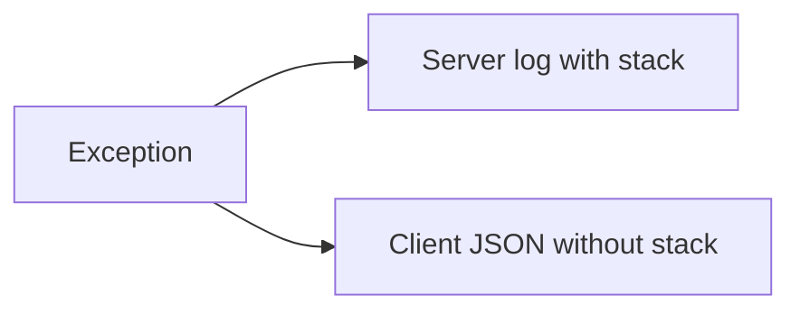

# Error Schemas, Status Selection, and Safe Logging

## 1. Metadata and prerequisites

- Topic IDs: D19-T08 through D19-T13
- Domain: 19
- Difficulty: Advanced
- Prerequisites: D05-T18, D19-T04
- Learning objectives: Standardize error JSON, pick statuses, log safely.
- Related topic IDs: D10-T19, D27-T19
- Estimated complexity: medium
- Completion status: DRAFT
- Verification: RFC 9457 Problem Details 2026-10-13. **UNVERIFIED**.

## 2. Introduction and fundamentals

### D19-T08 Consistent error schemas

**Definition.** All errors share fields (`type`, `title`, `status`, `detail`, `instance`).

**Mechanism.** RFC 9457 Problem Details for HTTP APIs.

**Misconception.** `{"detail": "..."}` alone scales for clients. Add stable machine codes.

**Production rule.** Version error schema; document in OpenAPI `responses`.

### D19-T09 Error codes and trace IDs

**Definition.** Machine-readable `code` plus server `trace_id` for support correlation.

**Mechanism.** Middleware sets `trace_id`; handlers include it in problem JSON.

**Misconception.** Trace IDs should be sequential integers. Use opaque UUIDs.

**Production rule.** Log `trace_id` with exception stack server-side only.

### D19-T10 Correct HTTP status code selection

**Definition.** Match semantics in RFC 9110: auth, validation, conflict, server fault.

**Mechanism.** Decision table per error type.

**Misconception.** `500` for all server-side business failures. Use `409`/`422` when client-relevant.

**Production rule.** `401` vs `403`: unauthenticated vs authenticated but not permitted; ownership failures are often `403`, not `404`, when hiding existence is a product choice—document policy.

### D19-T11 Avoiding internal stack-trace leakage

**Definition.** Clients never receive Python tracebacks or SQL text.

**Mechanism.** Generic `500` body; full trace in logs/metrics.

**Misconception.** Debug mode in prod is acceptable briefly. It is not.

**Production rule.** Disable debug flags; test error responses in CI for substring leaks.

### D19-T12 Logging exceptions

**Definition.** Structured error logs with context, not response bodies.

**Mechanism.** `logger.exception` in generic handler with `trace_id`, user id hashed if needed.

**Misconception.** Return log message to client. Separate channels.

**Production rule.** Redact PII and secrets from logs (Domain 29).

### D19-T13 Handling unexpected exceptions

**Definition.** Catch-all for `Exception` not mapped elsewhere.

**Mechanism.** Return `500` problem JSON; increment metric; alert on rate.

**Misconception.** Re-raise after logging to let Uvicorn print traceback to client. Handle and return safe JSON.

**Production rule.** Pair with error reporting service; never echo exception class names that reveal library versions to untrusted clients unless intentional.

## 3. Internal workings

Unhandled exception → generic handler → metric + log with stack → sanitized JSON.

## 4. Architecture diagrams



## 5. Code and implementation

**UNVERIFIED:**

```python
import logging
import uuid

from fastapi import FastAPI, Request
from fastapi.responses import JSONResponse

logger = logging.getLogger(__name__)
app = FastAPI()


@app.exception_handler(Exception)
async def unhandled(request: Request, exc: Exception) -> JSONResponse:
    trace_id = str(uuid.uuid4())
    logger.exception("unhandled error trace_id=%s path=%s", trace_id, request.url.path)
    return JSONResponse(
        status_code=500,
        content={
            "type": "about:blank",
            "title": "Internal Server Error",
            "status": 500,
            "detail": "An unexpected error occurred.",
            "trace_id": trace_id,
        },
    )
```

## 6. API contracts

Document problem schema for 4xx/5xx in OpenAPI components.

## 7. Production considerations

Align `401`/`WWW-Authenticate` for bearer APIs where applicable.

## 8. Comparison and tradeoffs

Verbose errors help devs hurt attackers—environment-specific handlers via settings.

## 9. Debugging and troubleshooting

Clients see generic 500: use `trace_id` to find log stack.

## 10. Interview preparation

**Advanced.** Should 500 body include exception message? **Model:** no for untrusted clients.

## 11. Exercises and mastery assessment

1. RFC 9457 payload for 403 ownership denial. 2. Add trace_id middleware integration. 3. Test no `Traceback` substring in response.

**Mastery checklist:** problem details; trace ids; no leakage; logging.

## 8. Comparison and tradeoffs (extended)

Verbose 4xx messages help API consumers during integration; they also assist attackers probing IDs. Balance with generic messages for unauthenticated callers and detailed messages for authenticated developers behind a portal. RFC 9457 `type` URIs should be stable permalinks your organization controls, not random strings per deploy.

## 10. Interview preparation (extended)

**Beginner.** 401 vs 403 in one line each? **Model answer:** `401` missing/invalid authentication; `403` authenticated but not allowed to perform the action or access the object. **Incorrect answer:** “403 means not logged in.”

## 11. Exercises and mastery assessment (extended)

4. Write problem JSON for ownership denial without naming the owner user id.  
5. Add CI assertion that `500` responses never contain the substring `Traceback`.

**Revision summary.** Stable problem JSON, correct statuses (especially 401/403), traceable logs, and zero stack traces in production responses.
