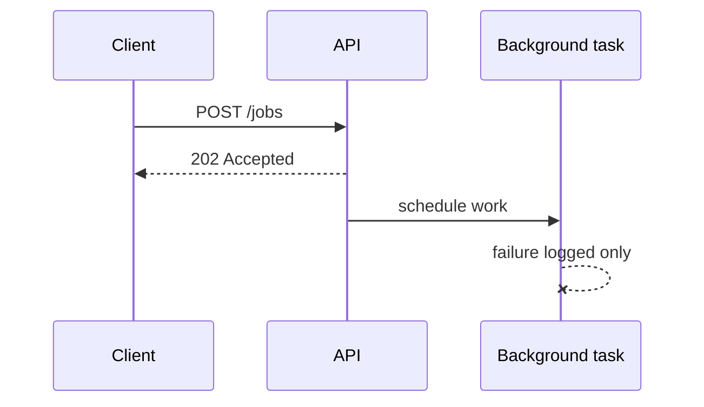

# Errors in Background and Async Workflows

## 1. Metadata and prerequisites

- Topic IDs: D19-T14, D19-T15
- Domain: 19
- Difficulty: Advanced
- Prerequisites: D19-T04, D24-T03
- Learning objectives: Handle failures in `BackgroundTasks` and async workflows outside the request handler return path.
- Related topic IDs: D21-T17, D24-T02
- Estimated complexity: medium
- Completion status: DRAFT
- Verification: BackgroundTasks error behavior—confirm FastAPI docs 2026-10-13. **UNVERIFIED**.

## 2. Introduction and fundamentals

### D19-T14 Error handling in background tasks

**Definition.** `BackgroundTasks` schedules callables after the response is sent.

**Mechanism.** FastAPI runs tasks on the same event loop after response; exceptions may log as task failures without changing HTTP status already returned.

**Misconception.** Clients learn background failures via the HTTP response they already got. They do not—use job status stores or queues.

**Production rule.** Do not rely on `BackgroundTasks` for critical work; use durable queues (Domain 24). Wrap tasks with try/except and metrics.

### D19-T15 Error handling in asynchronous workflows

**Definition.** Errors in `asyncio` tasks, SSE streams, and async generators started during a request.

**Mechanism.** Exceptions may surface mid-stream or after disconnect; cancellation propagates as `CancelledError`.

**Misconception.** Async exceptions always hit global HTTP handlers. Only errors during request handling do; detached tasks need their own handlers.

**Production rule.** Use supervision patterns: log, retry with policy, dead-letter for async jobs; never block event loop in recovery.

## 3. Internal workings

Response `200` returns → background task runs → uncaught exception logs → no automatic client notification.

## 4. Architecture diagrams



## 5. Code and implementation

**UNVERIFIED:**

```python
import logging

from fastapi import BackgroundTasks, FastAPI

logger = logging.getLogger(__name__)
app = FastAPI()


def send_email(to: str) -> None:
    try:
        raise RuntimeError("smtp down")
    except Exception:
        logger.exception("background email failed to=%s", to)


@app.post("/notify", status_code=202)
async def notify(to: str, tasks: BackgroundTasks) -> dict[str, str]:
    tasks.add_task(send_email, to)
    return {"status": "accepted"}
```

## 6. API contracts

Return `202` when work is async; expose polling webhook or status URL for outcomes.

## 7. Production considerations

Idempotent background handlers; duplicate delivery possible.

## 8. Comparison and tradeoffs

| Mechanism | Durability | Client feedback |
| --- | --- | --- |
| BackgroundTasks | low | none |
| Queue worker | high | job status API |

## 9. Debugging and troubleshooting

Silent failures: check logs after response; add metrics on task exceptions.

## 10. Interview preparation

**Intermediate.** Background task raises—what does client see? **Model:** already returned response; error logged unless you designed status tracking.

## 11. Exercises and mastery assessment

1. Wrap background task with logging metric. 2. Design job status endpoint for failures. 3. Why not email from BackgroundTasks at scale?

**Mastery checklist:** post-response errors; async supervision.

## 7. Production considerations (extended)

`BackgroundTasks` share the worker event loop—long tasks block other requests unless offloaded. For AI or agent workflows (Domain 31), assume clients disconnect while work continues; persist job state externally. Async task exceptions should increment a `background_failures` metric and optionally alert when rates exceed SLOs. Never assume `yield` dependency cleanup covers work spawned into detached `asyncio.create_task` without awaiting.

## 10. Interview preparation (extended)

**Advanced.** User receives `202 Accepted` then work fails. How do they know? **Model answer:** design a status resource, webhook, or polling contract—HTTP response already completed. **Incorrect answer:** “Change response to 500 retroactively.”

## 11. Exercises and mastery assessment (extended)

4. Propose job table fields: `id`, `status`, `error_code`, `trace_id`.  
5. Compare Celery retry to BackgroundTasks for payment capture.

## 8. Comparison and tradeoffs (extended)

In-process `BackgroundTasks` minimize infrastructure but maximize coupling to API process lifetime—when the worker restarts, queued tasks vanish. External queues add operational cost but provide retries, dead-letter queues, and visibility dashboards essential for payments and notifications.

## 6. API contracts (extended)

If you return `202`, document the `Location` or `status_url` field in OpenAPI `responses` so clients know how to observe failures that occur after the HTTP transaction completes.

## 10. Interview preparation (extended)

**Beginner.** Does a global exception handler catch BackgroundTasks errors? **Model answer:** generally no—the HTTP response path already completed; tasks need local try/except. **Incorrect answer:** “Yes, same handler returns 500 to the client.”

**Revision summary.** Errors after the response need their own logging, metrics, and durable workflows—HTTP exception handlers do not save background failures.
