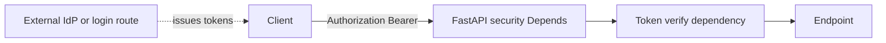

# FastAPI Security Schemes

## 1. Metadata and prerequisites

- Topic IDs: D20-T01 through D20-T05
- Domain: 20, Authentication and Authorization in FastAPI
- Difficulty: Intermediate
- Prerequisites: D07-T06, D16-T08
- Learning objectives: Declare OpenAPI security schemes and extract credentials with FastAPI security utilities.
- Related topic IDs: D12-T13, D19-T10
- Estimated complexity: medium
- Completion status: DRAFT
- Verification: FastAPI security module as of 2026-10-13. **UNVERIFIED**.

## 2. Introduction and fundamentals

### D20-T01 OAuth2PasswordBearer

**Definition.** `OAuth2PasswordBearer` is a FastAPI helper that declares an OAuth2 password-flow **security scheme** in OpenAPI and extracts a bearer token from the `Authorization` header.

**Mechanism.** `tokenUrl` documents where clients obtain tokens in the schema; `Depends(oauth2_scheme)` returns the token string or raises `401` if missing.

**Misconception.** Using `OAuth2PasswordBearer` makes your app an OAuth 2.0 authorization server. **It does not.** FastAPI only documents and parses the bearer token. You must implement token issuance, storage, rotation, and consent elsewhere (or integrate an external IdP).

**Production rule.** Treat `OAuth2PasswordBearer` as “bearer token extractor + OpenAPI metadata,” not as a complete OAuth server.

### D20-T02 OAuth2PasswordRequestForm

**Definition.** A form model for the username/password fields used in the password grant **shape** (`username`, `password`, optional `scope`).

**Mechanism.** Used on a login route accepting `application/x-www-form-urlencoded` to validate credentials and return tokens you mint.

**Misconception.** The form performs authentication by itself. Your code must verify passwords and issue tokens.

**Production rule.** Rate-limit login; hash passwords (D20-T07); never log submitted passwords.

### D20-T03 HTTP Bearer authentication

**Definition.** `HTTPBearer` extracts `Authorization: Bearer <token>` for APIs using opaque or JWT access tokens.

**Mechanism.** Returns `HTTPAuthorizationCredentials` with `.scheme` and `.credentials`.

**Misconception.** Bearer means “no validation needed.” You must validate the token on every protected route.

**Production rule.** Combine `HTTPBearer` with verification dependency; return `401` for invalid/expired tokens.

### D20-T04 API key security schemes

**Definition.** `APIKeyHeader`, `APIKeyQuery`, or `APIKeyCookie` document and extract API keys.

**Mechanism.** Keys appear in OpenAPI `apiKey` security; dependency returns key string.

**Misconception.** API keys in query strings are private. They leak via logs and referrers—prefer headers.

**Production rule.** Scope keys per tenant; rotate and revoke; rate limit by key.

### D20-T05 Basic authentication

**Definition.** `HTTPBasic` decodes Base64 `username:password` from the `Authorization` header.

**Mechanism.** Returns credentials object; constant-time compare for passwords if you implement verification.

**Misconception.** Basic auth is fine over HTTP. It is not—use only over TLS and prefer tokens for APIs.

**Production rule.** Avoid Basic for public internet APIs except legacy bridges; prefer bearer tokens.

## 3. Internal workings

Security scheme dependency runs in the dependency graph before the endpoint. Missing credentials → `403` or `401` depending on scheme auto-error settings—verify `auto_error` behavior in docs. Authentication is separate from authorization checks on the resource.

## 4. Architecture diagrams



Note: FastAPI sits on the verify path, not as the IdP.

## 5. Code and implementation

**UNVERIFIED:**

```python
from fastapi import Depends, FastAPI
from fastapi.security import HTTPAuthorizationCredentials, HTTPBearer, OAuth2PasswordBearer

app = FastAPI()
oauth2_scheme = OAuth2PasswordBearer(tokenUrl="/token", auto_error=True)
bearer = HTTPBearer(auto_error=True)


async def get_token(oauth_token: str = Depends(oauth2_scheme)) -> str:
    return oauth_token


@app.get("/protected")
async def protected(token: str = Depends(get_token)) -> dict[str, str]:
    return {"token_prefix": token[:6]}


@app.get("/alt")
async def alt(creds: HTTPAuthorizationCredentials = Depends(bearer)) -> dict[str, str]:
    return {"scheme": creds.scheme}
```

## 6. API contracts

| Route | Auth | Failure |
| --- | --- | --- |
| `/protected` | Bearer (OAuth2 scheme) | `401` if missing |
| `/token` | Form login (you implement) | `401` invalid creds |

```bash
curl -sS -H "Authorization: Bearer change-me" "http://127.0.0.1:8000/protected"
```

## 7. Production considerations

Explicitly document that `OAuth2PasswordBearer` is not an authorization server. Integrate real OAuth/OIDC providers for enterprise SSO (D20-T16, D20-T17).

## 8. Comparison and tradeoffs

| Scheme | Use |
| --- | --- |
| OAuth2PasswordBearer | SPA/mobile password login + bearer APIs |
| HTTPBearer | Generic JWT/opaque tokens |
| API key | service-to-service automation |

## 9. Debugging and troubleshooting

Swagger “Authorize” sends bearer but route still 401: verification dependency rejects token.

## 10. Interview preparation

**Intermediate.** What does `OAuth2PasswordBearer` do? **Model:** extracts bearer token and declares OpenAPI security; **not** a full OAuth server. **Wrong:** “implements OAuth server.”

## 11. Exercises and mastery assessment

1. Add `HTTPBearer` route. 2. Write one sentence for docs clarifying FastAPI is not an IdP. 3. API key in header vs query tradeoff.

**Mastery checklist:** schemes vs verification; OAuth2PasswordBearer limits.

**Revision summary.** Security scheme classes wire OpenAPI and extract credentials; token issuance and OAuth server duties stay in your login service or external IdP.
