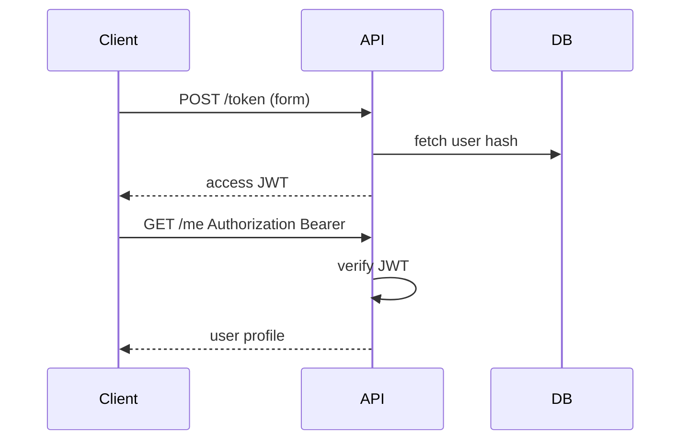

# JWT, Password Hashing, and Current User

## 1. Metadata and prerequisites

- Topic IDs: D20-T06 through D20-T10
- Domain: 20
- Difficulty: Advanced
- Prerequisites: D07-T07, D20-T01
- Learning objectives: Mint and verify JWTs, hash passwords, model token expiry and refresh, expose `get_current_user`.
- Related topic IDs: D07-T16, D26-T07
- Estimated complexity: high
- Completion status: DRAFT
- Verification: Use maintained crypto libraries; no secrets in examples 2026-10-13. **UNVERIFIED**.

## 2. Introduction and fundamentals

### D20-T06 JWT creation and verification

**Definition.** JSON Web Tokens are signed (or MAC’d) compact claims used as access tokens.

**Mechanism.** Login issues JWT with claims (`sub`, `exp`, `aud`); dependencies decode with secret/public key and validate signature and time.

**Misconception.** JWTs are encrypted by default. They are signed, often readable—do not put secrets in payload.

**Production rule.** Validate `exp`, `iss`, `aud`; use asymmetric keys for multi-service verification when possible.

### D20-T07 Password hashing

**Definition.** Store password verifiers with slow hashes (bcrypt, argon2, scrypt), never plaintext.

**Mechanism.** On register, `hash(password)`; on login, `verify(password, hash)`.

**Misconception.** FastAPI hashes passwords automatically. You must call a hashing library.

**Production rule.** Use established algorithms via `passlib` or direct argon2/bcrypt APIs; pepper secrets via KMS if required.

### D20-T08 Access-token expiry

**Definition.** Short-lived access tokens limit exposure when leaked.

**Mechanism.** Set `exp` claim minutes to hours; reject expired tokens with `401`.

**Misconception.** Long-lived JWTs remove need for refresh. They increase replay window.

**Production rule.** Keep access tokens short; pair with refresh strategy or session revocation list for sensitive apps.

### D20-T09 Refresh-token strategies

**Definition.** Refresh tokens obtain new access tokens without re-entering password.

**Mechanism.** Store refresh tokens hashed server-side or rotate refresh tokens per use; bind to client/device where possible.

**Misconception.** Refresh tokens can live in localStorage without risk. Treat like secrets; prefer HttpOnly cookies for browser apps with CSRF defenses.

**Production rule.** Separate refresh endpoint; revoke on logout; detect reuse.

### D20-T10 Current-user dependencies

**Definition.** `get_current_user` dependency maps validated token to a user model/principal.

**Mechanism.** Chain `Depends(oauth2_scheme)` → decode JWT → load user → return `User` or raise `401`.

**Misconception.** Current user implies permission to mutate any resource. Still need object-level checks (D20-T13).

**Production rule.** Authentication dependency returns identity only; authorization happens per resource.

## 3. Internal workings

Login: verify password hash → issue tokens. Request: extract bearer → verify JWT → load user → endpoint → optional ownership check in service.

## 4. Architecture diagrams



## 5. Code and implementation

**UNVERIFIED** — illustrative only; wire real libraries in production:

```python
from datetime import datetime, timedelta, timezone
from typing import Any

from fastapi import Depends, FastAPI, HTTPException, status
from fastapi.security import OAuth2PasswordBearer, OAuth2PasswordRequestForm
from pydantic import BaseModel, ConfigDict

app = FastAPI()
oauth2_scheme = OAuth2PasswordBearer(tokenUrl="/token")


class User(BaseModel):
    model_config = ConfigDict(extra="forbid")
    id: int
    username: str


def fake_verify_password(plain: str, hashed: str) -> bool:
    return plain == "not-used-in-prod"


def fake_create_access_token(subject: str, minutes: int = 30) -> str:
    _ = datetime.now(tz=timezone.utc) + timedelta(minutes=minutes)
    return f"fake-token-for-{subject}"


async def get_current_user(token: str = Depends(oauth2_scheme)) -> User:
    if not token.startswith("fake-token-for-"):
        raise HTTPException(status_code=status.HTTP_401_UNAUTHORIZED, detail="Invalid token")
    username = token.removeprefix("fake-token-for-")
    return User(id=1, username=username)


@app.post("/token")
async def login(form: OAuth2PasswordRequestForm = Depends()) -> dict[str, str]:
    if not fake_verify_password(form.password, "stored-hash"):
        raise HTTPException(status_code=401, detail="Incorrect username or password")
    access = fake_create_access_token(form.username)
    return {"access_token": access, "token_type": "bearer"}


@app.get("/me", response_model=User)
async def me(current: User = Depends(get_current_user)) -> User:
    return current
```

## 6. API contracts

| Endpoint | Auth | Success |
| --- | --- | --- |
| POST `/token` | none | `200` + bearer token |
| GET `/me` | Bearer | `200` User or `401` |

## 7. Production considerations

Never commit signing keys; rotate keys with overlap. `response_model` on `/me` excludes internal fields.

## 8. Comparison and tradeoffs

Opaque server tokens vs JWT: JWT scales verification; opaque simplifies revocation.

## 9. Debugging and troubleshooting

401 after login: clock skew on `exp`; wrong `aud`/`iss`.

## 10. Interview preparation

**Advanced.** Where hash passwords? **Model:** registration/login service, not in Pydantic models alone.

## 11. Exercises and mastery assessment

1. Chain `get_current_user` on write route. 2. List JWT claims to validate. 3. Why refresh tokens?

**Mastery checklist:** hash; JWT verify; current user dep.

**Revision summary.** Login hashes passwords and issues tokens; dependencies verify tokens and yield principals—authorization remains separate.
