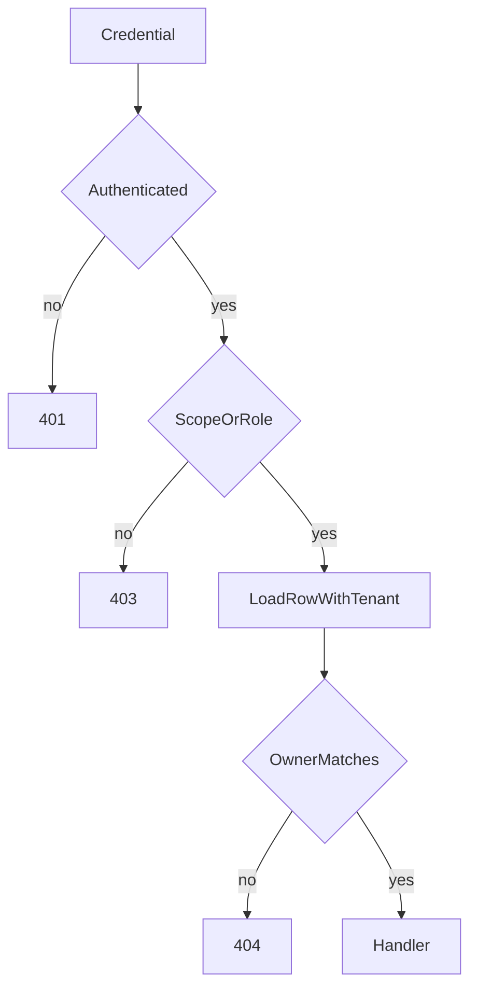
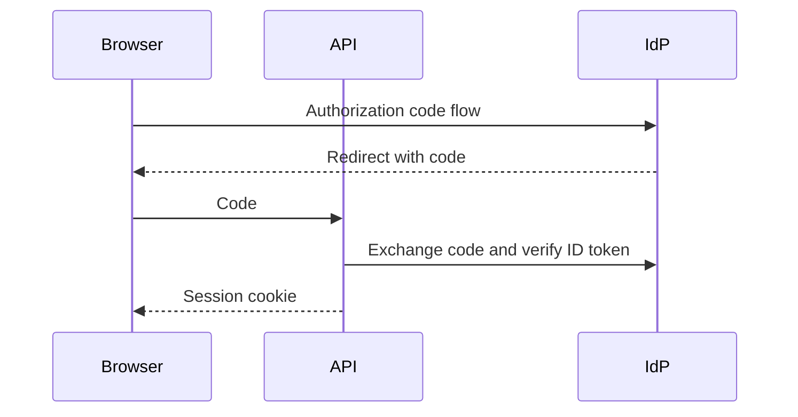

# Roles, Scopes, Ownership, Tenancy, Cookies, and OIDC

## 1. Metadata and prerequisites

- Topic IDs: D20-T11, D20-T12, D20-T13, D20-T14, D20-T15, D20-T16, D20-T17
- Domain: 20, Authentication and Authorization in FastAPI
- Difficulty: Advanced
- Prerequisites: D07-T11, D07-T14, D20-T01, D20-T10
- Learning objectives:
  - Enforce roles, scopes, and object ownership as separate checks.
  - Isolate tenants on every query.
  - Explain cookie authentication and what an OIDC integration actually verifies.
- Related topic IDs: D10-T02, D27-T02, D27-T07
- Estimated complexity: high
- Completion status: TECHNICALLY_REVIEWED
- Verification: FastAPI security utilities described from current public docs as of 2026-10-13. Snippets are unverified.

## 2. Introduction and fundamentals

### D20-T11 Role-based authorization

A role is a label on the principal, such as `admin` or `shopper`. A dependency reads the current user and raises `403` when the role is missing. Roles answer "may this kind of person call this route?" They do not answer "may this person touch this row?"

### D20-T12 Scope-based authorization

OAuth scopes are strings granted to a token, such as `orders:read`. `Security(oauth2, scopes=["orders:read"])` in FastAPI checks that the token's scope list contains the required scope and returns `403` when it does not. Scopes travel with the token. They are still not an object check.

### D20-T13 Resource ownership checks

After authentication, load the row and compare its owner to the current user on the server. Never trust an `owner_id` in the body. If the caller must not learn that the row exists, return `404` for both missing and not-owned. Use `403` when revealing existence is acceptable.

### D20-T14 Multi-tenant authorization

Every tenant-owned query includes `tenant_id` from the token or session, not from a client-supplied override, unless an explicit support role is allowed to pass a tenant and that pass is audited. A missing predicate is a cross-tenant leak even if the route has a role check.

### D20-T15 Cookie-based authentication

The browser stores an `HttpOnly`, `Secure`, `SameSite` session cookie. A dependency reads `Cookie()` and loads the session. Cookie authentication needs CSRF protection because the browser attaches the cookie on cross-site requests. Bearer tokens in `Authorization` are not attached automatically, so CSRF is a smaller concern for pure bearer APIs and a real concern for cookie APIs.

### D20-T16 OAuth 2.0 authorization flows

The authorization-code flow sends the user to the authorization server, then your API exchanges the code for tokens using a client secret on the server. The implicit flow is obsolete for new apps. The resource-owner password flow is what `OAuth2PasswordRequestForm` resembles, and it is a poor fit for third-party login. FastAPI's helper classes do not implement these flows by themselves. Your code, or an identity product, does.

### D20-T17 OpenID Connect integration

OIDC adds an ID token to OAuth 2.0. Validate the signature against the provider's keys, and check `iss`, `aud`, and `exp`. The access token is for calling APIs. The ID token is the sign-in assertion. Do not use an unverified JWT payload as the user id.

## 3. Internal workings



Skip a box only when the route is public. Do not skip the owner box because the role was `admin` unless admin access is an explicit, audited branch.

## 4. Architecture diagrams



The browser does not embed the client secret. The API does.

## 5. Code and implementation

Unverified illustration.

```python
from fastapi import Depends, HTTPException

def require_owner(order, user) -> None:
    if order.user_id != user.id:
        raise HTTPException(status_code=404, detail="Order not found")
```

Tenant filter:

```python
stmt = select(Order).where(Order.id == order_id, Order.tenant_id == user.tenant_id)
```

Cookie flags belong at `set_cookie` time: `httponly=True`, `secure=True`, `samesite="lax"`.

## 6. API contracts

| Failure | Status |
| --- | --- |
| Missing or bad credential | 401 with `WWW-Authenticate` when using a challenge scheme |
| Authenticated, wrong role or scope | 403 |
| Authenticated, object not visible | 404 if existence is sensitive, else 403 |
| Cookie session | CSRF token or SameSite plus unsafe-method checks |

## 7. Production considerations

Mandatory: server-side owner and tenant checks, no role flag accepted from the client, CSRF story for cookies, OIDC signature and audience checks.

Optional: policy engine for many rules, audit log on admin cross-tenant reads.

## 8. Comparison and tradeoffs

| Check | Stops | Does not stop |
| --- | --- | --- |
| Role | A shopper calling an admin route | A shopper reading another shopper's order |
| Scope | A token that was not granted `orders:write` | A stolen token that has the scope |
| Ownership | Cross-user id guessing | A bug that forgets the comparison |
| Tenant predicate | Cross-tenant reads | A token minted for the wrong tenant |

## 9. Debugging and troubleshooting

**Symptom:** user A can `GET /orders/15` for user B.  
**Cause:** the query used the id and ignored `user_id`.  
**Reproduce:** two tokens, one foreign id.  
**Fix:** add the predicate and a test.  
**Prevent:** repository methods that require a principal and refuse to query by id alone.

**Symptom:** cookie login works in curl and fails from the browser on another site.  
**Cause:** SameSite or CORS credentials, or missing CSRF token.  
**Fix:** decide whether the cookie is first-party. Do not set `SameSite=None` without a CSRF control.

## 10. Interview preparation

**Beginner.** Does a valid JWT mean the caller may update the order?  
**Model answer.** No. It means you trust the identity claims you validated. The order check is separate.  
**Incorrect answer.** "Yes, the token is signed."

**Intermediate.** When do you return 404 instead of 403 for a foreign object?  
**Model answer.** When a 403 would tell the caller that the id exists. Pick one policy and test it.  
**Follow-up.** Where does the tenant id come from? From the validated token or session, not from the body.

**Scenario.** The SPA stores a role in local storage and hides the admin button. Is that authorization?  
**Model answer.** No. It is a display hint. The API must reject the call.

## 11. Exercises and mastery assessment

1. List the checks for `DELETE /orders/{id}` in order.
2. Why is a client-supplied `tenant_id` not the source of truth?
3. What three OIDC claims do you verify besides the signature?
4. Why do cookie sessions need a CSRF story that bearer tokens often do not?

**Solutions.**

1. Authenticate, then role or scope if required, then load the order for that owner and tenant, then delete. Any failed visibility check returns the contract's not-found or forbidden status.
2. The client can send another tenant's id. The token is the server-issued claim.
3. `iss`, `aud`, and `exp`.
4. Browsers attach cookies to cross-site requests. They do not attach `Authorization` unless script does, and script on another origin cannot read your token if you did not expose it.

**Mastery checklist.**

- Split role, scope, and ownership.
- Put `tenant_id` in the query.
- State that OAuth helpers are not the authorization server.

**Revision summary.** FastAPI dependencies are a convenient place to reject a call. They are not a substitute for a query that is scoped to the owner and the tenant.

## Flashcards

- Q: What does a scope check prove? | A: The token was granted that scope. Not that this row belongs to the caller.
- Q: Who verifies an OIDC ID token? | A: Your server, against the issuer's keys, audience, and expiry.
