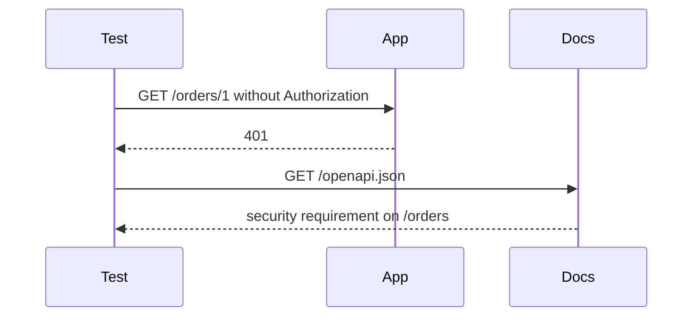

# OpenAPI Security, Auth Tests, and Failure Handling

## 1. Metadata and prerequisites

- Topic IDs: D20-T18, D20-T19, D20-T20
- Domain: 20, Authentication and Authorization in FastAPI
- Difficulty: Advanced
- Prerequisites: D20-T01, D20-T11, D11-T01, D11-T12
- Learning objectives:
  - Declare security schemes so `/openapi.json` matches runtime behavior.
  - Test both authentication and authorization failures.
  - Return a stable error body without leaking token details.
- Related topic IDs: D19-T08, D26-T07, D11-T02
- Estimated complexity: medium
- Completion status: TECHNICALLY_REVIEWED
- Verification: OpenAPI security-scheme shape checked against the OpenAPI 3.1 idea of `securitySchemes` on 2026-10-13. Examples were not executed.

## 2. Introduction and fundamentals

### D20-T18 Security scheme declarations in OpenAPI

FastAPI adds security schemes when a route depends on `OAuth2PasswordBearer`, `HTTPBearer`, `HTTPBasic`, `APIKeyHeader`, or `Security`. The generated document lists them under `components.securitySchemes` and references them on operations. Swagger UI then shows an Authorize button.

The scheme in the document must be the scheme you actually enforce. A route that "forgets" the dependency looks public in `/docs` and is public at runtime. A route that checks a header manually and does not use a security class looks public in the docs even if it is protected. Use the security dependency so the contract and the code stay tied together.

`OAuth2PasswordBearer` documents a bearer scheme and a token URL. It does not implement the authorization server behind that URL.

### D20-T19 Authentication testing

Mint tokens with the test secret, or override `current_user`. Cover:

- no header → `401`
- malformed token → `401`
- expired token → `401`
- valid token → not `401`
- valid token, other user's object → `404` or `403`
- valid token, missing role → `403`

Override the user dependency when the test is about business rules and the identity is not the subject. Use a real token when the test is about parsing and expiry. Do not mix production secrets into the test process.

### D20-T20 Authorization failure handling

Return the same error schema you use elsewhere (RFC 9457 or your problem document). `401` includes `WWW-Authenticate` when you use a standard scheme. The body says "invalid token" or "not allowed." It does not say "signature mismatch on kid abc" or echo the token. Log the reason server-side with the request id.

Do not convert every failure into `401`. A logged-in shopper who calls an admin route is `403`. A missing token is `401`. Clients branch on that difference.

If you hide missing objects with `404`, do it for both "no row" and "row owned by someone else" so timing and status do not diverge more than you can help.

## 3. Internal workings



A contract test can assert that every path under `/orders` has a security requirement. Public paths are an allow-list in that test.

## 4. Architecture diagrams

Swagger UI is a client. It stores the token in the browser session for the docs page. That is convenient and it is also a reason not to expose docs on an untrusted shared machine without protection. Production often disables or authenticates `/docs`.

## 5. Code and implementation

Unverified test sketch.

```python
def test_orders_require_a_token(client):
    response = client.get("/orders/1")
    assert response.status_code == 401

def test_docs_mark_orders_secured(client):
    schema = client.get("/openapi.json").json()
    operation = schema["paths"]["/orders/{order_id}"]["get"]
    assert operation.get("security"), operation
```

Failure body sketch:

```json
{"type":"about:blank","title":"Unauthorized","status":401}
```

## 6. API contracts

Document `401`, `403`, and `404` on protected routes. Document which routes are public. The OpenAPI `security` array is empty only on those public routes.

## 7. Production considerations

Mandatory: tests for `401` and for cross-user access, problem responses without token echoes, scheme names that match the header you read.

Optional: a CI check that fails if a new path has no security and is not on the public allow-list. Rate-limit failures so token guessing is slow.

## 8. Comparison and tradeoffs

| Approach | Advantage | Disadvantage |
| --- | --- | --- |
| Real JWT in the test | Covers parsing and expiry | More setup |
| `dependency_overrides` | Fast business-rule tests | Skips the parser |
| Hand-written header check | Flexible | Docs drift from runtime |
| Security dependency | Docs and runtime match | You must use it on every protected route |

## 9. Debugging and troubleshooting

**Symptom:** Swagger Authorize does nothing useful and the route still returns 200 without a token.  
**Cause:** the route never depended on a security class.  
**Fix:** add the dependency. Re-read `/openapi.json`.  
**Prevent:** the contract test above.

**Symptom:** tests pass with overrides and production rejects every token.  
**Cause:** the test never used the real decoder, and the secret or algorithm differs.  
**Fix:** one test that mints a token the way login does and calls the route without an override.

## 10. Interview preparation

**Beginner.** What does `OAuth2PasswordBearer` add to OpenAPI?  
**Model answer.** A security scheme and a requirement on routes that depend on it. It does not issue tokens.  
**Incorrect answer.** "It turns FastAPI into an OAuth server."

**Intermediate.** Which status do you test for a valid user calling an admin route?  
**Model answer.** `403`, if they are authenticated. `401` would tell the client to log in again, which is the wrong instruction.  
**Follow-up.** What must the `401` body not contain? The raw token, the signing key, or a stack trace.

**Design.** How do you keep a new route from shipping as accidentally public?  
**Model answer.** A test walks `openapi.json` and fails when a path is missing `security` and is not allow-listed.

## 11. Exercises and mastery assessment

1. Name two tests that overrides cannot replace.
2. Why is an empty `security` array meaningful?
3. What header accompanies `401` for a bearer scheme?
4. Write the assertion that a foreign object is not returned.

**Solutions.**

1. Expired token and malformed token. Overrides skip the decoder.
2. It marks the operation as public. A missing requirement on a sensitive path is a bug.
3. `WWW-Authenticate: Bearer`.
4. Create two users, take user A's object id, call as user B, assert `404` or `403` and that A's secret field is absent.

**Mastery checklist.**

- Tie security dependencies to the OpenAPI document.
- Test `401`, `403`, and object access separately.
- Keep failure bodies free of secrets.

**Revision summary.** The docs scheme, the dependency, and the tests are one control. A route that only looks protected in a diagram is public.

## Flashcards

- Q: What does a security requirement in OpenAPI mean? | A: Callers must satisfy that scheme for this operation.
- Q: Why test with two users? | A: To prove object authorization, not only that a token parses.
