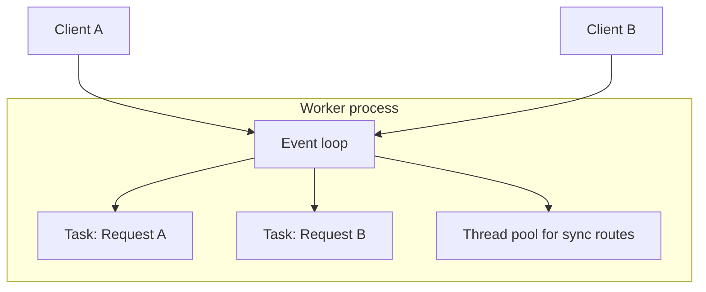

# Endpoints, the Event Loop, and Awaitables

## 1. Metadata and prerequisites

- Topic IDs: D21-T01, D21-T02, D21-T03, D21-T04, D21-T05
- Domain: 21, Async Programming and Concurrency
- Difficulty: Intermediate
- Prerequisites: D12-T03 (ASGI), D16-T01 (Depends), D17-T01 (ASGI lifecycle)
- Learning objectives:
  - Choose `async def` versus `def` endpoints based on I/O and blocking behavior.
  - Explain how the event loop schedules coroutines without creating one thread per request.
  - Distinguish coroutines, tasks, and generic awaitables in application code.
- Related topic IDs: D21-T06, D16-T17, D28-T03, D25-T12
- Estimated complexity: medium
- Completion status: DRAFT
- Verification: prose aligned with asyncio and FastAPI docs as of 2026-10-13. Code examples are UNVERIFIED in this workspace.

## 2. Introduction and fundamentals

### D21-T01 async def versus def endpoints

**Formal definition.** In FastAPI, route handlers may be declared with `async def` or `def`. ASGI runs `async def` handlers on the event loop as coroutines. `def` handlers are executed in a thread pool so synchronous code does not block the loop directly.

**Problem solved.** Lets one process serve many concurrent connections when work is mostly awaiting I/O instead of holding a thread per request.

**Mechanism.** Starlette detects the callable type. Async callables are awaited; sync callables are wrapped with `run_in_threadpool`.

**Misconception.** "Always use `async def` for performance." Blocking calls inside `async def` still stall the event loop because they run on the loop thread.

**Production rule.** Use `async def` only when the handler and its dependencies await non-blocking I/O. Use `def` for purely synchronous stacks, or offload blocking work explicitly (D21-T12).

### D21-T02 asyncio fundamentals

**Formal definition.** `asyncio` is Python's library for cooperative concurrency: coroutines yield control at `await`, and a single-threaded event loop resumes ready work.

**Problem solved.** Multiplexes thousands of idle-waiting operations (network, disk with async drivers) without thousands of OS threads.

**Mechanism.** The loop maintains a queue of ready callbacks; I/O readiness (via the OS) wakes waiting coroutines.

**Misconception.** asyncio parallelizes CPU work on one core. CPU-bound code needs processes or explicit pools.

**Production rule.** Treat asyncio as an I/O concurrency tool; profile CPU separately.

### D21-T03 Event loop

**Formal definition.** The event loop is the scheduler that runs coroutines, executes callbacks, and integrates with async I/O primitives.

**Problem solved.** Provides one coordination point for timers, sockets, and task completion.

**Mechanism.** Under Uvicorn, each worker process typically owns one loop running ASGI apps. Request handlers are scheduled as tasks on that loop.

**Misconception.** "Each request gets its own loop." One worker process shares one loop across requests.

**Production rule.** Never call `asyncio.run()` inside a running FastAPI worker; use the existing loop and `await`.

### D21-T04 Coroutines and tasks

**Formal definition.** A coroutine is the object returned by calling an `async def` function. A `Task` is a coroutine scheduled on the loop via `asyncio.create_task`.

**Problem solved.** Tasks let you run concurrent work within one request (e.g., fan-out HTTP calls) while the parent awaits completion.

**Mechanism.** `create_task` registers the coroutine; `await task` or `asyncio.gather` collects results. Un-awaited fire-and-forget tasks can be garbage-collected mid-flight.

**Misconception.** Creating a task is the same as parallelism across cores. Tasks are concurrent on one thread unless offloaded.

**Production rule.** Always retain a reference and await or cancel tasks started in a request; log exceptions with `task.add_done_callback`.

### D21-T05 Awaitables

**Formal definition.** An awaitable is any object that can follow `await`, including coroutines, Tasks, and objects implementing `__await__`.

**Problem solved.** Uniform syntax for suspending until an operation completes.

**Mechanism.** `await` suspends the current coroutine until the awaitable completes, registering a callback with the loop.

**Misconception.** Anything can be awaited if it returns a Future from a library. Only true awaitables are valid; mixing blocking returns causes bugs.

**Production rule.** Type async dependencies to return awaitables; in tests, override with async fakes that `await asyncio.sleep(0)`.

## 3. Internal workings

When a client opens an HTTP connection to Uvicorn:

1. ASGI receives `http.request` events on the connection.
2. Starlette routing resolves the path and builds the endpoint callable.
3. If the endpoint is `async def`, the coroutine is awaited on the loop thread.
4. If the endpoint is `def`, Starlette submits it to a thread pool and awaits a Future bridging back to the loop.
5. Dependencies run in the same mode as their definitions (`async def` dependencies are awaited).
6. When the handler returns, the response is serialized and sent; the connection may stay open for keep-alive.

Blocking the loop at step 3 delays every other coroutine in that worker, including health checks and in-flight requests.

## 4. Architecture diagrams



The diagram shows one loop multiplexing multiple request tasks. Sync `def` routes run on the thread pool branch but still tie up pool threads; they do not free the loop if you mistakenly block inside `async def`.

## 5. Code and implementation

**UNVERIFIED** example: async versus sync endpoints.

```python
from fastapi import FastAPI
import httpx

app = FastAPI()

@app.get("/sync-ok")
def read_sync():
    return {"mode": "threadpool"}

@app.get("/async-ok")
async def read_async():
    async with httpx.AsyncClient() as client:
        r = await client.get("https://httpbin.org/get", timeout=5.0)
    return {"status": r.status_code}
```

Expected behavior: `/sync-ok` runs in a worker thread; `/async-ok` suspends at `await` without blocking other async routes in the same worker.

**UNVERIFIED** task fan-out inside a request:

```python
import asyncio

async def fetch_one(client: httpx.AsyncClient, url: str):
    r = await client.get(url, timeout=5.0)
    return r.status_code

async def fetch_many(urls: list[str]):
    async with httpx.AsyncClient() as client:
        tasks = [asyncio.create_task(fetch_one(client, u)) for u in urls]
        return await asyncio.gather(*tasks)
```

## 6. API contracts

This chapter is runtime-focused. Contract implications:

| Concern | Rule |
| --- | --- |
| Latency under load | Async handlers improve tail latency only when work is awaitable I/O. |
| Timeouts | Apply client-side and server-side timeouts; hung coroutines still occupy memory. |
| Idempotency | Concurrency does not change HTTP semantics (RFC 9110). |

No dedicated REST resource; observability endpoints should remain cheap async handlers.

## 7. Production considerations

Mandatory:

- Ban blocking calls (`time.sleep`, sync DB drivers, heavy CPU) inside `async def` without offload.
- Size Uvicorn workers knowing each async worker is single-threaded for coroutines.
- Document which routes are sync versus async for onboarding.

Optional:

- `anyio` or `asyncio` debug mode in staging to log slow callbacks.
- Structured logs including `async` versus `sync` route in templates (custom middleware).

## 8. Comparison and tradeoffs

| Choice | When it wins | When it loses |
| --- | --- | --- |
| `async def` + async I/O | Many parallel upstream calls, websockets, SSE | Team unfamiliar with async pitfalls |
| `def` + sync stack | Simple SQLAlchemy sync session, legacy libs | High concurrent blocking I/O on thread pool |
| More workers | CPU-bound sync routes | Memory per worker; workers do not share in-memory state |

## 9. Debugging and troubleshooting

**Symptom:** p99 latency spikes under moderate load with low CPU.  
**Cause:** Event-loop blocking in `async def` (sync ORM, `requests.get`, tight loops).  
**Reproduce:** Load test while watching one worker; all routes slow together.  
**Diagnose:** Enable asyncio slow callback logging; trace one stalled request.  
**Fix:** Move blocking code to thread/process pool or switch to async drivers.  
**Prevention:** Lint rules and code review checklist for imports like `requests` in async modules.

## 10. Interview preparation

**Intermediate.** When should a FastAPI route be `def` instead of `async def`?  
**Model answer.** When the call stack is intentionally synchronous and uses blocking APIs end-to-end, letting Starlette run it in a thread pool. If you use `async def`, every blocking call must be offloaded.  
**Incorrect answer.** "`def` is always slower." It can be correct for blocking stacks.

**Advanced.** What happens if you call `time.sleep(5)` inside `async def`?  
**Model answer.** The event loop thread sleeps; no other coroutines in that worker run for five seconds.  
**Follow-up.** How would you fix it? `await asyncio.to_thread(time.sleep, 5)` for blocking sleep, or `await asyncio.sleep(5)` for non-blocking delay.

**Scenario.** Two requests hit one worker; one awaits a slow external API. Does the second progress?  
**Model answer.** Yes, while the first is awaiting I/O, the loop runs the second. If the first blocks the thread, the second does not.

## 11. Exercises and mastery assessment

1. **Conceptual.** List three operations that are safe in `async def` and three that are not without offload.
2. **Coding.** Write an `async def` endpoint that fetches two URLs concurrently and returns both status codes. (UNVERIFIED solution below.)
3. **Debugging.** All endpoints freeze when one endpoint calls a sync PostgreSQL driver. Explain why.
4. **Design.** A team has only sync SQLAlchemy. Recommend `async def` or `def` for CRUD routes and why.

**Solutions.**

1. Safe: `await httpx...`, `await asyncio.sleep`, `await asyncpg fetch`. Unsafe: `requests.get`, `session.query().all()` sync, CPU-heavy JSON parsing on huge payloads without offload.
2. ```python
   @app.get("/two")
   async def two():
       async with httpx.AsyncClient() as c:
           a, b = await asyncio.gather(c.get("https://example.com"), c.get("https://example.org"))
       return {"a": a.status_code, "b": b.status_code}
   ```
3. Sync driver blocks the loop thread inside `async def`.
4. Prefer `def` routes with sync session dependency, or migrate to async SQLAlchemy; do not keep sync DB in `async def`.

**Mastery checklist.**

- Explain loop versus thread pool paths in Starlette.
- Define coroutine versus Task.
- State the production rule for blocking in async routes.

**Revision summary.** FastAPI async routes run on the event loop; sync routes use a thread pool. Awaitables enable I/O concurrency; blocking inside `async def` harms every client on that worker.
