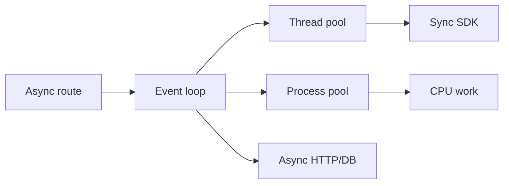

# Blocking I/O, Clients, Pools, and CPU Work

## 1. Metadata and prerequisites

- Topic IDs: D21-T06, D21-T07, D21-T08, D21-T09, D21-T10, D21-T11, D21-T12
- Domain: 21, Async Programming and Concurrency
- Difficulty: Advanced
- Prerequisites: D21-T01–T05, D22-T04, D28-T01
- Learning objectives:
  - Classify workloads as I/O-bound or CPU-bound and pick async clients or pools accordingly.
  - Use thread and process pools without exhausting shared limits.
- Related topic IDs: D28-T04, D22-T07, D09-T11
- Estimated complexity: high
- Completion status: DRAFT
- Verification: 2026-10-13. All code UNVERIFIED.

## 2. Introduction and fundamentals

### D21-T06 Blocking versus non-blocking I/O

**Definition.** Blocking I/O holds the calling thread until the kernel completes the operation. Non-blocking I/O returns immediately and signals completion via the event loop.

**Problem solved.** Lets the loop serve other coroutines while one waits on the network.

**Mechanism.** Async sockets register read/write readiness; `await` resumes the coroutine when data is available.

**Misconception.** Threads and async are interchangeable. Threads block OS threads; async avoids blocking the loop thread only when APIs are truly async.

**Production rule.** Audit third-party SDKs: many are sync-only and belong in a thread pool or a worker process.

### D21-T07 Async HTTP clients

**Definition.** Clients such as `httpx.AsyncClient` or `aiohttp` perform DNS, connect, and read/write using awaitable methods.

**Problem solved.** Outbound fan-out from one API request without blocking the loop.

**Mechanism.** Connection pools inside the client reuse TCP connections; limits cap concurrent sockets.

**Misconception.** One global client per process is always fine without closing. You must lifecycle-manage clients (lifespan or dependency) and respect pool limits.

**Production rule.** Set timeouts on every request; share one `AsyncClient` per worker via lifespan, not per request construction without need.

### D21-T08 Async database drivers

**Definition.** Drivers like `asyncpg` and SQLAlchemy `AsyncSession` issue queries that await network I/O to PostgreSQL.

**Problem solved.** Keeps database I/O off the loop thread when using `async def` routes.

**Mechanism.** Queries return awaitables; the session must be used in async context with proper commit/close (see D22).

**Misconception.** `create_async_engine` makes sync ORM calls async. Calling sync session methods inside async routes still blocks.

**Production rule.** Match session type to route style; PostgreSQL is the production default.

### D21-T09 Concurrency versus parallelism

**Definition.** Concurrency is overlapping progress; parallelism is simultaneous execution on multiple CPU cores.

**Problem solved.** Clarifies why asyncio helps I/O but not heavy CPU on one worker.

**Mechanism.** One event-loop thread interleaves coroutines; `ProcessPoolExecutor` spreads CPU across cores.

**Misconception.** `asyncio.gather` uses all CPU cores. It does not unless work is offloaded to processes.

**Production rule.** Scale CPU with multiple Uvicorn workers or process pools; scale I/O with async and connection pools.

### D21-T10 Thread pools

**Definition.** A bounded set of OS threads executes submitted callables, used by Starlette for sync routes and `asyncio.to_thread`.

**Problem solved.** Runs blocking libraries without blocking the event loop.

**Mechanism.** Work queue + fixed worker threads; saturation causes queueing and latency growth.

**Misconception.** Thread pools are unlimited. Default pool sizes are small; overload stalls sync endpoints.

**Production rule.** Monitor thread-pool queue depth indirectly via latency; cap concurrent blocking work with semaphores.

### D21-T11 CPU-bound versus I/O-bound workloads

**Definition.** CPU-bound work spends time in the interpreter or extensions computing; I/O-bound work waits on network or disk.

**Problem solved.** Drives architecture: async for I/O, processes for CPU.

**Mechanism.** GIL limits CPU parallelism in threads for pure Python; C extensions may release GIL.

**Misconception.** Run image resizing in `asyncio.to_thread` at huge concurrency. Threads still contend for CPU and GIL; use a process pool with a job queue.

**Production rule.** Queue long CPU jobs to workers; keep API workers for short offload only.

### D21-T12 Thread and process offloading

**Definition.** `asyncio.to_thread` (or `run_in_executor`) runs sync callables on threads; `ProcessPoolExecutor` runs in child processes.

**Problem solved.** Bridges legacy sync code with async handlers safely.

**Mechanism.** Awaitable wrapper completes when the pool finishes; exceptions propagate to the awaiter.

**Misconception.** Process pools are free. Serialization cost and pool size limits apply; workers do not share memory.

**Production rule.** Prefer process pools for CPU-heavy tasks; set explicit `max_workers` and timeouts.

## 3. Internal workings

An `async def` handler calling a sync HTTP library blocks at the C extension or socket read on the loop thread. Replacing with `httpx` moves waits to async I/O. Calling `pandas` compute on large frames may need `await asyncio.to_thread(func, df)` or an external job.

Starlette's thread pool for `def` routes is separate from `to_thread` but competes for the same machine resources.

## 4. Architecture diagrams



## 5. Code and implementation

**UNVERIFIED:**

```python
import asyncio
from concurrent.futures import ProcessPoolExecutor
from functools import partial

process_pool = ProcessPoolExecutor(max_workers=2)

def heavy_compute(n: int) -> int:
    return sum(i * i for i in range(n))

@app.on_event("shutdown")  # prefer lifespan in new apps
async def shutdown():
    process_pool.shutdown(wait=False)

@app.get("/hash")
async def hash_endpoint():
    loop = asyncio.get_running_loop()
    result = await loop.run_in_executor(process_pool, partial(heavy_compute, 10_000))
    return {"result": result}
```

## 6. API contracts

Outbound dependency calls should document timeout and retry policy. Internal APIs are unaffected, but SLA depends on pool saturation—return `503` with `Retry-After` when admission control rejects work (D08).

## 7. Production considerations

Mandatory: timeouts on async clients; bounded pools; no unbounded `gather` on user-controlled list lengths.

Optional: circuit breakers on outbound HTTP; separate microservice for CPU pipelines.

## 8. Comparison and tradeoffs

| Tool | Good for | Risk |
| --- | --- | --- |
| Async client | Many parallel I/O calls | Pool exhaustion |
| Thread pool | Short blocking I/O | GIL + thread count |
| Process pool | CPU-heavy pure Python | IPC overhead, memory |

## 9. Debugging and troubleshooting

**Symptom:** Thread count climbs; memory grows. **Cause:** Per-request thread spawn or unclosed clients. **Fix:** Lifespan-managed pools; close clients.

## 10. Interview preparation

**Q:** Why not run all endpoints as sync in thread pool?  
**Model:** Thread pools have limited threads; massive concurrent I/O wastes RAM and context switches. Async scales I/O better when APIs are async.  
**Wrong:** "Async is always faster."

**Q:** Where does CPU-bound work go?  
**Model:** Process pool or external worker queue; not the event loop thread.

## 11. Exercises and mastery assessment

1. Replace sync `requests` with `httpx` in an async route (sketch).  
2. Explain why 10_000 concurrent `to_thread` calls is dangerous.  
3. Design: PDF generation takes 30s CPU—where should it run?

**Solutions:** 1) `AsyncClient` + await. 2) Pool and machine saturation. 3) Durable job queue (D24), not API worker.

**Mastery checklist:** Classify I/O vs CPU; name offload primitives; state pool limits.

**Revision summary:** Async clients and DB drivers keep the loop responsive; threads and processes have finite capacity and do not share memory across workers.
