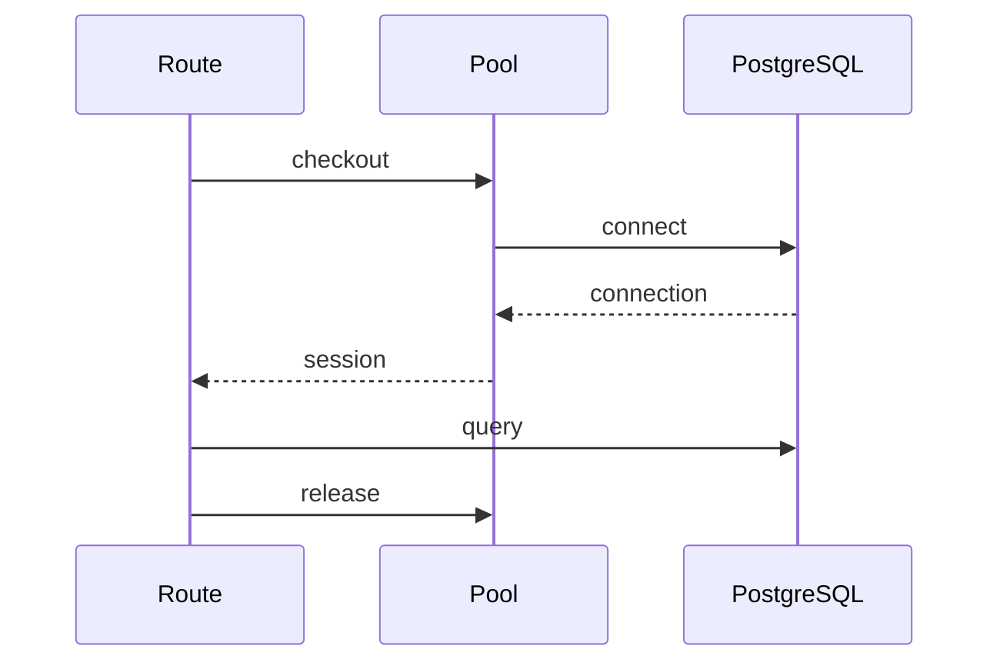

# Cancellation, Locks, Pools, and Context Managers

## 1. Metadata and prerequisites

- Topic IDs: D21-T13, D21-T14, D21-T15, D21-T16
- Domain: 21, Async Programming and Concurrency
- Difficulty: Advanced
- Prerequisites: D21-T01–T12, D08-T19
- Learning objectives: Apply timeouts and cancellation; bound concurrency with semaphores; manage async resources with context managers.
- Related topic IDs: D22-T07, D31-T10
- Estimated complexity: high
- Completion status: DRAFT
- Verification: 2026-10-13. Code UNVERIFIED.

## 2. Introduction and fundamentals

### D21-T13 Cancellation and timeouts

**Definition.** `asyncio.wait_for` and `asyncio.timeout` (3.11+) bound wait time; cancellation injects `CancelledError` into a task.

**Problem solved.** Prevents hung upstream calls from holding connections forever.

**Mechanism.** Client disconnect may cancel ASGI tasks; you should catch cancellation and abort outbound I/O.

**Misconception.** Cancellation instantly stops remote servers. It only stops local awaiting; upstream may still run.

**Production rule.** Use timeouts on every external call; on cancel, close httpx streams and DB transactions.

### D21-T14 Async locks and semaphores

**Definition.** `asyncio.Lock` and `Semaphore` coordinate coroutines without blocking threads.

**Problem solved.** Protects in-memory structures in one worker; limits concurrent access to scarce resources.

**Mechanism.** `async with lock` suspends until acquired.

**Misconception.** An asyncio Lock protects across Uvicorn workers. Workers do not share memory; use Redis or DB for distributed locks.

**Production rule.** Use semaphores to cap parallel outbound calls per worker; use distributed stores for cross-process limits.

### D21-T15 Connection pool limits

**Definition.** HTTP and DB pools maintain max open connections; excess waiters queue.

**Problem solved.** Prevents exhausting PostgreSQL `max_connections` or file descriptors.

**Mechanism.** Pool checkout blocks (async) until a connection returns or timeout fires.

**Misconception.** Bigger pool is always better. Too many connections hurt DB performance.

**Production rule.** Size pool ≤ DB budget per replica; align with worker count × expected concurrent queries.

### D21-T16 Async context managers

**Definition.** Objects implementing `async with` (`__aenter__`/`__aexit__`) acquire and release async resources.

**Problem solved.** Guarantees release on success, exception, or cancel when used correctly.

**Mechanism.** FastAPI `yield` dependencies are context managers for sessions and clients.

**Misconception.** `finally` in sync code is enough in async generators. Use `try/finally` in yield dependencies for rollback/close.

**Production rule.** One session per request via yield dependency; always close in `finally`.

## 3. Internal workings

On client disconnect, Starlette may cancel the request task. Your `await provider.chat()` should run under `asyncio.timeout`; on timeout, cancel the httpx request and return `504` or partial SSE close frame.

## 4. Architecture diagrams



## 5. Code and implementation

**UNVERIFIED:**

```python
from contextlib import asynccontextmanager
from asyncio import Semaphore

outbound_sem = Semaphore(20)

@asynccontextmanager
async def limited_upstream():
    async with outbound_sem:
        yield

@app.get("/data")
async def data():
    async with asyncio.timeout(3.0):
        async with limited_upstream():
            ...
```

## 6. API contracts

Document server timeouts in OpenAPI description. Long operations should return `202` + job id (D24).

## 7. Production considerations

Mandatory: pool limits, request timeouts, cancel-safe cleanup.

Optional: adaptive concurrency based on error rate.

## 8. Comparison and tradeoffs

| Primitive | Scope | Use |
| --- | --- | --- |
| Semaphore | One worker | Cap parallel I/O |
| Redis lock | Cluster | Cron singleton |
| Pool limit | DB-wide | Protect PostgreSQL |

## 9. Debugging and troubleshooting

**Symptom:** `QueuePool timeout`. **Cause:** Leaked sessions or too-small pool. **Fix:** Ensure dependency `finally` closes; increase pool or reduce workers.

## 10. Interview preparation

**Q:** Client closed tab—what should happen to DB transaction?  
**Model:** Cancellation should trigger dependency cleanup: rollback uncommitted work and close session.  
**Wrong:** "Commit anyway."

## 11. Exercises and mastery assessment

1. Wrap an httpx call with 2s timeout.  
2. Why semaphore(1000) per worker can still break PostgreSQL?  
3. Write yield dependency pseudocode with rollback.

**Solutions:** `async with asyncio.timeout(2): await client.get(...)`. Workers × sem × pool > DB max. `try: yield session; commit except: rollback finally: close`.

**Mastery checklist:** Timeout, cancel, pool math, async context managers.

### Worked example: request cancel during outbound call

When a mobile client aborts a download, the ASGI server may cancel the handler task. If your code is inside `await client.post(...)`, cancellation raises `CancelledError` unless suppressed. Allow cancellation to propagate after closing the httpx request context and rolling back any open database transaction. Swallowing `CancelledError` without cleanup leaks pool connections—the same failure mode as forgetting `session.close()`.

### Pool sizing checklist

1. Count API replicas and Uvicorn workers per replica.  
2. Multiply by expected concurrent DB operations per request.  
3. Add worker processes for external job runners—they need separate pools.  
4. Compare the sum to PostgreSQL `max_connections` minus admin overhead.  
5. If the math does not fit, lower pool size, add PgBouncer, or scale read replicas.

**Revision summary:** Bound time and concurrency; pools are shared budgets; async `with` and yield dependencies release resources on all exit paths.
