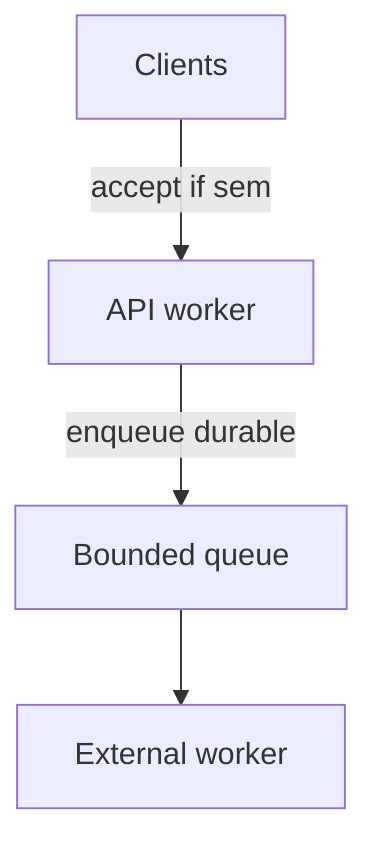

# Background Work, Races, Backpressure, and Cleanup

## 1. Metadata and prerequisites

- Topic IDs: D21-T17, D21-T18, D21-T19, D21-T20, D21-T21
- Domain: 21, Async Programming and Concurrency
- Difficulty: Advanced
- Prerequisites: D21-T01–T16, D24-T01
- Learning objectives: Recognize race and deadlock patterns; apply backpressure; avoid loop-blocking mistakes in background work.
- Related topic IDs: D24-T02, D19-T14
- Estimated complexity: high
- Completion status: DRAFT
- Verification: 2026-10-13. Code UNVERIFIED.

## 2. Introduction and fundamentals

### D21-T17 Background task execution

**Definition.** Work scheduled after sending the response (`BackgroundTasks`) or via `create_task` during a request.

**Problem solved.** Quick post-response chores (email hook) without blocking the response bytes.

**Mechanism.** Starlette runs background tasks on the same event loop after response start.

**Misconception.** BackgroundTasks survive process restart. They are in-process and not durable (D24).

**Production rule.** Use queues + DB rows for durable work; BackgroundTasks only for best-effort, short tasks.

### D21-T18 Deadlocks and race conditions

**Definition.** Deadlock: coroutines wait on each other circularly. Race: outcome depends on interleaving without synchronization.

**Problem solved.** Awareness prevents subtle data corruption in shared caches or lazy singletons.

**Mechanism.** Awaiting lock A then B while another task holds B then A deadlocks. Mutating a module-level dict from concurrent tasks races.

**Misconception.** asyncio eliminates races. It only helps when you use locks or immutable patterns.

**Production rule.** No mutable shared state across requests without locks; prefer stateless handlers and external stores.

### D21-T19 Backpressure

**Definition.** Signaling producers to slow when consumers cannot keep up.

**Problem solved.** Prevents memory blow-up from unbounded queues of tasks or buffered SSE chunks.

**Mechanism.** Semaphores, bounded `asyncio.Queue`, HTTP `429`, or rejecting connections at the proxy.

**Misconception.** "Just add more async tasks." Unbounded task creation OOMs the worker.

**Production rule.** Bound in-flight work per endpoint; stream consumers should pause when buffers fill.

### D21-T20 Async resource cleanup

**Definition.** Closing clients, rolling back transactions, and deleting temp files on success, error, or cancellation.

**Problem solved.** Leaks connections and disk under failure paths.

**Mechanism.** `try/finally`, `async with`, and yield dependencies with `finally: await session.close()`.

**Misconception.** GC closes HTTP connections promptly. Always explicit close.

**Production rule.** Pair every acquire with release in `finally`; test cancel paths.

### D21-T21 Common event-loop blocking mistakes

**Definition.** Sync DB, `time.sleep`, CPU loops, or `open().read()` large files inside `async def`.

**Problem solved.** Checklist for code review.

**Mechanism.** Each blocks the single loop thread.

**Misconception.** Small sleep is fine. At scale, small blocks accumulate.

**Production rule.** Static analysis + runtime slow-callback logging in staging.

## 3. Internal workings

`BackgroundTasks.add_task(send_webhook)` runs after response; if `send_webhook` uses blocking `requests`, it blocks subsequent background tasks and delays new requests on that worker.

## 4. Architecture diagrams



Backpressure at API: reject or 429 when sem full; durable path for heavy work.

## 5. Code and implementation

**UNVERIFIED anti-pattern versus fix:**

```python
# BAD in async def
def bad():
    time.sleep(1)

# GOOD
async def good():
    await asyncio.to_thread(time.sleep, 1)
```

## 6. API contracts

For streaming, close SSE on client disconnect. Document that fire-and-forget endpoints are not guaranteed processed.

## 7. Production considerations

Mandatory: durable jobs for important side effects; bounds on background fan-out.

Optional: dead-letter queues for failed webhooks.

## 8. Comparison and tradeoffs

| Pattern | Durability | Complexity |
| --- | --- | --- |
| BackgroundTasks | None | Low |
| Queue + DB row | High | Medium |

## 9. Debugging and troubleshooting

**Symptom:** Random 502 under load. **Cause:** Loop blocked by background task. **Fix:** Offload or externalize.

## 10. Interview preparation

**Q:** Difference between BackgroundTasks and Celery?  
**Model:** BackgroundTasks runs in API process after response, not durable; Celery uses broker + workers with persisted jobs.  
**Wrong:** "Same thing."

## 11. Exercises and mastery assessment

1. List three blocking mistakes in async routes.  
2. Design backpressure for upload storm.  
3. Trace cleanup on cancelled request with yield session.

**Mastery checklist:** Durable vs in-process; backpressure tools; cleanup on cancel.

### Duplicate delivery and idempotency at the API edge

Clients retry POST on timeouts. Combine idempotency keys with a unique database constraint on `(tenant_id, idempotency_key)` so a duplicate returns the original `201` payload instead of creating two rows. Retries may arrive while the first request still awaits upstream I/O.

### Review checklist for async modules

- No `time.sleep`, sync large file reads, or sync ORM in `async def`.  
- Outbound HTTP uses an async client with timeouts.  
- No unguarded mutable module globals across requests.  
- Long work is enqueued; return `202 Accepted` when work continues offline (RFC 9110).

**Revision summary:** Protect the loop, bound concurrency, durable work belongs in queues; workers never share in-memory state.
