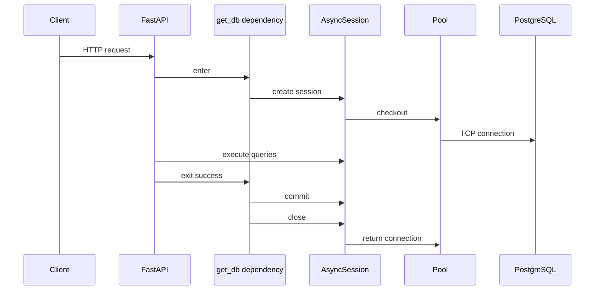

# SQLAlchemy, Sessions, and PostgreSQL

## 1. Metadata and prerequisites

- Topic IDs: D22-T01, D22-T02, D22-T03, D22-T04, D22-T05, D22-T06, D22-T07
- Domain: 22, Database Integration
- Difficulty: Intermediate
- Prerequisites: D16-T07, D21-T08, D14-T01
- Learning objectives: Configure SQLAlchemy 2.0 with PostgreSQL; manage sync and async sessions; avoid connection leaks.
- Related topic IDs: D22-T08–T23, D27-T20
- Estimated complexity: medium
- Completion status: DRAFT
- Verification: 2026-10-13. Code UNVERIFIED.

## 2. Introduction and fundamentals

### D22-T01 SQLAlchemy ORM

**Definition.** The ORM maps Python classes to relational tables and provides unit-of-work session semantics.

**Problem solved.** Expresses domain logic in objects while persisting to PostgreSQL.

**Mechanism.** `Mapped` columns, `relationship()`, `select()` API in 2.0 style.

**Misconception.** ORM removes need to know SQL. Performance tuning still requires SQL and indexes.

**Production rule.** Use 2.0 `select()` patterns; avoid legacy `Query` API in new code.

### D22-T02 SQLAlchemy Core

**Definition.** Core is SQL expression language and connection layer beneath ORM.

**Problem solved.** Bulk operations, reporting queries, and precise SQL control.

**Mechanism.** `text()`, `insert()`, executed on `Connection` or via `session.execute`.

**Misconception.** Core is always faster. ORM overhead is often negligible versus network round trips.

**Production rule.** Reach for Core for bulk ETL inside transactions with explicit statements.

### D22-T03 Synchronous database sessions

**Definition.** `Session` bound to sync engine; blocking I/O on pool connections.

**Problem solved.** Integrates with sync route handlers (`def`) and mature tooling.

**Mechanism.** `sessionmaker`; one session per request via dependency.

**Misconception.** Share one global Session across requests. Sessions are not thread-safe for concurrent requests.

**Production rule.** Request-scoped session; close in `finally`.

### D22-T04 Asynchronous database sessions

**Definition.** `AsyncSession` with `create_async_engine` and asyncpg driver.

**Problem solved.** Fits `async def` routes without blocking the loop.

**Mechanism.** `await session.execute(select(...))`; `await session.commit()`.

**Misconception.** Mix sync session in async route without thread offload.

**Production rule.** Match async engine URL (`postgresql+asyncpg://`) and async dependencies end-to-end.

### D22-T05 PostgreSQL integration

**Definition.** Production RDBMS with JSONB, constraints, and strong transactional guarantees.

**Problem solved.** Durable multi-tenant data with rich indexing.

**Mechanism.** Connection string via settings; migrations via Alembic (D22-T17).

**Misconception.** SQLite in dev proves production behavior. Test against PostgreSQL in CI.

**Production rule.** Primary store is PostgreSQL; use least-privilege DB role per service.

### D22-T06 SQLite for lightweight examples

**Definition.** File-backed engine for local demos and fast unit tests.

**Problem solved.** Zero external dependency for learning.

**Mechanism.** `sqlite+aiosqlite://` for async samples.

**Misconception.** Deploy SQLite for multi-worker API. File locking and concurrency differ from PostgreSQL.

**Production rule.** Examples only; do not ship SQLite as shared production DB behind multiple workers.

### D22-T07 Connection pooling

**Definition.** Pool reuses TCP connections to PostgreSQL.

**Problem solved.** Amortizes connection setup cost.

**Mechanism.** `pool_size`, `max_overflow`, checkout on query, return on session close.

**Misconception.** `pool_size=100` per pod with 20 pods is safe. Multiply by replica count against `max_connections`.

**Production rule.** Calculate pool budget with DBAs; enable pool pre-ping or health checks.

## 3. Internal workings

FastAPI resolves `get_db` dependency before the route. Yield provides session; route runs; dependency resumes to commit or rollback and always closes, returning connection to pool.

## 4. Architecture diagrams



## 5. Code and implementation

**UNVERIFIED** SQLAlchemy 2.0 async session dependency:

```python
from collections.abc import AsyncGenerator
from sqlalchemy.ext.asyncio import AsyncSession, async_sessionmaker, create_async_engine

engine = create_async_engine(settings.database_url, pool_pre_ping=True)
SessionLocal = async_sessionmaker(engine, expire_on_commit=False)

async def get_db() -> AsyncGenerator[AsyncSession, None]:
    async with SessionLocal() as session:
        try:
            yield session
            await session.commit()
        except Exception:
            await session.rollback()
            raise
```

Sync variant uses `with SessionLocal() as session` and `session.commit()` in the same pattern.

## 6. API contracts

Database errors map to `503` or `409` via exception handlers (D19). Do not leak SQL text to clients.

## 7. Production considerations

Mandatory: one session per request; commit/rollback/close; PostgreSQL in prod; pool limits.

Optional: read replicas with separate engines for read-only dependencies.

## 8. Comparison and tradeoffs

| Stack | Pros | Cons |
| --- | --- | --- |
| Async + asyncpg | Fits async API | Ecosystem gaps |
| Sync + psycopg in `def` routes | Simple mental model | Thread pool for routes |

## 9. Debugging and troubleshooting

**Symptom:** `Too many connections`. **Cause:** Sessions not closed or pool oversized. **Fix:** Audit yield `finally`; lower `pool_size`.

## 10. Interview preparation

**Q:** How do you scope a SQLAlchemy session in FastAPI?  
**Model:** `Depends` with `yield`: create session, yield to route, commit on success, rollback on exception, always close.  
**Wrong:** "Singleton session for speed."

## 11. Exercises and mastery assessment

1. Write sync `get_db` with rollback on error.  
2. Compute max connections: 4 workers × pool_size 5 × 3 pods.  
3. Why `expire_on_commit=False` for read-after-commit in same request?

**Solutions:** Standard yield pattern. 60 connections—compare to PG limit. Avoid lazy reload after commit in same handler.

**Mastery checklist:** ORM vs Core; async URL; pool math; request-scoped session.

**Revision summary:** PostgreSQL + SQLAlchemy 2.0; one session per request via yield; pools are a shared fleet budget.
