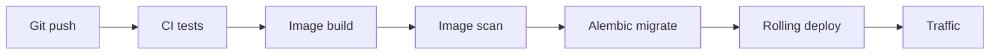

# Nginx, TLS, Uvicorn, and Migration Timing

## 1. Metadata and prerequisites

- Topic IDs: D30-T08, D30-T09, D30-T10, D30-T11, D30-T12
- Domain: 30, Deployment and Production Operations
- Difficulty: Advanced
- Prerequisites: D16-T07, D21-T01
- Learning objectives: Master topics D30-T08, D30-T09, D30-T10, D30-T11, D30-T12 for production FastAPI systems on PostgreSQL.
- Related topic IDs: see COVERAGE_MATRIX.md
- Estimated complexity: high
- Completion status: DRAFT
- Verification: prose reviewed 2026-10-13. Code UNVERIFIED. No invented pytest or benchmark output.

## 2. Introduction and fundamentals

### D30-T08 Reverse proxy with Nginx

**Definition.** Reverse proxy with Nginx in production FastAPI services refers to the practice of reverse proxy with nginx with PostgreSQL, async-aware handlers, and clear operational boundaries.

**Problem solved.** Teams avoid ad hoc implementations that leak connections, skip authorization, or break under duplicate delivery and multi-worker deploys.

**Mechanism.** Apply reverse proxy with nginx in the FastAPI request path with explicit error handling and observability hooks.

**Misconception.** One shortcut configuration works for dev and prod without pool sizing, timeouts, or tenant isolation.

**Production rule.** Document the behavior in runbooks; enforce with code review, dependency injection, and automated checks in CI—not only comments.

### D30-T09 TLS termination

**Definition.** TLS termination in production FastAPI services refers to the practice of tls termination with PostgreSQL, async-aware handlers, and clear operational boundaries.

**Problem solved.** Teams avoid ad hoc implementations that leak connections, skip authorization, or break under duplicate delivery and multi-worker deploys.

**Mechanism.** Apply tls termination in the FastAPI request path with explicit error handling and observability hooks.

**Misconception.** One shortcut configuration works for dev and prod without pool sizing, timeouts, or tenant isolation.

**Production rule.** Document the behavior in runbooks; enforce with code review, dependency injection, and automated checks in CI—not only comments.

### D30-T10 Production ASGI server configuration

**Definition.** Production ASGI server configuration in production FastAPI services refers to the practice of production asgi server configuration with PostgreSQL, async-aware handlers, and clear operational boundaries.

**Problem solved.** Teams avoid ad hoc implementations that leak connections, skip authorization, or break under duplicate delivery and multi-worker deploys.

**Mechanism.** Apply production asgi server configuration in the FastAPI request path with explicit error handling and observability hooks.

**Misconception.** One shortcut configuration works for dev and prod without pool sizing, timeouts, or tenant isolation.

**Production rule.** Document the behavior in runbooks; enforce with code review, dependency injection, and automated checks in CI—not only comments.

### D30-T11 Worker processes and concurrency

**Definition.** Worker processes and concurrency in production FastAPI services refers to the practice of worker processes and concurrency with PostgreSQL, async-aware handlers, and clear operational boundaries.

**Problem solved.** Teams avoid ad hoc implementations that leak connections, skip authorization, or break under duplicate delivery and multi-worker deploys.

**Mechanism.** Apply worker processes and concurrency in the FastAPI request path with explicit error handling and observability hooks.

**Misconception.** One shortcut configuration works for dev and prod without pool sizing, timeouts, or tenant isolation.

**Production rule.** Document the behavior in runbooks; enforce with code review, dependency injection, and automated checks in CI—not only comments.

### D30-T12 Database migrations during deployment

**Definition.** Database migrations during deployment in production FastAPI services refers to the practice of database migrations during deployment with PostgreSQL, async-aware handlers, and clear operational boundaries.

**Problem solved.** Teams avoid ad hoc implementations that leak connections, skip authorization, or break under duplicate delivery and multi-worker deploys.

**Mechanism.** Apply database migrations during deployment in the FastAPI request path with explicit error handling and observability hooks.

**Misconception.** One shortcut configuration works for dev and prod without pool sizing, timeouts, or tenant isolation.

**Production rule.** Document the behavior in runbooks; enforce with code review, dependency injection, and automated checks in CI—not only comments.


## 3. Internal workings

Requests enter ASGI middleware, resolve dependencies, execute the route, serialize the response, and run yield dependency teardown. Failures before commit should rollback database work. Worker processes do not share in-memory caches, counters, or BackgroundTasks state.

## 4. Architecture diagrams



The diagram anchors discussion for this chapter; combine it with logs and traces to find which hop failed.

## 5. Code and implementation

All examples below are **UNVERIFIED** in this workspace (date context: 2026-10-13).

```dockerfile
FROM python:3.12-slim AS builder
WORKDIR /app
COPY requirements.txt .
RUN pip install --no-cache-dir -r requirements.txt
FROM python:3.12-slim
RUN useradd -m appuser
USER appuser
COPY --from=builder /usr/local/lib/python3.12 /usr/local/lib/python3.12
HEALTHCHECK CMD curl -f http://localhost:8000/health/live || exit 1
```

## 6. API contracts

Where endpoints are illustrated, use Problem Details (RFC 9457) for errors, explicit auth on mutating routes, and idempotency keys for retry-safe creates (RFC 9110 semantics).

## 7. Production considerations

**Mandatory:** input validation (Pydantic v2), authentication separate from authorization, timeouts on outbound calls, least-privilege credentials, structured logs with request IDs.

**Optional:** feature flags, canary deploys, redaction filters, cost dashboards for AI paths.

## 8. Comparison and tradeoffs

| Approach | Benefit | Cost |
| --- | --- | --- |
| In-process shortcut | Fast to ship | Not durable across restarts; poor for long work |
| Queue + database row | Durable, observable | Operational complexity |
| Sync stack in `def` routes | Simple libraries | Thread pool limits under load |

## 9. Debugging and troubleshooting

**Symptom:** elevated 5xx or stalled requests. **Cause:** pool exhaustion, blocking in `async def`, or missing rollback. **Reproduce:** single-request trace plus pool metrics. **Fix:** close sessions, offload blocking work, right-size pools. **Prevention:** integration tests and load tests in CI.

## 10. Interview preparation

**Intermediate.** How does FastAPI clean up a database session?  
**Model answer.** A `yield` dependency commits on success, rolls back on exceptions, and closes the session in `finally`, returning the connection to the pool.  
**Incorrect answer.** "Garbage collection closes connections."

**Advanced.** Why must job consumers be idempotent?  
**Model answer.** Brokers may deliver duplicates; retries replay work. Idempotency keys and unique constraints prevent double side effects.  
**Follow-up.** Where do you store idempotency state? Prefer the primary database or a dedicated store with TTL, not worker RAM.

## 11. Exercises and mastery assessment

1. **Conceptual.** Name three components that must not rely on in-memory state shared across Uvicorn workers.  
2. **Coding.** Sketch a dependency that yields an `AsyncSession` with rollback on error (UNVERIFIED).  
3. **Debugging.** `QueuePool timeout` during traffic spike—list two causes and two fixes.  
4. **Design.** Choose BackgroundTasks versus a queue for a 30-second PDF job.

**Solutions.** 1) Rate-limit counters, dedupe caches, BackgroundTasks completion flags. 2) `try: yield session; await commit except: rollback finally: close`. 3) Leaked sessions; pool too small—increase pool budget carefully or fix leaks. 4) Queue with DB row; not BackgroundTasks.

**Mastery checklist.**

- Explain request-scoped session lifecycle.
- State when async versus sync routes are appropriate.
- Describe durable job state versus in-process tasks.

**Revision summary.** Nginx, TLS, Uvicorn, and Migration Timing ties handbook topics to production-safe FastAPI patterns: validate early, bound resources, persist important state in PostgreSQL, and assume duplicate delivery for async work.

