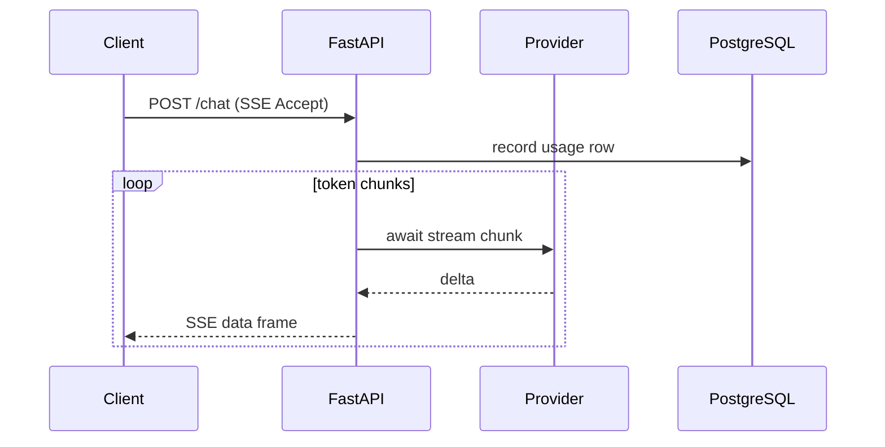

# LLM Endpoints, Providers, Schemas, and Streaming

## 1. Metadata and prerequisites

- Topic IDs: D31-T01, D31-T02, D31-T03, D31-T04, D31-T05, D31-T06
- Domain: 31, FastAPI for AI Engineering
- Difficulty: Advanced
- Prerequisites: D16-T07, D21-T01
- Learning objectives: Master topics D31-T01, D31-T02, D31-T03, D31-T04, D31-T05, D31-T06 for production FastAPI systems on PostgreSQL.
- Related topic IDs: see COVERAGE_MATRIX.md
- Estimated complexity: high
- Completion status: DRAFT
- Verification: prose reviewed 2026-10-13. Code UNVERIFIED. No invented pytest or benchmark output.

## 2. Introduction and fundamentals

### D31-T01 Building LLM APIs with FastAPI

**Definition.** An LLM API exposes chat, completion, or embedding operations over HTTP with explicit schemas, auth, and observability—typically `async def` routes backed by provider clients and PostgreSQL for usage records.

**Problem solved.** Centralizes model access so clients never hold provider API keys and you can enforce quotas, logging, and guardrails in one place.

**Mechanism.** Router modules accept Pydantic v2 bodies, resolve a `Provider` dependency, call `await provider.complete(...)`, map errors to RFC 9457 problem responses.

**Misconception.** The API can be a thin proxy with no server-side policy. You still own authentication, authorization, timeouts, and cost accounting.

**Production rule.** Separate authentication (who) from tool permissions (what actions the server will execute on behalf of the user).

### D31-T02 Integrating hosted LLM providers

**Definition.** Hosted providers (OpenAI-compatible HTTP APIs, Anthropic, etc.) are called with async HTTP clients and API keys loaded from secrets management—not from images or git.

**Problem solved.** Offloads model weights while keeping your FastAPI layer as the control plane.

**Mechanism.** Inject a provider interface; production uses real HTTP; tests override with a **mock provider** that returns deterministic tokens without network I/O.

**Misconception.** Provider SDK sync calls inside `async def` are fine. They block the event loop unless you use async clients or `asyncio.to_thread` with limits.

**Production rule.** Use dependency overrides in tests to register a mock provider; never commit real API keys.

### D31-T03 Local model inference endpoints

**Definition.** Endpoints that call an on-prem or sidecar inference server (vLLM, TGI, Ollama HTTP) for lower latency or data residency.

**Problem solved.** Keeps sensitive prompts off third-party networks when policy requires it.

**Mechanism.** Same provider abstraction as hosted APIs; base URL points to internal load balancer; timeouts align with GPU batching latency.

**Misconception.** Local inference removes capacity planning. GPUs saturate; queue long runs (D31-T19).

**Production rule.** Treat local servers as untrusted for availability—apply retries, circuit breaking, and queue overflow to `202` job pattern.

### D31-T04 Pydantic schemas for AI requests and responses

**Definition.** Strict request models (`model`, `messages`, `temperature`, `max_tokens`) and response models that exclude raw provider payloads when they leak internal fields.

**Problem solved.** Prevents unbounded prompts, schema drift, and accidental exposure of provider metadata.

**Mechanism.** `field_validator` caps string lengths; `response_model` filters output; use `model_dump` for persistence.

**Misconception.** Accept `dict` bodies for flexibility. You lose validation and OpenAPI contract tests.

**Production rule.** Version schemas (`ChatCompletionRequestV1`) when adding tools or multimodal fields.

### D31-T05 Streaming LLM responses with SSE

**Definition.** Server-Sent Events (`text/event-stream`) stream partial tokens to the client using `StreamingResponse` or an async generator.

**Problem solved.** Improves perceived latency for long answers without holding the full completion in memory.

**Mechanism.** Async iterate provider chunks; format `data: {...}\n\n`; flush on disconnect by cancelling the upstream stream.

**Misconception.** SSE is WebSockets. SSE is one-way HTTP streaming; proxies must not buffer indefinitely.

**Production rule.** Set proxy buffering off for stream routes; enforce max duration and token limits server-side.

### D31-T06 Async model API calls

**Definition.** Provider I/O is awaited so other requests progress on the same worker while waiting on network I/O to the model host.

**Problem solved.** Preserves API throughput under concurrent chat sessions.

**Mechanism.** `async with httpx.AsyncClient()` or native async SDK methods wrapped in `asyncio.timeout`.

**Misconception.** Unlimited concurrent model calls per worker. Provider rate limits and connection pools require semaphores.

**Production rule.** Cap concurrent model calls per tenant; queue excess work (D31-T19).


## 3. Internal workings

Requests enter ASGI middleware, resolve dependencies, execute the route, serialize the response, and run yield dependency teardown. Failures before commit should rollback database work. Worker processes do not share in-memory caches, counters, or BackgroundTasks state.

## 4. Architecture diagrams



The diagram anchors discussion for this chapter; combine it with logs and traces to find which hop failed.

## 5. Code and implementation

All examples below are **UNVERIFIED** in this workspace (date context: 2026-10-13).

```python
async def event_stream():
    async for chunk in provider.stream():
        yield f"data: {chunk}\n\n"
```

## 6. API contracts

Where endpoints are illustrated, use Problem Details (RFC 9457) for errors, explicit auth on mutating routes, and idempotency keys for retry-safe creates (RFC 9110 semantics).

## 7. Production considerations

**Mandatory:** input validation (Pydantic v2), authentication separate from authorization, timeouts on outbound calls, least-privilege credentials, structured logs with request IDs.

**Optional:** feature flags, canary deploys, redaction filters, cost dashboards for AI paths.

## 8. Comparison and tradeoffs

| Approach | Benefit | Cost |
| --- | --- | --- |
| In-process shortcut | Fast to ship | Not durable across restarts; poor for long work |
| Queue + database row | Durable, observable | Operational complexity |
| Sync stack in `def` routes | Simple libraries | Thread pool limits under load |

## 9. Debugging and troubleshooting

**Symptom:** elevated 5xx or stalled requests. **Cause:** pool exhaustion, blocking in `async def`, or missing rollback. **Reproduce:** single-request trace plus pool metrics. **Fix:** close sessions, offload blocking work, right-size pools. **Prevention:** integration tests and load tests in CI.

## 10. Interview preparation

**Intermediate.** How does FastAPI clean up a database session?  
**Model answer.** A `yield` dependency commits on success, rolls back on exceptions, and closes the session in `finally`, returning the connection to the pool.  
**Incorrect answer.** "Garbage collection closes connections."

**Advanced.** Why must job consumers be idempotent?  
**Model answer.** Brokers may deliver duplicates; retries replay work. Idempotency keys and unique constraints prevent double side effects.  
**Follow-up.** Where do you store idempotency state? Prefer the primary database or a dedicated store with TTL, not worker RAM.

## 11. Exercises and mastery assessment

1. **Conceptual.** Name three components that must not rely on in-memory state shared across Uvicorn workers.  
2. **Coding.** Sketch a dependency that yields an `AsyncSession` with rollback on error (UNVERIFIED).  
3. **Debugging.** `QueuePool timeout` during traffic spike—list two causes and two fixes.  
4. **Design.** Choose BackgroundTasks versus a queue for a 30-second PDF job.

**Solutions.** 1) Rate-limit counters, dedupe caches, BackgroundTasks completion flags. 2) `try: yield session; await commit except: rollback finally: close`. 3) Leaked sessions; pool too small—increase pool budget carefully or fix leaks. 4) Queue with DB row; not BackgroundTasks.

**Mastery checklist.**

- Explain request-scoped session lifecycle.
- State when async versus sync routes are appropriate.
- Describe durable job state versus in-process tasks.

**Revision summary.** LLM Endpoints, Providers, Schemas, and Streaming ties handbook topics to production-safe FastAPI patterns: validate early, bound resources, persist important state in PostgreSQL, and assume duplicate delivery for async work.

