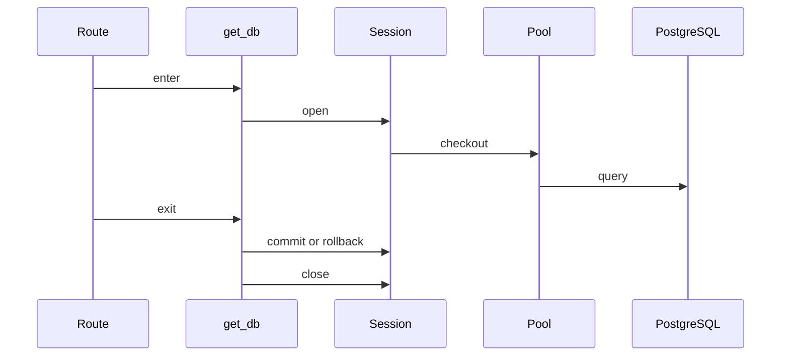

# Timeouts, Retries, Quotas, Tokens, and Cancellation

## 1. Metadata and prerequisites

- Topic IDs: D31-T07, D31-T08, D31-T09, D31-T10
- Domain: 31, FastAPI for AI Engineering
- Difficulty: Advanced
- Prerequisites: D16-T07, D21-T01
- Learning objectives: Master topics D31-T07, D31-T08, D31-T09, D31-T10 for production FastAPI systems on PostgreSQL.
- Related topic IDs: see COVERAGE_MATRIX.md
- Estimated complexity: high
- Completion status: DRAFT
- Verification: prose reviewed 2026-10-13. Code UNVERIFIED. No invented pytest or benchmark output.

## 2. Introduction and fundamentals

### D31-T07 Timeouts and retries for model providers

**Definition.** Timeouts and retries for model providers in production FastAPI services refers to the practice of timeouts and retries for model providers with PostgreSQL, async-aware handlers, and clear operational boundaries.

**Problem solved.** Teams avoid ad hoc implementations that leak connections, skip authorization, or break under duplicate delivery and multi-worker deploys.

**Mechanism.** Apply timeouts and retries for model providers in the FastAPI request path with explicit error handling and observability hooks.

**Misconception.** One shortcut configuration works for dev and prod without pool sizing, timeouts, or tenant isolation.

**Production rule.** Document the behavior in runbooks; enforce with code review, dependency injection, and automated checks in CI—not only comments.

### D31-T08 Provider rate limits

**Definition.** Provider rate limits in production FastAPI services refers to the practice of provider rate limits with PostgreSQL, async-aware handlers, and clear operational boundaries.

**Problem solved.** Teams avoid ad hoc implementations that leak connections, skip authorization, or break under duplicate delivery and multi-worker deploys.

**Mechanism.** Apply provider rate limits in the FastAPI request path with explicit error handling and observability hooks.

**Misconception.** One shortcut configuration works for dev and prod without pool sizing, timeouts, or tenant isolation.

**Production rule.** Document the behavior in runbooks; enforce with code review, dependency injection, and automated checks in CI—not only comments.

### D31-T09 Token usage and cost tracking

**Definition.** Token usage and cost tracking in production FastAPI services refers to the practice of token usage and cost tracking with PostgreSQL, async-aware handlers, and clear operational boundaries.

**Problem solved.** Teams avoid ad hoc implementations that leak connections, skip authorization, or break under duplicate delivery and multi-worker deploys.

**Mechanism.** Apply token usage and cost tracking in the FastAPI request path with explicit error handling and observability hooks.

**Misconception.** One shortcut configuration works for dev and prod without pool sizing, timeouts, or tenant isolation.

**Production rule.** Document the behavior in runbooks; enforce with code review, dependency injection, and automated checks in CI—not only comments.

### D31-T10 Request cancellation

**Definition.** Request cancellation in production FastAPI services refers to the practice of request cancellation with PostgreSQL, async-aware handlers, and clear operational boundaries.

**Problem solved.** Teams avoid ad hoc implementations that leak connections, skip authorization, or break under duplicate delivery and multi-worker deploys.

**Mechanism.** Apply request cancellation in the FastAPI request path with explicit error handling and observability hooks.

**Misconception.** One shortcut configuration works for dev and prod without pool sizing, timeouts, or tenant isolation.

**Production rule.** Document the behavior in runbooks; enforce with code review, dependency injection, and automated checks in CI—not only comments.


## 3. Internal workings

Requests enter ASGI middleware, resolve dependencies, execute the route, serialize the response, and run yield dependency teardown. Failures before commit should rollback database work. Worker processes do not share in-memory caches, counters, or BackgroundTasks state.

## 4. Architecture diagrams



The diagram anchors discussion for this chapter; combine it with logs and traces to find which hop failed.

## 5. Code and implementation

All examples below are **UNVERIFIED** in this workspace (date context: 2026-10-13).

```python
async def get_db() -> AsyncGenerator[AsyncSession, None]:
    async with SessionLocal() as session:
        try:
            yield session
            await session.commit()
        except Exception:
            await session.rollback()
            raise
```

## 6. API contracts

Where endpoints are illustrated, use Problem Details (RFC 9457) for errors, explicit auth on mutating routes, and idempotency keys for retry-safe creates (RFC 9110 semantics).

## 7. Production considerations

**Mandatory:** input validation (Pydantic v2), authentication separate from authorization, timeouts on outbound calls, least-privilege credentials, structured logs with request IDs.

**Optional:** feature flags, canary deploys, redaction filters, cost dashboards for AI paths.

## 8. Comparison and tradeoffs

| Approach | Benefit | Cost |
| --- | --- | --- |
| In-process shortcut | Fast to ship | Not durable across restarts; poor for long work |
| Queue + database row | Durable, observable | Operational complexity |
| Sync stack in `def` routes | Simple libraries | Thread pool limits under load |

## 9. Debugging and troubleshooting

**Symptom:** elevated 5xx or stalled requests. **Cause:** pool exhaustion, blocking in `async def`, or missing rollback. **Reproduce:** single-request trace plus pool metrics. **Fix:** close sessions, offload blocking work, right-size pools. **Prevention:** integration tests and load tests in CI.

## 10. Interview preparation

**Intermediate.** How does FastAPI clean up a database session?  
**Model answer.** A `yield` dependency commits on success, rolls back on exceptions, and closes the session in `finally`, returning the connection to the pool.  
**Incorrect answer.** "Garbage collection closes connections."

**Advanced.** Why must job consumers be idempotent?  
**Model answer.** Brokers may deliver duplicates; retries replay work. Idempotency keys and unique constraints prevent double side effects.  
**Follow-up.** Where do you store idempotency state? Prefer the primary database or a dedicated store with TTL, not worker RAM.

## 11. Exercises and mastery assessment

1. **Conceptual.** Name three components that must not rely on in-memory state shared across Uvicorn workers.  
2. **Coding.** Sketch a dependency that yields an `AsyncSession` with rollback on error (UNVERIFIED).  
3. **Debugging.** `QueuePool timeout` during traffic spike—list two causes and two fixes.  
4. **Design.** Choose BackgroundTasks versus a queue for a 30-second PDF job.

**Solutions.** 1) Rate-limit counters, dedupe caches, BackgroundTasks completion flags. 2) `try: yield session; await commit except: rollback finally: close`. 3) Leaked sessions; pool too small—increase pool budget carefully or fix leaks. 4) Queue with DB row; not BackgroundTasks.

**Mastery checklist.**

- Explain request-scoped session lifecycle.
- State when async versus sync routes are appropriate.
- Describe durable job state versus in-process tasks.

**Revision summary.** Timeouts, Retries, Quotas, Tokens, and Cancellation ties handbook topics to production-safe FastAPI patterns: validate early, bound resources, persist important state in PostgreSQL, and assume duplicate delivery for async work.

