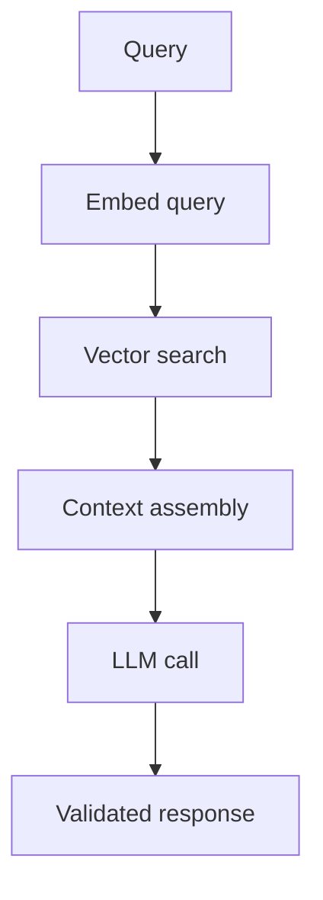

# RAG, Ingestion, Background Processing, and Vectors

## 1. Metadata and prerequisites

- Topic IDs: D31-T11, D31-T12, D31-T13, D31-T14
- Domain: 31, FastAPI for AI Engineering
- Difficulty: Advanced
- Prerequisites: D16-T07, D21-T01
- Learning objectives: Master topics D31-T11, D31-T12, D31-T13, D31-T14 for production FastAPI systems on PostgreSQL.
- Related topic IDs: see COVERAGE_MATRIX.md
- Estimated complexity: high
- Completion status: DRAFT
- Verification: prose reviewed 2026-10-13. Code UNVERIFIED. No invented pytest or benchmark output.

## 2. Introduction and fundamentals

### D31-T11 RAG query endpoints

**Definition.** HTTP routes that embed the user question, retrieve similar document chunks, assemble a prompt, and call the LLM.

**Problem solved.** Grounds answers in private corpora without fine-tuning on every document change.

**Mechanism.** Embed query → vector search (tenant-scoped) → rank chunks → inject into system prompt with citations.

**Misconception.** Retrieved text is safe to trust. It is **untrusted retrieval**—treat as attacker-controlled prompt injection surface.

**Production rule.** Sanitize and bound chunk size; log retrieval IDs; enforce tenant filters on every search.

### D31-T12 Document ingestion APIs

**Definition.** Upload or register documents (`POST /documents`) storing metadata in PostgreSQL and blobs in object storage.

**Problem solved.** Separates fast API acknowledgment from slow parsing and embedding.

**Mechanism.** Validate size and MIME; store object key; insert row `status=pending`; enqueue durable job.

**Misconception.** Parse PDF synchronously in the request thread. Use `202 Accepted` + job id for large files.

**Production rule.** Same upload security as D23: limits, content checks, no path traversal.

### D31-T13 Background document processing

**Definition.** Workers chunk text, compute embeddings, and upsert vectors—outside the API process.

**Problem solved.** Ingestion survives API restarts and scales independently.

**Mechanism.** Job row transitions SUBMITTED→QUEUED→RUNNING→SUCCEEDED/FAILED; idempotent consumers handle duplicate delivery.

**Misconception.** FastAPI `BackgroundTasks` is enough. It is in-process and not durable.

**Production rule.** Workers do not share memory; store progress only in DB/queue.

### D31-T14 Vector database integration

**Definition.** Storage and query engine for embeddings (pgvector in PostgreSQL, or dedicated vector DB) with metadata filters.

**Problem solved.** Fast similarity search at scale with ACL metadata.

**Mechanism.** Store `(tenant_id, document_id, chunk_id, embedding)`; queries always filter `tenant_id`.

**Misconception.** One global index without tenant predicate. Leads to cross-tenant retrieval bugs.

**Production rule.** Integration tests assert tenant A cannot retrieve tenant B vectors.


## 3. Internal workings

Requests enter ASGI middleware, resolve dependencies, execute the route, serialize the response, and run yield dependency teardown. Failures before commit should rollback database work. Worker processes do not share in-memory caches, counters, or BackgroundTasks state.

## 4. Architecture diagrams



The diagram anchors discussion for this chapter; combine it with logs and traces to find which hop failed.

## 5. Code and implementation

All examples below are **UNVERIFIED** in this workspace (date context: 2026-10-13).

```python
async def get_db() -> AsyncGenerator[AsyncSession, None]:
    async with SessionLocal() as session:
        try:
            yield session
            await session.commit()
        except Exception:
            await session.rollback()
            raise
```

## 6. API contracts

Where endpoints are illustrated, use Problem Details (RFC 9457) for errors, explicit auth on mutating routes, and idempotency keys for retry-safe creates (RFC 9110 semantics).

## 7. Production considerations

**Mandatory:** input validation (Pydantic v2), authentication separate from authorization, timeouts on outbound calls, least-privilege credentials, structured logs with request IDs.

**Optional:** feature flags, canary deploys, redaction filters, cost dashboards for AI paths.

## 8. Comparison and tradeoffs

| Approach | Benefit | Cost |
| --- | --- | --- |
| In-process shortcut | Fast to ship | Not durable across restarts; poor for long work |
| Queue + database row | Durable, observable | Operational complexity |
| Sync stack in `def` routes | Simple libraries | Thread pool limits under load |

## 9. Debugging and troubleshooting

**Symptom:** elevated 5xx or stalled requests. **Cause:** pool exhaustion, blocking in `async def`, or missing rollback. **Reproduce:** single-request trace plus pool metrics. **Fix:** close sessions, offload blocking work, right-size pools. **Prevention:** integration tests and load tests in CI.

## 10. Interview preparation

**Intermediate.** How does FastAPI clean up a database session?  
**Model answer.** A `yield` dependency commits on success, rolls back on exceptions, and closes the session in `finally`, returning the connection to the pool.  
**Incorrect answer.** "Garbage collection closes connections."

**Advanced.** Why must job consumers be idempotent?  
**Model answer.** Brokers may deliver duplicates; retries replay work. Idempotency keys and unique constraints prevent double side effects.  
**Follow-up.** Where do you store idempotency state? Prefer the primary database or a dedicated store with TTL, not worker RAM.

## 11. Exercises and mastery assessment

1. **Conceptual.** Name three components that must not rely on in-memory state shared across Uvicorn workers.  
2. **Coding.** Sketch a dependency that yields an `AsyncSession` with rollback on error (UNVERIFIED).  
3. **Debugging.** `QueuePool timeout` during traffic spike—list two causes and two fixes.  
4. **Design.** Choose BackgroundTasks versus a queue for a 30-second PDF job.

**Solutions.** 1) Rate-limit counters, dedupe caches, BackgroundTasks completion flags. 2) `try: yield session; await commit except: rollback finally: close`. 3) Leaked sessions; pool too small—increase pool budget carefully or fix leaks. 4) Queue with DB row; not BackgroundTasks.

**Mastery checklist.**

- Explain request-scoped session lifecycle.
- State when async versus sync routes are appropriate.
- Describe durable job state versus in-process tasks.

**Revision summary.** RAG, Ingestion, Background Processing, and Vectors ties handbook topics to production-safe FastAPI patterns: validate early, bound resources, persist important state in PostgreSQL, and assume duplicate delivery for async work.

