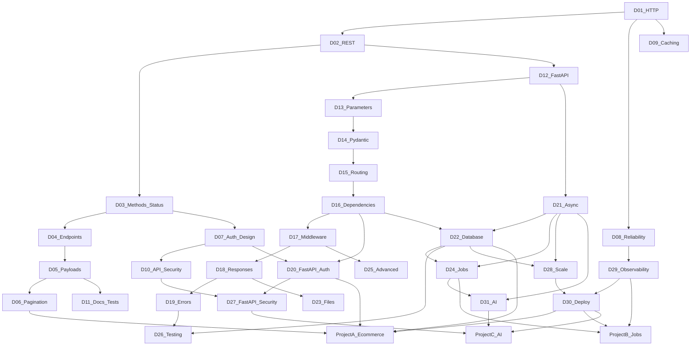

# Dependency Graph

Recommended study order follows the domain numbers. Edges below are prerequisites, not the only useful reading order.

## Prerequisite rules

- Domains 1–3 before endpoint and payload design.
- Domains 4–6 before pagination-heavy project work.
- Domain 7 before FastAPI authentication in Domain 20.
- Domains 12–19 before database, jobs, and testing chapters that assume those mechanics.
- Domain 21 before async SQLAlchemy, streaming, and model-provider calls.
- Domains 22 and 24 before Projects A and B.
- Domains 27–30 before treating a project as production-ready.
- Domain 31 before Project C.

## Cross-links that must stay distinct

- Domain 1 explains protocol mechanics. Domain 3 explains which method and status an API should choose.
- Domain 7 explains authentication and authorization design. Domain 20 shows FastAPI security utilities. Domain 27 applies those controls in a production configuration.
- Domain 9 explains caching and performance concepts. Domain 28 explains process model, saturation, and scaling.
- Domain 11 explains the test taxonomy. Domain 26 shows FastAPI and pytest mechanics.
