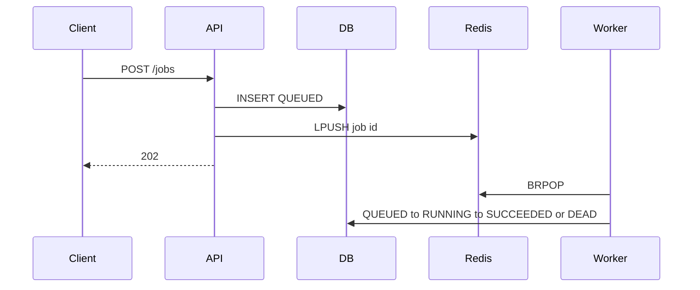

# Project B: Asynchronous Job Processing API

## PRD

Clients submit work and receive `202` plus a job id. A separate worker performs the work. The API process can restart without losing the job record.

## Requirements

- `POST /jobs` stores a row and wakes a worker.
- `GET /jobs/{id}` returns status and result.
- Status flow: `QUEUED` → `RUNNING` → `SUCCEEDED`, or `FAILED` is not used as a terminal retry state. Exhausted retries become `DEAD`. Cancellation of a queued job becomes `CANCELLED`.
- Redis is the wake-up list. PostgreSQL is the source of truth.
- Duplicate `idempotency_key` returns the original job.
- Worker checks `cancel_requested` before publishing a success.

`SUBMITTED` in the curriculum maps to the moment the row is inserted. This API commits the row already in `QUEUED` because the enqueue happens before the response. If Redis is down, the handler returns `503` and the transaction rolls back, so there is no accepted job without a wake-up. A production extension is to commit `QUEUED` and have a sweeper re-push ids that never got a Redis message.

## Design



## Run

```bash
docker compose up --build
```

API: `http://localhost:8001`.

Tests do not need a live Redis process. They replace the client with a fake. They do need PostgreSQL:

```bash
docker compose run --rm api pytest
```

Cleanup: `docker compose down -v`.

## Security and reliability

- Task names are a short allow-list pattern, not arbitrary code.
- Results and errors are stored as text. Do not put secrets in `value`.
- Attempts are counted in the database. The worker re-queues only when status returns to `QUEUED`.
- `GET /health/worker` reports the queued count. It does not prove the worker process is alive. Pair it with the worker container health in a real deploy.
- In-process `BackgroundTasks` are not used.

## Interview prompts

1. Why not store the queue only in Redis?
2. What happens if the worker dies after setting `RUNNING`?
3. Why is `202` the submit status?

Answers: (1) Redis can lose the list; the row still supports a sweeper. This milestone still depends on the LPUSH succeeding before commit acknowledgement... the code pushes after flush and before the dependency commits. If the process dies after commit and before LPUSH, the row is `QUEUED` with no wake-up. That is a known gap; fix it with an outbox sweeper. (2) The row stays `RUNNING`. A sweeper should requeue stale `RUNNING` rows. Not implemented in this milestone. (3) The work is accepted, not finished.
