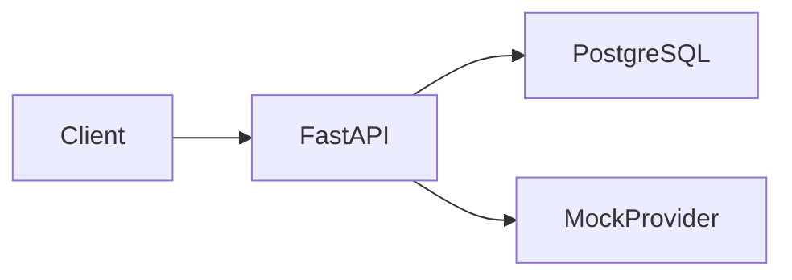

# Project C: Production AI API

## PRD

A tenant-scoped API answers questions from ingested text, streams a mock model, and runs an allow-listed tool. No paid model key is required.

## Requirements

- Mock provider only in this build (`MODEL_PROVIDER=mock`).
- Bearer token carries `tenant`.
- Document ingest splits paragraphs into chunks.
- Query retrieves only that tenant's chunks and labels them untrusted in the prompt.
- SSE chat at `/v1/chat/stream`.
- `/mcp/tools/call` and `/v1/agent` refuse tools that are not on the server allow-list.
- Token usage is counted per tenant and returns `429` over `QUOTA_LIMIT`.
- Output lines that start with `tool:` are stripped. The model cannot grant itself a tool.

## What is synchronous

Mock completion and retrieval run in the request because they are bounded and in-process. A real hosted model call should use a timeout. A multi-minute agent belongs in Project B's job table, not in this request.

## Design



The MCP route is an HTTP stand-in for a tool boundary. It is not the official MCP SDK and it does not open network connections from model text.

## Run

```bash
docker compose up --build
```

API: `http://localhost:8002`.

```bash
docker compose run --rm api pytest
docker compose down -v
```

## Security

- Demo password is a shared environment value. Replace this endpoint with a real identity provider before any shared deployment.
- Retrieval never crosses tenants.
- Tool names are allow-listed. URL arguments are rejected.
- Guardrail is a filter, not a proof. Keep tools behind the allow-list anyway.

## Interview prompts

1. Why is retrieved text untrusted?
2. Why does the agent endpoint not parse a tool name out of model output and call it?
3. Which calls should move to a durable queue?

Answers: (1) the document can contain instructions aimed at the model. (2) the model must not be the authorization source. (3) anything that outlives the request or calls a slow provider with retries that must survive a restart.
